<!-- _class: lead -->

# The Postgres Mistakes<br>We All Still Make

Scott Mead
Senior Staff Engineer · Lakebase · Databricks

NYC Postgres Meetup · November 18, 2026

---

<!-- _class: center -->

# The Premise

- Postgres is thirty years old.

- I've been working on it for 22.

- We're all doing the same [bad] things over and over.

</br>

- Every mistake here "works on my laptop"
- Every one shows up in metrics 
- They all seem innocent at first

---

# Mistake #0: it's always connections

Postgres runs a process per connection.

</br>

- **connect** is `fork()`, memory, authentication, a cold catalog cache, before any row is touched
- **a 5 ms query** connect:~2ms  run: 5 ms 
  - Without a pool, every request is a connect / disconnect
- **rate** is the issue. A number of connections is one problem, a high rate of connections grinds the system

<small>A pool connects once and reuses the backend</small>

---

# Where the rate comes from

```python
def handle(request):
    conn = psycopg2.connect(DSN)        # a new connection per request, no pool
    try:
        with conn.cursor() as cur:
            cur.execute("SELECT ... WHERE id = %s", (request.user_id,))
            return cur.fetchone()
    finally:
        conn.close()                    # torn down again. Next request: fork again
```

- Or forty app servers, each with a pool of fifty per core
- Or reconnect with no delay

---

<!-- _class: chart-slide -->

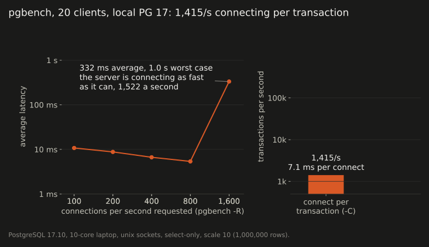

---

# Use a pooled connection

```python
from psycopg2 import pool

db = pool.ThreadedConnectionPool(minconn=2, maxconn=10, dsn=DSN)   # once, at startup

def handle(request):
    conn = db.getconn()                 # borrow an open connection, no fork
    try:
        with conn.cursor() as cur:
            cur.execute("SELECT ... WHERE id = %s", (request.user_id,))
            return cur.fetchone()
    finally:
        db.putconn(conn)                # give it back, still connected
```

<small>Same pattern in psycopg 3, HikariCP in Java, and `database/sql` in Go</small>

---

<!-- _class: chart-slide -->

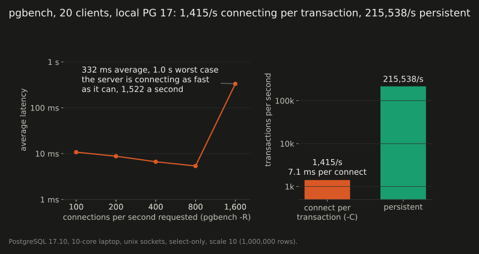

---

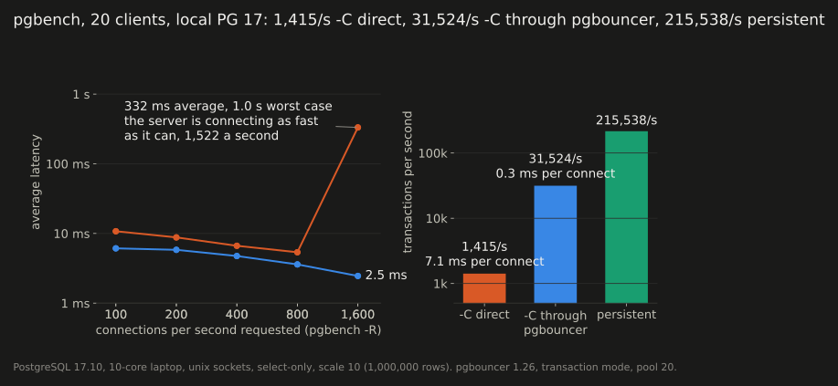

---

# Detection

```sql
-- PG 14+. sample twice, a minute apart; the difference is the churn
SELECT now(), datname, sessions,
       sessions_abandoned, sessions_fatal,
       sessions_killed, stats_reset
  FROM pg_stat_database
```

<div style="height: 1.6em"></div>

- `sessions`: sessions established on this database since `stats_reset`
- `sessions_abandoned`: the client went away without disconnecting
- `sessions_fatal`: ended by a FATAL error
- `sessions_killed`: ended by an operator

---

<!-- _class: kv -->

# Deployment Options

<div class="cols">
<div class="center-img">

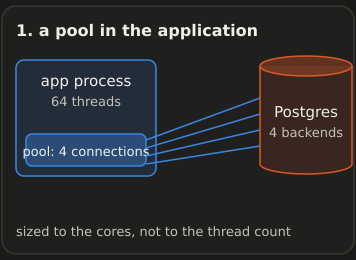

</div>
<div class="center-img">

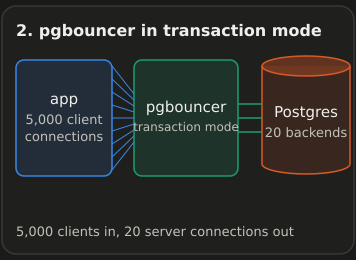

</div>
</div>
<div class="center-img">

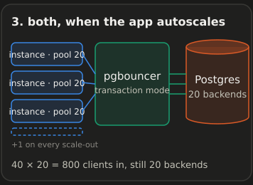

</div>

---

# Mistake #1: ignoring MVCC

<svg xmlns="http://www.w3.org/2000/svg" id="mvcc-svg" width="1150" height="470" viewBox="0 0 1100 450" font-family="DejaVu Sans, system-ui, sans-serif">
<rect width="1100" height="450" fill="#1a1a19"/>
<rect x="24" y="40" width="560" height="250" rx="8" fill="#199e70" fill-opacity="0.07" stroke="#199e70" stroke-width="1.5"/>
<text x="38" y="64" fill="#f0efec" font-size="15" text-anchor="start">users, heap page 0</text>
<text id="mv-sw1" x="570" y="64" fill="#898781" font-size="12.5" text-anchor="end" opacity="0">8,192 bytes, 48 free</text>
<text id="mv-sw2" x="570" y="64" fill="#c3c2b7" font-size="12.5" text-anchor="end" opacity="0">8,192 bytes, 56 free</text>
<text id="mv-sw3" x="570" y="64" fill="#c3c2b7" font-size="12.5" text-anchor="end" opacity="0">8,192 bytes, 0 free</text>
<text id="mv-sw4" x="570" y="64" fill="#3987e5" font-size="12.5" text-anchor="end" opacity="0">8,192 bytes, 48 free</text>
<text id="mv-sw5" x="570" y="64" fill="#c3c2b7" font-size="12.5" text-anchor="end" opacity="0">8,192 bytes, 0 free</text>
<text id="mv-sw6" x="570" y="64" fill="#3987e5" font-size="12.5" text-anchor="end" opacity="0">8,192 bytes, 48 free</text>
<text id="mv-sw7" x="570" y="64" fill="#898781" font-size="12.5" text-anchor="end" opacity="0">8,192 bytes, 48 free</text>
<text x="38" y="84" fill="#c3c2b7" font-size="11.5" text-anchor="start">xmin is the xid that wrote the version. xmax is the xid that deleted or replaced it</text>
<text x="42" y="108" fill="#898781" font-size="12" text-anchor="start" font-family="DejaVu Sans Mono, Menlo, monospace">xmin</text>
<text x="112" y="108" fill="#898781" font-size="12" text-anchor="start" font-family="DejaVu Sans Mono, Menlo, monospace">xmax</text>
<text x="182" y="108" fill="#898781" font-size="12" text-anchor="start" font-family="DejaVu Sans Mono, Menlo, monospace">id</text>
<text x="224" y="108" fill="#898781" font-size="12" text-anchor="start" font-family="DejaVu Sans Mono, Menlo, monospace">first_name</text>
<text x="324" y="108" fill="#898781" font-size="12" text-anchor="start" font-family="DejaVu Sans Mono, Menlo, monospace">last_name</text>
<line x1="34" y1="118" x2="574" y2="118" stroke="#383835" stroke-width="1"/>
<rect x="32" y="226" width="544" height="26" rx="4" fill="#f0efec" fill-opacity="0.03" stroke="#f0efec" stroke-width="0"/>
<text x="42" y="244" fill="#898781" font-size="11.5" text-anchor="start">and the other 150 rows on this page</text>
<rect id="mv-rowbg1" x="32" y="119" width="544" height="30" rx="4" fill="#f0efec" fill-opacity="0.04" stroke="#f0efec" stroke-width="0"/>
<text id="mv-sw8" x="42" y="140" fill="#f0efec" font-size="13" text-anchor="start" opacity="0" font-family="DejaVu Sans Mono, Menlo, monospace">500</text>
<text id="mv-sw9" x="42" y="140" fill="#898781" font-size="13" text-anchor="start" opacity="0" font-family="DejaVu Sans Mono, Menlo, monospace">500</text>
<text id="mv-sw10" x="112" y="140" fill="#e0a52a" font-size="13" text-anchor="start" opacity="0" font-family="DejaVu Sans Mono, Menlo, monospace">502</text>
<text id="mv-sw11" x="112" y="140" fill="#f0efec" font-size="13" text-anchor="start" opacity="0" font-family="DejaVu Sans Mono, Menlo, monospace">502</text>
<text id="mv-sw12" x="112" y="140" fill="#898781" font-size="13" text-anchor="start" opacity="0" font-family="DejaVu Sans Mono, Menlo, monospace">502</text>
<text id="mv-rid1" x="182" y="140" fill="#f0efec" font-size="13" text-anchor="start" opacity="0" font-family="DejaVu Sans Mono, Menlo, monospace">1</text>
<text id="mv-rfn1" x="224" y="140" fill="#f0efec" font-size="13" text-anchor="start" opacity="0" font-family="DejaVu Sans Mono, Menlo, monospace">Jane</text>
<text id="mv-sw13" x="324" y="140" fill="#f0efec" font-size="13" text-anchor="start" opacity="0" font-family="DejaVu Sans Mono, Menlo, monospace">Smith</text>
<text id="mv-sw14" x="324" y="140" fill="#898781" font-size="13" text-anchor="start" opacity="0" font-family="DejaVu Sans Mono, Menlo, monospace">Smith</text>
<text id="mv-sw15" x="448" y="140" fill="#898781" font-size="11.5" text-anchor="start" opacity="0">48 bytes</text>
<text id="mv-sw16" x="448" y="140" fill="#e0a52a" font-size="11.5" text-anchor="start" opacity="0">xmax 502, in flight</text>
<text id="mv-sw17" x="448" y="140" fill="#c3c2b7" font-size="11.5" text-anchor="start" opacity="0">old version</text>
<text id="mv-sw18" x="448" y="140" fill="#898781" font-size="11.5" text-anchor="start" opacity="0">dead until VACUUM</text>
<line id="mv-strike1" x1="174" y1="135" x2="420" y2="135" stroke="#e5484d" stroke-width="1.6" opacity="0"/>
<rect id="mv-free1" x="32" y="119" width="544" height="30" rx="4" fill="none" stroke="#898781" stroke-width="1" stroke-dasharray="5 4" opacity="0"/>
<text id="mv-sw19" x="42" y="140" fill="#898781" font-size="12" text-anchor="start" opacity="0">48 bytes free. Nothing coming is that small: bloat</text>
<text id="mv-sw20" x="42" y="140" fill="#3987e5" font-size="12" text-anchor="start" opacity="0">free space, 48 bytes</text>
<text id="mv-sw21" x="42" y="140" fill="#3987e5" font-size="12" text-anchor="start" opacity="0">free space, 48 bytes, as VACUUM left it</text>
<text id="mv-sw22" x="42" y="140" fill="#898781" font-size="12" text-anchor="start" opacity="0">48 bytes free. Nothing coming is that small: bloat</text>
<rect id="mv-rowbg2" x="32" y="119" width="544" height="30" rx="4" fill="#f0efec" fill-opacity="0.04" stroke="#f0efec" stroke-width="0"/>
<text id="mv-sw23" x="42" y="140" fill="#f0efec" font-size="13" text-anchor="start" opacity="0" font-family="DejaVu Sans Mono, Menlo, monospace">504</text>
<text id="mv-rid2" x="182" y="140" fill="#f0efec" font-size="13" text-anchor="start" opacity="0" font-family="DejaVu Sans Mono, Menlo, monospace">3</text>
<text id="mv-rfn2" x="224" y="140" fill="#f0efec" font-size="13" text-anchor="start" opacity="0" font-family="DejaVu Sans Mono, Menlo, monospace">Susie</text>
<text id="mv-sw24" x="324" y="140" fill="#f0efec" font-size="13" text-anchor="start" opacity="0" font-family="DejaVu Sans Mono, Menlo, monospace">Rivera</text>
<text id="mv-sw25" x="448" y="140" fill="#199e70" font-size="11.5" text-anchor="start" opacity="0">48 bytes, reused</text>
<line id="mv-strike2" x1="174" y1="135" x2="420" y2="135" stroke="#e5484d" stroke-width="1.6" opacity="0"/>
<rect id="mv-rowbg3" x="32" y="155" width="544" height="30" rx="4" fill="#f0efec" fill-opacity="0.04" stroke="#f0efec" stroke-width="0"/>
<text id="mv-sw26" x="42" y="176" fill="#f0efec" font-size="13" text-anchor="start" opacity="0" font-family="DejaVu Sans Mono, Menlo, monospace">500</text>
<text id="mv-sw27" x="42" y="176" fill="#f0efec" font-size="13" text-anchor="start" opacity="0" font-family="DejaVu Sans Mono, Menlo, monospace">500</text>
<text id="mv-rid3" x="182" y="176" fill="#f0efec" font-size="13" text-anchor="start" opacity="0" font-family="DejaVu Sans Mono, Menlo, monospace">2</text>
<text id="mv-rfn3" x="224" y="176" fill="#f0efec" font-size="13" text-anchor="start" opacity="0" font-family="DejaVu Sans Mono, Menlo, monospace">Mike</text>
<text id="mv-sw28" x="324" y="176" fill="#f0efec" font-size="13" text-anchor="start" opacity="0" font-family="DejaVu Sans Mono, Menlo, monospace">Rivera</text>
<text id="mv-sw29" x="324" y="176" fill="#f0efec" font-size="13" text-anchor="start" opacity="0" font-family="DejaVu Sans Mono, Menlo, monospace">Rivera</text>
<text id="mv-sw30" x="448" y="176" fill="#898781" font-size="11.5" text-anchor="start" opacity="0">48 bytes</text>
<text id="mv-sw31" x="448" y="176" fill="#898781" font-size="11.5" text-anchor="start" opacity="0">48 bytes</text>
<line id="mv-strike3" x1="174" y1="171" x2="420" y2="171" stroke="#e5484d" stroke-width="1.6" opacity="0"/>
<rect id="mv-rowbg4" x="32" y="191" width="544" height="30" rx="4" fill="#f0efec" fill-opacity="0.04" stroke="#f0efec" stroke-width="0"/>
<text id="mv-sw32" x="42" y="212" fill="#f0efec" font-size="13" text-anchor="start" opacity="0" font-family="DejaVu Sans Mono, Menlo, monospace">502</text>
<text id="mv-sw33" x="42" y="212" fill="#e0a52a" font-size="13" text-anchor="start" opacity="0" font-family="DejaVu Sans Mono, Menlo, monospace">502</text>
<text id="mv-sw34" x="42" y="212" fill="#f0efec" font-size="13" text-anchor="start" opacity="0" font-family="DejaVu Sans Mono, Menlo, monospace">502</text>
<text id="mv-rid4" x="182" y="212" fill="#f0efec" font-size="13" text-anchor="start" opacity="0" font-family="DejaVu Sans Mono, Menlo, monospace">1</text>
<text id="mv-rfn4" x="224" y="212" fill="#f0efec" font-size="13" text-anchor="start" opacity="0" font-family="DejaVu Sans Mono, Menlo, monospace">Jane</text>
<text id="mv-sw35" x="324" y="212" fill="#f0efec" font-size="13" text-anchor="start" opacity="0" font-family="DejaVu Sans Mono, Menlo, monospace">Smith-Rivera</text>
<text id="mv-sw36" x="324" y="212" fill="#e0a52a" font-size="13" text-anchor="start" opacity="0" font-family="DejaVu Sans Mono, Menlo, monospace">Smith-Rivera</text>
<text id="mv-sw37" x="324" y="212" fill="#f0efec" font-size="13" text-anchor="start" opacity="0" font-family="DejaVu Sans Mono, Menlo, monospace">Smith-Rivera</text>
<text id="mv-sw38" x="448" y="212" fill="#898781" font-size="11.5" text-anchor="start" opacity="0">56 bytes</text>
<text id="mv-sw39" x="448" y="212" fill="#e0a52a" font-size="11.5" text-anchor="start" opacity="0">56 bytes, in flight</text>
<text id="mv-sw40" x="448" y="212" fill="#199e70" font-size="11.5" text-anchor="start" opacity="0">56 bytes, live</text>
<text id="mv-sw41" x="448" y="212" fill="#898781" font-size="11.5" text-anchor="start" opacity="0">56 bytes</text>
<line id="mv-strike4" x1="174" y1="207" x2="420" y2="207" stroke="#e5484d" stroke-width="1.6" opacity="0"/>
<text id="mv-sw42" x="38" y="276" fill="#898781" font-size="12.5" text-anchor="start" opacity="0">48 bytes free that no row fits. The table grew a page instead</text>
<text id="mv-sw43" x="38" y="276" fill="#c3c2b7" font-size="12.5" text-anchor="start" opacity="0">xid 500 wrote both rows and committed. 56 bytes left on the page</text>
<text id="mv-sw44" x="38" y="276" fill="#c3c2b7" font-size="12.5" text-anchor="start" opacity="0">UPDATE wrote a second version of row 1 and set xmax on the first. Page full</text>
<text id="mv-sw45" x="38" y="276" fill="#c3c2b7" font-size="12.5" text-anchor="start" opacity="0">COMMIT changed nothing on this page. It marked 502 committed in the clog</text>
<text id="mv-sw46" x="38" y="276" fill="#898781" font-size="12.5" text-anchor="start" opacity="0">two live versions, one dead. Every reader steps over it until VACUUM</text>
<text id="mv-sw47" x="38" y="276" fill="#c3c2b7" font-size="12.5" text-anchor="start" opacity="0">VACUUM removed the dead version. 48 bytes free</text>
<text id="mv-sw48" x="38" y="276" fill="#c3c2b7" font-size="12.5" text-anchor="start" opacity="0">the INSERT reused the 48 bytes. The table did not grow</text>
<text id="mv-sw49" x="38" y="276" fill="#c3c2b7" font-size="12.5" text-anchor="start" opacity="0">rewind: the page as VACUUM left it, 48 bytes free</text>
<text id="mv-sw50" x="38" y="276" fill="#898781" font-size="12.5" text-anchor="start" opacity="0">48 bytes free that no row fits. The table grew a page instead</text>
<rect id="mv-p11" x="24" y="300" width="560" height="46" rx="8" fill="#d95926" fill-opacity="0.07" stroke="#d95926" stroke-width="1.5" opacity="0"/>
<text id="mv-p1t1" x="38" y="318" fill="#f0efec" font-size="13" text-anchor="start" opacity="0">users, heap page 1, new</text>
<text id="mv-p1t2" x="42" y="336" fill="#f0efec" font-size="13" text-anchor="start" opacity="0" font-family="DejaVu Sans Mono, Menlo, monospace">7500</text>
<text id="mv-p1t3" x="182" y="336" fill="#f0efec" font-size="13" text-anchor="start" opacity="0" font-family="DejaVu Sans Mono, Menlo, monospace">4</text>
<text id="mv-p1t4" x="224" y="336" fill="#f0efec" font-size="13" text-anchor="start" opacity="0" font-family="DejaVu Sans Mono, Menlo, monospace">Bartholomew</text>
<text id="mv-p1t5" x="342" y="336" fill="#f0efec" font-size="13" text-anchor="start" opacity="0" font-family="DejaVu Sans Mono, Menlo, monospace">Featherstonehaugh</text>
<text id="mv-p1t6" x="570" y="318" fill="#c3c2b7" font-size="12.5" text-anchor="end" opacity="0">8,192 bytes, 8,128 free</text>
<text id="mv-p1t7" x="570" y="336" fill="#d95926" font-size="11.5" text-anchor="end" opacity="0">64 bytes</text>
<rect x="24" y="356" width="560" height="60" rx="8" fill="#3987e5" fill-opacity="0.07" stroke="#3987e5" stroke-width="1.5"/>
<text x="38" y="374" fill="#f0efec" font-size="13" text-anchor="start">free space map (FSM), one entry per page</text>
<text id="mv-sw51" x="38" y="393" fill="#898781" font-size="12.5" text-anchor="start" opacity="0">page 0: 48 bytes free. Too small for any row that comes in</text>
<text id="mv-sw52" x="38" y="393" fill="#c3c2b7" font-size="12.5" text-anchor="start" opacity="0">page 0: 56 bytes free</text>
<text id="mv-sw53" x="38" y="393" fill="#898781" font-size="12.5" text-anchor="start" opacity="0">page 0: 0 bytes free</text>
<text id="mv-sw54" x="38" y="393" fill="#3987e5" font-size="12.5" text-anchor="start" opacity="0">page 0: 48 bytes free</text>
<text id="mv-sw55" x="38" y="393" fill="#898781" font-size="12.5" text-anchor="start" opacity="0">page 0: 0 bytes free</text>
<text id="mv-sw56" x="38" y="393" fill="#3987e5" font-size="12.5" text-anchor="start" opacity="0">page 0: 48 bytes free</text>
<text id="mv-sw57" x="38" y="393" fill="#898781" font-size="12.5" text-anchor="start" opacity="0">page 0: 48 bytes free. Too small for any row that comes in</text>
<text id="mv-sw58" x="38" y="409" fill="#3987e5" font-size="12.5" text-anchor="start" opacity="0">page 1: 8,128 bytes free</text>
<text id="mv-sw59" x="38" y="409" fill="#3987e5" font-size="12.5" text-anchor="start" opacity="0">page 1: 8,128 bytes free</text>
<path id="mv-fsmarrow1" d="M 254,389 H 594 V 134 H 586" fill="none" stroke="#3987e5" stroke-width="1.6" opacity="0"/>
<polygon id="mv-fsmhead1" points="578,134 588,129 588,139" fill="#3987e5" opacity="0"/>
<rect x="610" y="40" width="470" height="205" rx="8" fill="#3987e5" fill-opacity="0.1" stroke="#3987e5" stroke-width="1.5"/>
<text x="624" y="64" fill="#3987e5" font-size="14" text-anchor="start">transaction 501, the reader</text>
<rect x="610" y="255" width="470" height="130" rx="8" fill="#d95926" fill-opacity="0.1" stroke="#d95926" stroke-width="1.5"/>
<clipPath id="mv-clip"><rect x="620" y="70" width="450" height="30"/></clipPath>
<text id="mv-cmd1" x="1066" y="90" fill="#f0efec" font-size="11.5" text-anchor="end" font-family="DejaVu Sans Mono, Menlo, monospace" clip-path="url(#mv-clip)" opacity="0"><tspan>BEGIN; </tspan><tspan>SELECT * FROM users;</tspan></text>
<text id="mv-cmd2" x="1066" y="90" fill="#f0efec" font-size="11.5" text-anchor="end" font-family="DejaVu Sans Mono, Menlo, monospace" clip-path="url(#mv-clip)" opacity="0"><tspan>BEGIN; </tspan><tspan fill="#898781" text-decoration="line-through">SELECT * FROM users;</tspan><tspan> </tspan><tspan>SELECT * FROM users;</tspan></text>
<text id="mv-cmd3" x="1066" y="90" fill="#f0efec" font-size="11.5" text-anchor="end" font-family="DejaVu Sans Mono, Menlo, monospace" clip-path="url(#mv-clip)" opacity="0"><tspan>BEGIN; </tspan><tspan fill="#898781" text-decoration="line-through">SELECT * FROM users;</tspan><tspan> </tspan><tspan fill="#898781" text-decoration="line-through">SELECT * FROM users;</tspan><tspan> </tspan><tspan>SELECT * FROM users;</tspan></text>
<text id="mv-cmd4" x="1066" y="90" fill="#f0efec" font-size="11.5" text-anchor="end" font-family="DejaVu Sans Mono, Menlo, monospace" clip-path="url(#mv-clip)" opacity="0"><tspan>BEGIN; </tspan><tspan fill="#898781" text-decoration="line-through">SELECT * FROM users;</tspan><tspan> </tspan><tspan fill="#898781" text-decoration="line-through">SELECT * FROM users;</tspan><tspan> </tspan><tspan fill="#898781" text-decoration="line-through">SELECT * FROM users;</tspan><tspan> </tspan><tspan>SELECT * FROM users;</tspan></text>
<text id="mv-res1" x="624" y="112" fill="#c3c2b7" font-size="11.5" xml:space="preserve" font-family="DejaVu Sans Mono, Menlo, monospace" opacity="0"> id | first_name | last_name</text>
<text id="mv-res2" x="624" y="127" fill="#c3c2b7" font-size="11.5" xml:space="preserve" font-family="DejaVu Sans Mono, Menlo, monospace" opacity="0">----+------------+----------</text>
<text id="mv-res3" x="624" y="142" fill="#3987e5" font-size="11.5" xml:space="preserve" font-family="DejaVu Sans Mono, Menlo, monospace" opacity="0">  1 | Jane       | Smith    </text>
<text id="mv-res4" x="624" y="157" fill="#3987e5" font-size="11.5" xml:space="preserve" font-family="DejaVu Sans Mono, Menlo, monospace" opacity="0">  2 | Mike       | Rivera   </text>
<text id="mv-res5" x="624" y="172" fill="#c3c2b7" font-size="11.5" xml:space="preserve" font-family="DejaVu Sans Mono, Menlo, monospace" opacity="0">(2 rows)</text>
<text id="mv-res6" x="624" y="112" fill="#c3c2b7" font-size="11.5" xml:space="preserve" font-family="DejaVu Sans Mono, Menlo, monospace" opacity="0"> id | first_name | last_name   </text>
<text id="mv-res7" x="624" y="127" fill="#c3c2b7" font-size="11.5" xml:space="preserve" font-family="DejaVu Sans Mono, Menlo, monospace" opacity="0">----+------------+-------------</text>
<text id="mv-res8" x="624" y="142" fill="#3987e5" font-size="11.5" xml:space="preserve" font-family="DejaVu Sans Mono, Menlo, monospace" opacity="0">  2 | Mike       | Rivera      </text>
<text id="mv-res9" x="624" y="157" fill="#3987e5" font-size="11.5" xml:space="preserve" font-family="DejaVu Sans Mono, Menlo, monospace" opacity="0">  1 | Jane       | Smith-Rivera</text>
<text id="mv-res10" x="624" y="172" fill="#c3c2b7" font-size="11.5" xml:space="preserve" font-family="DejaVu Sans Mono, Menlo, monospace" opacity="0">(2 rows)</text>
<text id="mv-res11" x="624" y="112" fill="#c3c2b7" font-size="11.5" xml:space="preserve" font-family="DejaVu Sans Mono, Menlo, monospace" opacity="0"> id | first_name | last_name   </text>
<text id="mv-res12" x="624" y="127" fill="#c3c2b7" font-size="11.5" xml:space="preserve" font-family="DejaVu Sans Mono, Menlo, monospace" opacity="0">----+------------+-------------</text>
<text id="mv-res13" x="624" y="142" fill="#3987e5" font-size="11.5" xml:space="preserve" font-family="DejaVu Sans Mono, Menlo, monospace" opacity="0">  3 | Susie      | Rivera      </text>
<text id="mv-res14" x="624" y="157" fill="#3987e5" font-size="11.5" xml:space="preserve" font-family="DejaVu Sans Mono, Menlo, monospace" opacity="0">  2 | Mike       | Rivera      </text>
<text id="mv-res15" x="624" y="172" fill="#3987e5" font-size="11.5" xml:space="preserve" font-family="DejaVu Sans Mono, Menlo, monospace" opacity="0">  1 | Jane       | Smith-Rivera</text>
<text id="mv-res16" x="624" y="187" fill="#c3c2b7" font-size="11.5" xml:space="preserve" font-family="DejaVu Sans Mono, Menlo, monospace" opacity="0">(3 rows)</text>
<text id="mv-res17" x="624" y="112" fill="#c3c2b7" font-size="11.5" xml:space="preserve" font-family="DejaVu Sans Mono, Menlo, monospace" opacity="0"> id | first_name  | last_name        </text>
<text id="mv-res18" x="624" y="127" fill="#c3c2b7" font-size="11.5" xml:space="preserve" font-family="DejaVu Sans Mono, Menlo, monospace" opacity="0">----+-------------+------------------</text>
<text id="mv-res19" x="624" y="142" fill="#3987e5" font-size="11.5" xml:space="preserve" font-family="DejaVu Sans Mono, Menlo, monospace" opacity="0">  2 | Mike        | Rivera           </text>
<text id="mv-res20" x="624" y="157" fill="#3987e5" font-size="11.5" xml:space="preserve" font-family="DejaVu Sans Mono, Menlo, monospace" opacity="0">  1 | Jane        | Smith-Rivera     </text>
<text id="mv-res21" x="624" y="172" fill="#3987e5" font-size="11.5" xml:space="preserve" font-family="DejaVu Sans Mono, Menlo, monospace" opacity="0">  4 | Bartholomew | Featherstonehaugh</text>
<text id="mv-res22" x="624" y="187" fill="#c3c2b7" font-size="11.5" xml:space="preserve" font-family="DejaVu Sans Mono, Menlo, monospace" opacity="0">(3 rows)</text>
<text id="mv-sw60" x="624" y="237" fill="#199e70" font-size="11.5" text-anchor="start" opacity="0">heap order: page 0 top to bottom, then page 1. No ORDER BY</text>
<text id="mv-sw61" x="624" y="237" fill="#c3c2b7" font-size="11.5" text-anchor="start" opacity="0">snapshot: everything committed before now</text>
<text id="mv-sw62" x="624" y="237" fill="#e0a52a" font-size="11.5" text-anchor="start" opacity="0">still Smith. 502 is in flight, its version is invisible</text>
<text id="mv-sw63" x="624" y="237" fill="#199e70" font-size="11.5" text-anchor="start" opacity="0">Smith-Rivera. New statement, new snapshot. Note the order</text>
<text id="mv-sw64" x="624" y="237" fill="#199e70" font-size="11.5" text-anchor="start" opacity="0">three rows, in the order they sit on the page</text>
<text id="mv-sw65" x="624" y="237" fill="#c3c2b7" font-size="11.5" text-anchor="start" opacity="0">two rows, the page as VACUUM left it</text>
<text id="mv-sw66" x="624" y="237" fill="#199e70" font-size="11.5" text-anchor="start" opacity="0">heap order: page 0 top to bottom, then page 1. No ORDER BY</text>
<text id="mv-sw67" x="624" y="279" fill="#d95926" font-size="14" text-anchor="start" opacity="0">transaction 7500, months later, a new user</text>
<text id="mv-sw68" x="624" y="279" fill="#d95926" font-size="14" text-anchor="start" opacity="0">transaction 502, marry me</text>
<text id="mv-sw69" x="624" y="279" fill="#199e70" font-size="14" text-anchor="start" opacity="0">autovacuum, or VACUUM users</text>
<text id="mv-sw70" x="624" y="279" fill="#d95926" font-size="14" text-anchor="start" opacity="0">transaction 504, a new user</text>
<text id="mv-sw71" x="624" y="279" fill="#199e70" font-size="14" text-anchor="start" opacity="0">take two: same page, a different newcomer</text>
<text id="mv-sw72" x="624" y="279" fill="#d95926" font-size="14" text-anchor="start" opacity="0">transaction 7500, months later, a new user</text>
<text id="mv-sw73" x="624" y="305" fill="#f0efec" font-size="12.5" text-anchor="start" opacity="0" font-family="DejaVu Sans Mono, Menlo, monospace">BEGIN;</text>
<text id="mv-sw74" x="624" y="305" fill="#f0efec" font-size="12.5" text-anchor="start" opacity="0" font-family="DejaVu Sans Mono, Menlo, monospace">VACUUM users;</text>
<text id="mv-sw75" x="624" y="305" fill="#f0efec" font-size="12.5" text-anchor="start" opacity="0" font-family="DejaVu Sans Mono, Menlo, monospace">BEGIN;</text>
<text id="mv-sw76" x="624" y="305" fill="#c3c2b7" font-size="12.5" text-anchor="start" opacity="0" font-family="DejaVu Sans Mono, Menlo, monospace">rewind to step 8: page 0 has 48 bytes free</text>
<text id="mv-sw77" x="624" y="305" fill="#f0efec" font-size="12.5" text-anchor="start" opacity="0" font-family="DejaVu Sans Mono, Menlo, monospace">BEGIN;</text>
<text id="mv-sw78" x="624" y="325" fill="#f0efec" font-size="12.5" text-anchor="start" opacity="0" font-family="DejaVu Sans Mono, Menlo, monospace">INSERT INTO users</text>
<text id="mv-sw79" x="624" y="325" fill="#f0efec" font-size="12.5" text-anchor="start" opacity="0" font-family="DejaVu Sans Mono, Menlo, monospace">UPDATE users SET last_name = 'Smith-Rivera'</text>
<text id="mv-sw80" x="624" y="325" fill="#c3c2b7" font-size="12.5" text-anchor="start" opacity="0" font-family="DejaVu Sans Mono, Menlo, monospace">dead versions become free space on the page</text>
<text id="mv-sw81" x="624" y="325" fill="#f0efec" font-size="12.5" text-anchor="start" opacity="0" font-family="DejaVu Sans Mono, Menlo, monospace">INSERT INTO users VALUES (3, 'Susie', 'Rivera');</text>
<text id="mv-sw82" x="624" y="325" fill="#c3c2b7" font-size="12.5" text-anchor="start" opacity="0" font-family="DejaVu Sans Mono, Menlo, monospace">the FSM still points at page 0</text>
<text id="mv-sw83" x="624" y="325" fill="#f0efec" font-size="12.5" text-anchor="start" opacity="0" font-family="DejaVu Sans Mono, Menlo, monospace">INSERT INTO users</text>
<text id="mv-sw84" x="624" y="343" fill="#f0efec" font-size="12.5" text-anchor="start" opacity="0" font-family="DejaVu Sans Mono, Menlo, monospace">  VALUES (4, 'Bartholomew', 'Featherstonehaugh');</text>
<text id="mv-sw85" x="624" y="343" fill="#f0efec" font-size="12.5" text-anchor="start" opacity="0" font-family="DejaVu Sans Mono, Menlo, monospace">  WHERE id = 1;</text>
<text id="mv-sw86" x="624" y="343" fill="#c3c2b7" font-size="12.5" text-anchor="start" opacity="0" font-family="DejaVu Sans Mono, Menlo, monospace">the free space map (FSM) records how much</text>
<text id="mv-sw87" x="624" y="343" fill="#f0efec" font-size="12.5" text-anchor="start" opacity="0" font-family="DejaVu Sans Mono, Menlo, monospace">  VALUES (4, 'Bartholomew', 'Featherstonehaugh');</text>
<text id="mv-sw88" x="624" y="363" fill="#199e70" font-size="12.5" text-anchor="start" opacity="0" font-family="DejaVu Sans Mono, Menlo, monospace">COMMIT;</text>
<text id="mv-sw89" x="624" y="363" fill="#199e70" font-size="12.5" text-anchor="start" opacity="0" font-family="DejaVu Sans Mono, Menlo, monospace">COMMIT;</text>
<text id="mv-sw90" x="624" y="363" fill="#199e70" font-size="12.5" text-anchor="start" opacity="0" font-family="DejaVu Sans Mono, Menlo, monospace">COMMIT;</text>
<text id="mv-sw91" x="624" y="363" fill="#199e70" font-size="12.5" text-anchor="start" opacity="0" font-family="DejaVu Sans Mono, Menlo, monospace">COMMIT;</text>
<text id="mv-sw92" x="624" y="379" fill="#e5484d" font-size="11.5" text-anchor="start" opacity="0">64 bytes. Page 0 has 48 free, so the table grows a page</text>
<text id="mv-sw93" x="624" y="379" fill="#e0a52a" font-size="11.5" text-anchor="start" opacity="0">in flight: holds xid 502 and a connection</text>
<text id="mv-sw94" x="624" y="379" fill="#199e70" font-size="11.5" text-anchor="start" opacity="0">committed</text>
<text id="mv-sw95" x="624" y="379" fill="#c3c2b7" font-size="11.5" text-anchor="start" opacity="0">no lock on the table, readers and writers carry on</text>
<text id="mv-sw96" x="624" y="379" fill="#199e70" font-size="11.5" text-anchor="start" opacity="0">48 bytes after padding. The FSM sent her to page 0</text>
<text id="mv-sw97" x="624" y="379" fill="#c3c2b7" font-size="11.5" text-anchor="start" opacity="0">what if the next row had been bigger</text>
<text id="mv-sw98" x="624" y="379" fill="#e5484d" font-size="11.5" text-anchor="start" opacity="0">64 bytes. Page 0 has 48 free, so the table grows a page</text>
<rect id="mv-p1cover1" x="608" y="38" width="474" height="209" rx="8" fill="#1a1a19" fill-opacity="1" stroke="#1a1a19" stroke-width="0"/>
<rect id="mv-p2cover1" x="608" y="253" width="474" height="134" rx="8" fill="#1a1a19" fill-opacity="1" stroke="#1a1a19" stroke-width="0"/>
<text id="mv-sw99" x="24" y="30" fill="#f0efec" font-size="19" text-anchor="start" opacity="0">the whole story</text>
<text id="mv-sw100" x="24" y="30" fill="#f0efec" font-size="19" text-anchor="start" opacity="0">1. Bulk load</text>
<text id="mv-sw101" x="24" y="30" fill="#f0efec" font-size="19" text-anchor="start" opacity="0">2. A reader takes a snapshot</text>
<text id="mv-sw102" x="24" y="30" fill="#f0efec" font-size="19" text-anchor="start" opacity="0">3. UPDATE writes a new version</text>
<text id="mv-sw103" x="24" y="30" fill="#f0efec" font-size="19" text-anchor="start" opacity="0">4. The reader still sees Smith</text>
<text id="mv-sw104" x="24" y="30" fill="#f0efec" font-size="19" text-anchor="start" opacity="0">5. COMMIT</text>
<text id="mv-sw105" x="24" y="30" fill="#f0efec" font-size="19" text-anchor="start" opacity="0">6. New statement, new snapshot</text>
<text id="mv-sw106" x="24" y="30" fill="#f0efec" font-size="19" text-anchor="start" opacity="0">7. A dead version</text>
<text id="mv-sw107" x="24" y="30" fill="#f0efec" font-size="19" text-anchor="start" opacity="0">8. VACUUM frees 48 bytes</text>
<text id="mv-sw108" x="24" y="30" fill="#f0efec" font-size="19" text-anchor="start" opacity="0">9. A row that fits</text>
<text id="mv-sw109" x="24" y="30" fill="#f0efec" font-size="19" text-anchor="start" opacity="0">10. Rewind to the vacuumed page</text>
<text id="mv-sw110" x="24" y="30" fill="#f0efec" font-size="19" text-anchor="start" opacity="0">11. A row that does not fit</text>
<text id="mv-cap1" x="20" y="438" fill="#f0efec" font-size="14" text-anchor="start" opacity="0">dead versions become free bytes. A row that fits reuses them; a row that does not grows the table and leaves the gap behind</text>
<text id="mv-cap2" x="20" y="438" fill="#f0efec" font-size="14" text-anchor="start" opacity="0">xid 500 bulk-loads the table in one transaction and commits. The page is otherwise full</text>
<text id="mv-cap3" x="20" y="438" fill="#f0efec" font-size="14" text-anchor="start" opacity="0">501 reads. Its snapshot is everything committed before the statement started</text>
<text id="mv-cap4" x="20" y="438" fill="#f0efec" font-size="14" text-anchor="start" opacity="0">502 updates row 1. Postgres never overwrites: a new version is written, and the old one gets xmax = 502</text>
<text id="mv-cap5" x="20" y="438" fill="#f0efec" font-size="14" text-anchor="start" opacity="0">501 reads again and still sees Smith. 502 has not committed, so its version is invisible to everyone else</text>
<text id="mv-cap6" x="20" y="438" fill="#f0efec" font-size="14" text-anchor="start" opacity="0">502 commits. The page does not change; the commit log now says 502 is committed</text>
<text id="mv-cap7" x="20" y="438" fill="#f0efec" font-size="14" text-anchor="start" opacity="0">501's next statement takes a new snapshot and sees Smith-Rivera (READ COMMITTED, the default)</text>
<text id="mv-cap8" x="20" y="438" fill="#f0efec" font-size="14" text-anchor="start" opacity="0">the old version is dead. It stays on the page until VACUUM, and every reader steps over it until then</text>
<text id="mv-cap9" x="20" y="438" fill="#f0efec" font-size="14" text-anchor="start" opacity="0">VACUUM compacts the page, frees the dead version's 48 bytes, and records them in the free space map</text>
<text id="mv-cap10" x="20" y="438" fill="#f0efec" font-size="14" text-anchor="start" opacity="0">504 inserts Susie Rivera, 48 bytes after padding. The FSM points at page 0, so she takes the freed space</text>
<text id="mv-cap11" x="20" y="438" fill="#f0efec" font-size="14" text-anchor="start" opacity="0">rewind to step 8. Same page, 48 bytes free. Now a different newcomer, months later</text>
<text id="mv-cap12" x="20" y="438" fill="#f0efec" font-size="14" text-anchor="start" opacity="0">7500 inserts a 64-byte row. 48 is not enough, so the table grows a page. The 48 bytes stay empty: bloat</text>
<rect x="800" y="10" width="88" height="28" rx="6" fill="#1a1a19" fill-opacity="1" stroke="#383835" stroke-width="1.2"/>
<text id="mvcc-back-label" x="844" y="29" fill="#c3c2b7" font-size="12.5" text-anchor="middle">back (b)</text>
<rect x="896" y="10" width="88" height="28" rx="6" fill="#1a1a19" fill-opacity="1" stroke="#383835" stroke-width="1.2"/>
<text id="mvcc-next-label" x="940" y="29" fill="#c3c2b7" font-size="12.5" text-anchor="middle">next (n)</text>
<rect x="992" y="10" width="88" height="28" rx="6" fill="#1a1a19" fill-opacity="1" stroke="#383835" stroke-width="1.2"/>
<text id="mvcc-play-label" x="1036" y="29" fill="#c3c2b7" font-size="12.5" text-anchor="middle">play (a)</text>
<text id="mvcc-step" x="786" y="29" fill="#898781" font-size="12.5" text-anchor="end">step 1 of 11</text>
<animate href="#mv-sw1" attributeName="opacity" values="1;1;0;0" keyTimes="0.0000;0.0527;0.0541;1.0000" calcMode="discrete" dur="37.0s" repeatCount="indefinite"/>
<animate href="#mv-sw2" attributeName="opacity" values="0;0;1;1;0;0" keyTimes="0.0000;0.0527;0.0541;0.2257;0.2270;1.0000" calcMode="discrete" dur="37.0s" repeatCount="indefinite"/>
<animate href="#mv-sw3" attributeName="opacity" values="0;0;1;1;0;0" keyTimes="0.0000;0.2257;0.2270;0.6419;0.6432;1.0000" calcMode="discrete" dur="37.0s" repeatCount="indefinite"/>
<animate href="#mv-sw4" attributeName="opacity" values="0;0;1;1;0;0" keyTimes="0.0000;0.6419;0.6432;0.7284;0.7297;1.0000" calcMode="discrete" dur="37.0s" repeatCount="indefinite"/>
<animate href="#mv-sw5" attributeName="opacity" values="0;0;1;1;0;0" keyTimes="0.0000;0.7284;0.7297;0.8149;0.8162;1.0000" calcMode="discrete" dur="37.0s" repeatCount="indefinite"/>
<animate href="#mv-sw6" attributeName="opacity" values="0;0;1;1;0;0" keyTimes="0.0000;0.8149;0.8162;0.8959;0.8973;1.0000" calcMode="discrete" dur="37.0s" repeatCount="indefinite"/>
<animate href="#mv-sw7" attributeName="opacity" values="0;0;1;1" keyTimes="0.0000;0.8959;0.8973;1.0000" calcMode="discrete" dur="37.0s" repeatCount="indefinite"/>
<animate href="#mv-rowbg1" attributeName="opacity" values="0;0;1;1;0;0" keyTimes="0.0000;0.0527;0.0541;0.6419;0.6432;1.0000" calcMode="discrete" dur="37.0s" repeatCount="indefinite"/>
<animate href="#mv-sw8" attributeName="opacity" values="0;0;1;1;0;0" keyTimes="0.0000;0.0527;0.0541;0.5500;0.5514;1.0000" calcMode="discrete" dur="37.0s" repeatCount="indefinite"/>
<animate href="#mv-sw9" attributeName="opacity" values="0;0;1;1;0;0" keyTimes="0.0000;0.5500;0.5514;0.6419;0.6432;1.0000" calcMode="discrete" dur="37.0s" repeatCount="indefinite"/>
<animate href="#mv-sw10" attributeName="opacity" values="0;0;1;1;0;0" keyTimes="0.0000;0.2257;0.2270;0.4041;0.4054;1.0000" calcMode="discrete" dur="37.0s" repeatCount="indefinite"/>
<animate href="#mv-sw11" attributeName="opacity" values="0;0;1;1;0;0" keyTimes="0.0000;0.4041;0.4054;0.5500;0.5514;1.0000" calcMode="discrete" dur="37.0s" repeatCount="indefinite"/>
<animate href="#mv-sw12" attributeName="opacity" values="0;0;1;1;0;0" keyTimes="0.0000;0.5500;0.5514;0.6419;0.6432;1.0000" calcMode="discrete" dur="37.0s" repeatCount="indefinite"/>
<animate href="#mv-rid1" attributeName="opacity" values="0;0;1;1;0;0" keyTimes="0.0000;0.0527;0.0541;0.6419;0.6432;1.0000" calcMode="discrete" dur="37.0s" repeatCount="indefinite"/>
<animate href="#mv-rfn1" attributeName="opacity" values="0;0;1;1;0;0" keyTimes="0.0000;0.0527;0.0541;0.6419;0.6432;1.0000" calcMode="discrete" dur="37.0s" repeatCount="indefinite"/>
<animate href="#mv-sw13" attributeName="opacity" values="0;0;1;1;0;0" keyTimes="0.0000;0.0527;0.0541;0.5500;0.5514;1.0000" calcMode="discrete" dur="37.0s" repeatCount="indefinite"/>
<animate href="#mv-sw14" attributeName="opacity" values="0;0;1;1;0;0" keyTimes="0.0000;0.5500;0.5514;0.6419;0.6432;1.0000" calcMode="discrete" dur="37.0s" repeatCount="indefinite"/>
<animate href="#mv-sw15" attributeName="opacity" values="0;0;1;1;0;0" keyTimes="0.0000;0.0527;0.0541;0.2257;0.2270;1.0000" calcMode="discrete" dur="37.0s" repeatCount="indefinite"/>
<animate href="#mv-sw16" attributeName="opacity" values="0;0;1;1;0;0" keyTimes="0.0000;0.2257;0.2270;0.4041;0.4054;1.0000" calcMode="discrete" dur="37.0s" repeatCount="indefinite"/>
<animate href="#mv-sw17" attributeName="opacity" values="0;0;1;1;0;0" keyTimes="0.0000;0.4041;0.4054;0.5500;0.5514;1.0000" calcMode="discrete" dur="37.0s" repeatCount="indefinite"/>
<animate href="#mv-sw18" attributeName="opacity" values="0;0;1;1;0;0" keyTimes="0.0000;0.5500;0.5514;0.6419;0.6432;1.0000" calcMode="discrete" dur="37.0s" repeatCount="indefinite"/>
<animate href="#mv-strike1" attributeName="opacity" values="0;0;1;1;0;0" keyTimes="0.0000;0.5500;0.5514;0.6419;0.6432;1.0000" calcMode="discrete" dur="37.0s" repeatCount="indefinite"/>
<animate href="#mv-free1" attributeName="opacity" values="1;1;0;0;1;1;0;0;1;1" keyTimes="0.0000;0.0527;0.0541;0.6419;0.6432;0.7284;0.7297;0.8149;0.8162;1.0000" calcMode="discrete" dur="37.0s" repeatCount="indefinite"/>
<animate href="#mv-sw19" attributeName="opacity" values="1;1;0;0" keyTimes="0.0000;0.0527;0.0541;1.0000" calcMode="discrete" dur="37.0s" repeatCount="indefinite"/>
<animate href="#mv-sw20" attributeName="opacity" values="0;0;1;1;0;0" keyTimes="0.0000;0.6419;0.6432;0.7284;0.7297;1.0000" calcMode="discrete" dur="37.0s" repeatCount="indefinite"/>
<animate href="#mv-sw21" attributeName="opacity" values="0;0;1;1;0;0" keyTimes="0.0000;0.8149;0.8162;0.8959;0.8973;1.0000" calcMode="discrete" dur="37.0s" repeatCount="indefinite"/>
<animate href="#mv-sw22" attributeName="opacity" values="0;0;1;1" keyTimes="0.0000;0.8959;0.8973;1.0000" calcMode="discrete" dur="37.0s" repeatCount="indefinite"/>
<animate href="#mv-rowbg2" attributeName="opacity" values="0;0;1;1;0;0" keyTimes="0.0000;0.7284;0.7297;0.8149;0.8162;1.0000" calcMode="discrete" dur="37.0s" repeatCount="indefinite"/>
<animate href="#mv-sw23" attributeName="opacity" values="0;0;1;1;0;0" keyTimes="0.0000;0.7284;0.7297;0.8149;0.8162;1.0000" calcMode="discrete" dur="37.0s" repeatCount="indefinite"/>
<animate href="#mv-rid2" attributeName="opacity" values="0;0;1;1;0;0" keyTimes="0.0000;0.7284;0.7297;0.8149;0.8162;1.0000" calcMode="discrete" dur="37.0s" repeatCount="indefinite"/>
<animate href="#mv-rfn2" attributeName="opacity" values="0;0;1;1;0;0" keyTimes="0.0000;0.7284;0.7297;0.8149;0.8162;1.0000" calcMode="discrete" dur="37.0s" repeatCount="indefinite"/>
<animate href="#mv-sw24" attributeName="opacity" values="0;0;1;1;0;0" keyTimes="0.0000;0.7284;0.7297;0.8149;0.8162;1.0000" calcMode="discrete" dur="37.0s" repeatCount="indefinite"/>
<animate href="#mv-sw25" attributeName="opacity" values="0;0;1;1;0;0" keyTimes="0.0000;0.7284;0.7297;0.8149;0.8162;1.0000" calcMode="discrete" dur="37.0s" repeatCount="indefinite"/>
<animate href="#mv-strike2" attributeName="opacity" values="0;0" keyTimes="0.0000;1.0000" calcMode="discrete" dur="37.0s" repeatCount="indefinite"/>
<animate href="#mv-rowbg3" attributeName="opacity" values="1;1;0;0;1;1" keyTimes="0.0000;0.0527;0.0541;0.0770;0.0784;1.0000" calcMode="discrete" dur="37.0s" repeatCount="indefinite"/>
<animate href="#mv-sw26" attributeName="opacity" values="1;1;0;0" keyTimes="0.0000;0.0527;0.0541;1.0000" calcMode="discrete" dur="37.0s" repeatCount="indefinite"/>
<animate href="#mv-sw27" attributeName="opacity" values="0;0;1;1" keyTimes="0.0000;0.0770;0.0784;1.0000" calcMode="discrete" dur="37.0s" repeatCount="indefinite"/>
<animate href="#mv-rid3" attributeName="opacity" values="1;1;0;0;1;1" keyTimes="0.0000;0.0527;0.0541;0.0770;0.0784;1.0000" calcMode="discrete" dur="37.0s" repeatCount="indefinite"/>
<animate href="#mv-rfn3" attributeName="opacity" values="1;1;0;0;1;1" keyTimes="0.0000;0.0527;0.0541;0.0770;0.0784;1.0000" calcMode="discrete" dur="37.0s" repeatCount="indefinite"/>
<animate href="#mv-sw28" attributeName="opacity" values="1;1;0;0" keyTimes="0.0000;0.0527;0.0541;1.0000" calcMode="discrete" dur="37.0s" repeatCount="indefinite"/>
<animate href="#mv-sw29" attributeName="opacity" values="0;0;1;1" keyTimes="0.0000;0.0770;0.0784;1.0000" calcMode="discrete" dur="37.0s" repeatCount="indefinite"/>
<animate href="#mv-sw30" attributeName="opacity" values="1;1;0;0" keyTimes="0.0000;0.0527;0.0541;1.0000" calcMode="discrete" dur="37.0s" repeatCount="indefinite"/>
<animate href="#mv-sw31" attributeName="opacity" values="0;0;1;1" keyTimes="0.0000;0.0770;0.0784;1.0000" calcMode="discrete" dur="37.0s" repeatCount="indefinite"/>
<animate href="#mv-strike3" attributeName="opacity" values="0;0" keyTimes="0.0000;1.0000" calcMode="discrete" dur="37.0s" repeatCount="indefinite"/>
<animate href="#mv-rowbg4" attributeName="opacity" values="1;1;0;0;1;1" keyTimes="0.0000;0.0527;0.0541;0.2257;0.2270;1.0000" calcMode="discrete" dur="37.0s" repeatCount="indefinite"/>
<animate href="#mv-sw32" attributeName="opacity" values="1;1;0;0" keyTimes="0.0000;0.0527;0.0541;1.0000" calcMode="discrete" dur="37.0s" repeatCount="indefinite"/>
<animate href="#mv-sw33" attributeName="opacity" values="0;0;1;1;0;0" keyTimes="0.0000;0.2257;0.2270;0.4041;0.4054;1.0000" calcMode="discrete" dur="37.0s" repeatCount="indefinite"/>
<animate href="#mv-sw34" attributeName="opacity" values="0;0;1;1" keyTimes="0.0000;0.4041;0.4054;1.0000" calcMode="discrete" dur="37.0s" repeatCount="indefinite"/>
<animate href="#mv-rid4" attributeName="opacity" values="1;1;0;0;1;1" keyTimes="0.0000;0.0527;0.0541;0.2257;0.2270;1.0000" calcMode="discrete" dur="37.0s" repeatCount="indefinite"/>
<animate href="#mv-rfn4" attributeName="opacity" values="1;1;0;0;1;1" keyTimes="0.0000;0.0527;0.0541;0.2257;0.2270;1.0000" calcMode="discrete" dur="37.0s" repeatCount="indefinite"/>
<animate href="#mv-sw35" attributeName="opacity" values="1;1;0;0" keyTimes="0.0000;0.0527;0.0541;1.0000" calcMode="discrete" dur="37.0s" repeatCount="indefinite"/>
<animate href="#mv-sw36" attributeName="opacity" values="0;0;1;1;0;0" keyTimes="0.0000;0.2257;0.2270;0.4041;0.4054;1.0000" calcMode="discrete" dur="37.0s" repeatCount="indefinite"/>
<animate href="#mv-sw37" attributeName="opacity" values="0;0;1;1" keyTimes="0.0000;0.4041;0.4054;1.0000" calcMode="discrete" dur="37.0s" repeatCount="indefinite"/>
<animate href="#mv-sw38" attributeName="opacity" values="1;1;0;0" keyTimes="0.0000;0.0527;0.0541;1.0000" calcMode="discrete" dur="37.0s" repeatCount="indefinite"/>
<animate href="#mv-sw39" attributeName="opacity" values="0;0;1;1;0;0" keyTimes="0.0000;0.2257;0.2270;0.4041;0.4054;1.0000" calcMode="discrete" dur="37.0s" repeatCount="indefinite"/>
<animate href="#mv-sw40" attributeName="opacity" values="0;0;1;1;0;0" keyTimes="0.0000;0.4041;0.4054;0.6419;0.6432;1.0000" calcMode="discrete" dur="37.0s" repeatCount="indefinite"/>
<animate href="#mv-sw41" attributeName="opacity" values="0;0;1;1" keyTimes="0.0000;0.6419;0.6432;1.0000" calcMode="discrete" dur="37.0s" repeatCount="indefinite"/>
<animate href="#mv-strike4" attributeName="opacity" values="0;0" keyTimes="0.0000;1.0000" calcMode="discrete" dur="37.0s" repeatCount="indefinite"/>
<animate href="#mv-sw42" attributeName="opacity" values="1;1;0;0" keyTimes="0.0000;0.0527;0.0541;1.0000" calcMode="discrete" dur="37.0s" repeatCount="indefinite"/>
<animate href="#mv-sw43" attributeName="opacity" values="0;0;1;1;0;0" keyTimes="0.0000;0.0527;0.0541;0.2257;0.2270;1.0000" calcMode="discrete" dur="37.0s" repeatCount="indefinite"/>
<animate href="#mv-sw44" attributeName="opacity" values="0;0;1;1;0;0" keyTimes="0.0000;0.2257;0.2270;0.4041;0.4054;1.0000" calcMode="discrete" dur="37.0s" repeatCount="indefinite"/>
<animate href="#mv-sw45" attributeName="opacity" values="0;0;1;1;0;0" keyTimes="0.0000;0.4041;0.4054;0.5500;0.5514;1.0000" calcMode="discrete" dur="37.0s" repeatCount="indefinite"/>
<animate href="#mv-sw46" attributeName="opacity" values="0;0;1;1;0;0" keyTimes="0.0000;0.5500;0.5514;0.6419;0.6432;1.0000" calcMode="discrete" dur="37.0s" repeatCount="indefinite"/>
<animate href="#mv-sw47" attributeName="opacity" values="0;0;1;1;0;0" keyTimes="0.0000;0.6419;0.6432;0.7284;0.7297;1.0000" calcMode="discrete" dur="37.0s" repeatCount="indefinite"/>
<animate href="#mv-sw48" attributeName="opacity" values="0;0;1;1;0;0" keyTimes="0.0000;0.7284;0.7297;0.8149;0.8162;1.0000" calcMode="discrete" dur="37.0s" repeatCount="indefinite"/>
<animate href="#mv-sw49" attributeName="opacity" values="0;0;1;1;0;0" keyTimes="0.0000;0.8149;0.8162;0.8959;0.8973;1.0000" calcMode="discrete" dur="37.0s" repeatCount="indefinite"/>
<animate href="#mv-sw50" attributeName="opacity" values="0;0;1;1" keyTimes="0.0000;0.8959;0.8973;1.0000" calcMode="discrete" dur="37.0s" repeatCount="indefinite"/>
<animate href="#mv-p11" attributeName="opacity" values="1;1;0;0;1;1" keyTimes="0.0000;0.0527;0.0541;0.8959;0.8973;1.0000" calcMode="discrete" dur="37.0s" repeatCount="indefinite"/>
<animate href="#mv-p1t1" attributeName="opacity" values="1;1;0;0;1;1" keyTimes="0.0000;0.0527;0.0541;0.8959;0.8973;1.0000" calcMode="discrete" dur="37.0s" repeatCount="indefinite"/>
<animate href="#mv-p1t2" attributeName="opacity" values="1;1;0;0;1;1" keyTimes="0.0000;0.0527;0.0541;0.8959;0.8973;1.0000" calcMode="discrete" dur="37.0s" repeatCount="indefinite"/>
<animate href="#mv-p1t3" attributeName="opacity" values="1;1;0;0;1;1" keyTimes="0.0000;0.0527;0.0541;0.8959;0.8973;1.0000" calcMode="discrete" dur="37.0s" repeatCount="indefinite"/>
<animate href="#mv-p1t4" attributeName="opacity" values="1;1;0;0;1;1" keyTimes="0.0000;0.0527;0.0541;0.8959;0.8973;1.0000" calcMode="discrete" dur="37.0s" repeatCount="indefinite"/>
<animate href="#mv-p1t5" attributeName="opacity" values="1;1;0;0;1;1" keyTimes="0.0000;0.0527;0.0541;0.8959;0.8973;1.0000" calcMode="discrete" dur="37.0s" repeatCount="indefinite"/>
<animate href="#mv-p1t6" attributeName="opacity" values="1;1;0;0;1;1" keyTimes="0.0000;0.0527;0.0541;0.8959;0.8973;1.0000" calcMode="discrete" dur="37.0s" repeatCount="indefinite"/>
<animate href="#mv-p1t7" attributeName="opacity" values="1;1;0;0;1;1" keyTimes="0.0000;0.0527;0.0541;0.8959;0.8973;1.0000" calcMode="discrete" dur="37.0s" repeatCount="indefinite"/>
<animate href="#mv-sw51" attributeName="opacity" values="1;1;0;0" keyTimes="0.0000;0.0527;0.0541;1.0000" calcMode="discrete" dur="37.0s" repeatCount="indefinite"/>
<animate href="#mv-sw52" attributeName="opacity" values="0;0;1;1;0;0" keyTimes="0.0000;0.0527;0.0541;0.2257;0.2270;1.0000" calcMode="discrete" dur="37.0s" repeatCount="indefinite"/>
<animate href="#mv-sw53" attributeName="opacity" values="0;0;1;1;0;0" keyTimes="0.0000;0.2257;0.2270;0.6419;0.6432;1.0000" calcMode="discrete" dur="37.0s" repeatCount="indefinite"/>
<animate href="#mv-sw54" attributeName="opacity" values="0;0;1;1;0;0" keyTimes="0.0000;0.6419;0.6432;0.7284;0.7297;1.0000" calcMode="discrete" dur="37.0s" repeatCount="indefinite"/>
<animate href="#mv-sw55" attributeName="opacity" values="0;0;1;1;0;0" keyTimes="0.0000;0.7284;0.7297;0.8149;0.8162;1.0000" calcMode="discrete" dur="37.0s" repeatCount="indefinite"/>
<animate href="#mv-sw56" attributeName="opacity" values="0;0;1;1;0;0" keyTimes="0.0000;0.8149;0.8162;0.8959;0.8973;1.0000" calcMode="discrete" dur="37.0s" repeatCount="indefinite"/>
<animate href="#mv-sw57" attributeName="opacity" values="0;0;1;1" keyTimes="0.0000;0.8959;0.8973;1.0000" calcMode="discrete" dur="37.0s" repeatCount="indefinite"/>
<animate href="#mv-sw58" attributeName="opacity" values="1;1;0;0" keyTimes="0.0000;0.0527;0.0541;1.0000" calcMode="discrete" dur="37.0s" repeatCount="indefinite"/>
<animate href="#mv-sw59" attributeName="opacity" values="0;0;1;1" keyTimes="0.0000;0.8959;0.8973;1.0000" calcMode="discrete" dur="37.0s" repeatCount="indefinite"/>
<animate href="#mv-fsmarrow1" attributeName="opacity" values="0;0;1;1;0;0;1;1;0;0" keyTimes="0.0000;0.6419;0.6432;0.7284;0.7297;0.8149;0.8162;0.8959;0.8973;1.0000" calcMode="discrete" dur="37.0s" repeatCount="indefinite"/>
<animate href="#mv-fsmhead1" attributeName="opacity" values="0;0;1;1;0;0;1;1;0;0" keyTimes="0.0000;0.6419;0.6432;0.7284;0.7297;0.8149;0.8162;0.8959;0.8973;1.0000" calcMode="discrete" dur="37.0s" repeatCount="indefinite"/>
<animate href="#mv-cmd1" attributeName="opacity" values="0;0;1;1;0;0" keyTimes="0.0000;0.1392;0.1405;0.3176;0.3189;1.0000" calcMode="discrete" dur="37.0s" repeatCount="indefinite"/>
<animate href="#mv-cmd2" attributeName="opacity" values="0;0;1;1;0;0" keyTimes="0.0000;0.3176;0.3189;0.4743;0.4757;1.0000" calcMode="discrete" dur="37.0s" repeatCount="indefinite"/>
<animate href="#mv-cmd3" attributeName="opacity" values="0;0;1;1;0;0;1;1;0;0" keyTimes="0.0000;0.4743;0.4757;0.7284;0.7297;0.8149;0.8162;0.8959;0.8973;1.0000" calcMode="discrete" dur="37.0s" repeatCount="indefinite"/>
<animate href="#mv-cmd4" attributeName="opacity" values="1;1;0;0;1;1;0;0;1;1" keyTimes="0.0000;0.0527;0.0541;0.7284;0.7297;0.8149;0.8162;0.8959;0.8973;1.0000" calcMode="discrete" dur="37.0s" repeatCount="indefinite"/>
<animate href="#mv-res1" attributeName="opacity" values="0;0;1;1;0;0" keyTimes="0.0000;0.1392;0.1405;0.4743;0.4757;1.0000" calcMode="discrete" dur="37.0s" repeatCount="indefinite"/>
<animate href="#mv-res2" attributeName="opacity" values="0;0;1;1;0;0" keyTimes="0.0000;0.1392;0.1405;0.4743;0.4757;1.0000" calcMode="discrete" dur="37.0s" repeatCount="indefinite"/>
<animate href="#mv-res3" attributeName="opacity" values="0;0;1;1;0;0" keyTimes="0.0000;0.1392;0.1405;0.4743;0.4757;1.0000" calcMode="discrete" dur="37.0s" repeatCount="indefinite"/>
<animate href="#mv-res4" attributeName="opacity" values="0;0;1;1;0;0" keyTimes="0.0000;0.1392;0.1405;0.4743;0.4757;1.0000" calcMode="discrete" dur="37.0s" repeatCount="indefinite"/>
<animate href="#mv-res5" attributeName="opacity" values="0;0;1;1;0;0" keyTimes="0.0000;0.1392;0.1405;0.4743;0.4757;1.0000" calcMode="discrete" dur="37.0s" repeatCount="indefinite"/>
<animate href="#mv-res6" attributeName="opacity" values="0;0;1;1;0;0;1;1;0;0" keyTimes="0.0000;0.4743;0.4757;0.7284;0.7297;0.8149;0.8162;0.8959;0.8973;1.0000" calcMode="discrete" dur="37.0s" repeatCount="indefinite"/>
<animate href="#mv-res7" attributeName="opacity" values="0;0;1;1;0;0;1;1;0;0" keyTimes="0.0000;0.4743;0.4757;0.7284;0.7297;0.8149;0.8162;0.8959;0.8973;1.0000" calcMode="discrete" dur="37.0s" repeatCount="indefinite"/>
<animate href="#mv-res8" attributeName="opacity" values="0;0;1;1;0;0;1;1;0;0" keyTimes="0.0000;0.4743;0.4757;0.7284;0.7297;0.8149;0.8162;0.8959;0.8973;1.0000" calcMode="discrete" dur="37.0s" repeatCount="indefinite"/>
<animate href="#mv-res9" attributeName="opacity" values="0;0;1;1;0;0;1;1;0;0" keyTimes="0.0000;0.4743;0.4757;0.7284;0.7297;0.8149;0.8162;0.8959;0.8973;1.0000" calcMode="discrete" dur="37.0s" repeatCount="indefinite"/>
<animate href="#mv-res10" attributeName="opacity" values="0;0;1;1;0;0;1;1;0;0" keyTimes="0.0000;0.4743;0.4757;0.7284;0.7297;0.8149;0.8162;0.8959;0.8973;1.0000" calcMode="discrete" dur="37.0s" repeatCount="indefinite"/>
<animate href="#mv-res11" attributeName="opacity" values="0;0;1;1;0;0" keyTimes="0.0000;0.7284;0.7297;0.8149;0.8162;1.0000" calcMode="discrete" dur="37.0s" repeatCount="indefinite"/>
<animate href="#mv-res12" attributeName="opacity" values="0;0;1;1;0;0" keyTimes="0.0000;0.7284;0.7297;0.8149;0.8162;1.0000" calcMode="discrete" dur="37.0s" repeatCount="indefinite"/>
<animate href="#mv-res13" attributeName="opacity" values="0;0;1;1;0;0" keyTimes="0.0000;0.7284;0.7297;0.8149;0.8162;1.0000" calcMode="discrete" dur="37.0s" repeatCount="indefinite"/>
<animate href="#mv-res14" attributeName="opacity" values="0;0;1;1;0;0" keyTimes="0.0000;0.7284;0.7297;0.8149;0.8162;1.0000" calcMode="discrete" dur="37.0s" repeatCount="indefinite"/>
<animate href="#mv-res15" attributeName="opacity" values="0;0;1;1;0;0" keyTimes="0.0000;0.7284;0.7297;0.8149;0.8162;1.0000" calcMode="discrete" dur="37.0s" repeatCount="indefinite"/>
<animate href="#mv-res16" attributeName="opacity" values="0;0;1;1;0;0" keyTimes="0.0000;0.7284;0.7297;0.8149;0.8162;1.0000" calcMode="discrete" dur="37.0s" repeatCount="indefinite"/>
<animate href="#mv-res17" attributeName="opacity" values="1;1;0;0;1;1" keyTimes="0.0000;0.0527;0.0541;0.8959;0.8973;1.0000" calcMode="discrete" dur="37.0s" repeatCount="indefinite"/>
<animate href="#mv-res18" attributeName="opacity" values="1;1;0;0;1;1" keyTimes="0.0000;0.0527;0.0541;0.8959;0.8973;1.0000" calcMode="discrete" dur="37.0s" repeatCount="indefinite"/>
<animate href="#mv-res19" attributeName="opacity" values="1;1;0;0;1;1" keyTimes="0.0000;0.0527;0.0541;0.8959;0.8973;1.0000" calcMode="discrete" dur="37.0s" repeatCount="indefinite"/>
<animate href="#mv-res20" attributeName="opacity" values="1;1;0;0;1;1" keyTimes="0.0000;0.0527;0.0541;0.8959;0.8973;1.0000" calcMode="discrete" dur="37.0s" repeatCount="indefinite"/>
<animate href="#mv-res21" attributeName="opacity" values="1;1;0;0;1;1" keyTimes="0.0000;0.0527;0.0541;0.8959;0.8973;1.0000" calcMode="discrete" dur="37.0s" repeatCount="indefinite"/>
<animate href="#mv-res22" attributeName="opacity" values="1;1;0;0;1;1" keyTimes="0.0000;0.0527;0.0541;0.8959;0.8973;1.0000" calcMode="discrete" dur="37.0s" repeatCount="indefinite"/>
<animate href="#mv-sw60" attributeName="opacity" values="1;1;0;0" keyTimes="0.0000;0.0527;0.0541;1.0000" calcMode="discrete" dur="37.0s" repeatCount="indefinite"/>
<animate href="#mv-sw61" attributeName="opacity" values="0;0;1;1;0;0" keyTimes="0.0000;0.1392;0.1405;0.3176;0.3189;1.0000" calcMode="discrete" dur="37.0s" repeatCount="indefinite"/>
<animate href="#mv-sw62" attributeName="opacity" values="0;0;1;1;0;0" keyTimes="0.0000;0.3176;0.3189;0.4743;0.4757;1.0000" calcMode="discrete" dur="37.0s" repeatCount="indefinite"/>
<animate href="#mv-sw63" attributeName="opacity" values="0;0;1;1;0;0" keyTimes="0.0000;0.4743;0.4757;0.7284;0.7297;1.0000" calcMode="discrete" dur="37.0s" repeatCount="indefinite"/>
<animate href="#mv-sw64" attributeName="opacity" values="0;0;1;1;0;0" keyTimes="0.0000;0.7284;0.7297;0.8149;0.8162;1.0000" calcMode="discrete" dur="37.0s" repeatCount="indefinite"/>
<animate href="#mv-sw65" attributeName="opacity" values="0;0;1;1;0;0" keyTimes="0.0000;0.8149;0.8162;0.8959;0.8973;1.0000" calcMode="discrete" dur="37.0s" repeatCount="indefinite"/>
<animate href="#mv-sw66" attributeName="opacity" values="0;0;1;1" keyTimes="0.0000;0.8959;0.8973;1.0000" calcMode="discrete" dur="37.0s" repeatCount="indefinite"/>
<animate href="#mv-sw67" attributeName="opacity" values="1;1;0;0" keyTimes="0.0000;0.0527;0.0541;1.0000" calcMode="discrete" dur="37.0s" repeatCount="indefinite"/>
<animate href="#mv-sw68" attributeName="opacity" values="0;0;1;1;0;0" keyTimes="0.0000;0.0527;0.0541;0.6419;0.6432;1.0000" calcMode="discrete" dur="37.0s" repeatCount="indefinite"/>
<animate href="#mv-sw69" attributeName="opacity" values="0;0;1;1;0;0" keyTimes="0.0000;0.6419;0.6432;0.7284;0.7297;1.0000" calcMode="discrete" dur="37.0s" repeatCount="indefinite"/>
<animate href="#mv-sw70" attributeName="opacity" values="0;0;1;1;0;0" keyTimes="0.0000;0.7284;0.7297;0.8149;0.8162;1.0000" calcMode="discrete" dur="37.0s" repeatCount="indefinite"/>
<animate href="#mv-sw71" attributeName="opacity" values="0;0;1;1;0;0" keyTimes="0.0000;0.8149;0.8162;0.8959;0.8973;1.0000" calcMode="discrete" dur="37.0s" repeatCount="indefinite"/>
<animate href="#mv-sw72" attributeName="opacity" values="0;0;1;1" keyTimes="0.0000;0.8959;0.8973;1.0000" calcMode="discrete" dur="37.0s" repeatCount="indefinite"/>
<animate href="#mv-sw73" attributeName="opacity" values="1;1;0;0" keyTimes="0.0000;0.6419;0.6432;1.0000" calcMode="discrete" dur="37.0s" repeatCount="indefinite"/>
<animate href="#mv-sw74" attributeName="opacity" values="0;0;1;1;0;0" keyTimes="0.0000;0.6419;0.6432;0.7284;0.7297;1.0000" calcMode="discrete" dur="37.0s" repeatCount="indefinite"/>
<animate href="#mv-sw75" attributeName="opacity" values="0;0;1;1;0;0" keyTimes="0.0000;0.7284;0.7297;0.8149;0.8162;1.0000" calcMode="discrete" dur="37.0s" repeatCount="indefinite"/>
<animate href="#mv-sw76" attributeName="opacity" values="0;0;1;1;0;0" keyTimes="0.0000;0.8149;0.8162;0.8959;0.8973;1.0000" calcMode="discrete" dur="37.0s" repeatCount="indefinite"/>
<animate href="#mv-sw77" attributeName="opacity" values="0;0;1;1" keyTimes="0.0000;0.8959;0.8973;1.0000" calcMode="discrete" dur="37.0s" repeatCount="indefinite"/>
<animate href="#mv-sw78" attributeName="opacity" values="1;1;0;0" keyTimes="0.0000;0.0527;0.0541;1.0000" calcMode="discrete" dur="37.0s" repeatCount="indefinite"/>
<animate href="#mv-sw79" attributeName="opacity" values="0;0;1;1;0;0" keyTimes="0.0000;0.0527;0.0541;0.6419;0.6432;1.0000" calcMode="discrete" dur="37.0s" repeatCount="indefinite"/>
<animate href="#mv-sw80" attributeName="opacity" values="0;0;1;1;0;0" keyTimes="0.0000;0.6419;0.6432;0.7284;0.7297;1.0000" calcMode="discrete" dur="37.0s" repeatCount="indefinite"/>
<animate href="#mv-sw81" attributeName="opacity" values="0;0;1;1;0;0" keyTimes="0.0000;0.7284;0.7297;0.8149;0.8162;1.0000" calcMode="discrete" dur="37.0s" repeatCount="indefinite"/>
<animate href="#mv-sw82" attributeName="opacity" values="0;0;1;1;0;0" keyTimes="0.0000;0.8149;0.8162;0.8959;0.8973;1.0000" calcMode="discrete" dur="37.0s" repeatCount="indefinite"/>
<animate href="#mv-sw83" attributeName="opacity" values="0;0;1;1" keyTimes="0.0000;0.8959;0.8973;1.0000" calcMode="discrete" dur="37.0s" repeatCount="indefinite"/>
<animate href="#mv-sw84" attributeName="opacity" values="1;1;0;0" keyTimes="0.0000;0.0527;0.0541;1.0000" calcMode="discrete" dur="37.0s" repeatCount="indefinite"/>
<animate href="#mv-sw85" attributeName="opacity" values="0;0;1;1;0;0" keyTimes="0.0000;0.0527;0.0541;0.6419;0.6432;1.0000" calcMode="discrete" dur="37.0s" repeatCount="indefinite"/>
<animate href="#mv-sw86" attributeName="opacity" values="0;0;1;1;0;0" keyTimes="0.0000;0.6419;0.6432;0.7284;0.7297;1.0000" calcMode="discrete" dur="37.0s" repeatCount="indefinite"/>
<animate href="#mv-sw87" attributeName="opacity" values="0;0;1;1" keyTimes="0.0000;0.8959;0.8973;1.0000" calcMode="discrete" dur="37.0s" repeatCount="indefinite"/>
<animate href="#mv-sw88" attributeName="opacity" values="1;1;0;0" keyTimes="0.0000;0.0527;0.0541;1.0000" calcMode="discrete" dur="37.0s" repeatCount="indefinite"/>
<animate href="#mv-sw89" attributeName="opacity" values="0;0;1;1;0;0" keyTimes="0.0000;0.4041;0.4054;0.6419;0.6432;1.0000" calcMode="discrete" dur="37.0s" repeatCount="indefinite"/>
<animate href="#mv-sw90" attributeName="opacity" values="0;0;1;1;0;0" keyTimes="0.0000;0.7284;0.7297;0.8149;0.8162;1.0000" calcMode="discrete" dur="37.0s" repeatCount="indefinite"/>
<animate href="#mv-sw91" attributeName="opacity" values="0;0;1;1" keyTimes="0.0000;0.8959;0.8973;1.0000" calcMode="discrete" dur="37.0s" repeatCount="indefinite"/>
<animate href="#mv-sw92" attributeName="opacity" values="1;1;0;0" keyTimes="0.0000;0.0527;0.0541;1.0000" calcMode="discrete" dur="37.0s" repeatCount="indefinite"/>
<animate href="#mv-sw93" attributeName="opacity" values="0;0;1;1;0;0" keyTimes="0.0000;0.2257;0.2270;0.4041;0.4054;1.0000" calcMode="discrete" dur="37.0s" repeatCount="indefinite"/>
<animate href="#mv-sw94" attributeName="opacity" values="0;0;1;1;0;0" keyTimes="0.0000;0.4041;0.4054;0.6419;0.6432;1.0000" calcMode="discrete" dur="37.0s" repeatCount="indefinite"/>
<animate href="#mv-sw95" attributeName="opacity" values="0;0;1;1;0;0" keyTimes="0.0000;0.6419;0.6432;0.7284;0.7297;1.0000" calcMode="discrete" dur="37.0s" repeatCount="indefinite"/>
<animate href="#mv-sw96" attributeName="opacity" values="0;0;1;1;0;0" keyTimes="0.0000;0.7284;0.7297;0.8149;0.8162;1.0000" calcMode="discrete" dur="37.0s" repeatCount="indefinite"/>
<animate href="#mv-sw97" attributeName="opacity" values="0;0;1;1;0;0" keyTimes="0.0000;0.8149;0.8162;0.8959;0.8973;1.0000" calcMode="discrete" dur="37.0s" repeatCount="indefinite"/>
<animate href="#mv-sw98" attributeName="opacity" values="0;0;1;1" keyTimes="0.0000;0.8959;0.8973;1.0000" calcMode="discrete" dur="37.0s" repeatCount="indefinite"/>
<animate href="#mv-p1cover1" attributeName="opacity" values="0;0;1;1;0;0" keyTimes="0.0000;0.0527;0.0541;0.1392;0.1405;1.0000" calcMode="discrete" dur="37.0s" repeatCount="indefinite"/>
<animate href="#mv-p2cover1" attributeName="opacity" values="0;0;1;1;0;0" keyTimes="0.0000;0.0527;0.0541;0.2257;0.2270;1.0000" calcMode="discrete" dur="37.0s" repeatCount="indefinite"/>
<animate href="#mv-sw99" attributeName="opacity" values="1;1;0;0" keyTimes="0.0000;0.0527;0.0541;1.0000" calcMode="discrete" dur="37.0s" repeatCount="indefinite"/>
<animate href="#mv-sw100" attributeName="opacity" values="0;0;1;1;0;0" keyTimes="0.0000;0.0527;0.0541;0.1392;0.1405;1.0000" calcMode="discrete" dur="37.0s" repeatCount="indefinite"/>
<animate href="#mv-sw101" attributeName="opacity" values="0;0;1;1;0;0" keyTimes="0.0000;0.1392;0.1405;0.2257;0.2270;1.0000" calcMode="discrete" dur="37.0s" repeatCount="indefinite"/>
<animate href="#mv-sw102" attributeName="opacity" values="0;0;1;1;0;0" keyTimes="0.0000;0.2257;0.2270;0.3176;0.3189;1.0000" calcMode="discrete" dur="37.0s" repeatCount="indefinite"/>
<animate href="#mv-sw103" attributeName="opacity" values="0;0;1;1;0;0" keyTimes="0.0000;0.3176;0.3189;0.4041;0.4054;1.0000" calcMode="discrete" dur="37.0s" repeatCount="indefinite"/>
<animate href="#mv-sw104" attributeName="opacity" values="0;0;1;1;0;0" keyTimes="0.0000;0.4041;0.4054;0.4743;0.4757;1.0000" calcMode="discrete" dur="37.0s" repeatCount="indefinite"/>
<animate href="#mv-sw105" attributeName="opacity" values="0;0;1;1;0;0" keyTimes="0.0000;0.4743;0.4757;0.5500;0.5514;1.0000" calcMode="discrete" dur="37.0s" repeatCount="indefinite"/>
<animate href="#mv-sw106" attributeName="opacity" values="0;0;1;1;0;0" keyTimes="0.0000;0.5500;0.5514;0.6419;0.6432;1.0000" calcMode="discrete" dur="37.0s" repeatCount="indefinite"/>
<animate href="#mv-sw107" attributeName="opacity" values="0;0;1;1;0;0" keyTimes="0.0000;0.6419;0.6432;0.7284;0.7297;1.0000" calcMode="discrete" dur="37.0s" repeatCount="indefinite"/>
<animate href="#mv-sw108" attributeName="opacity" values="0;0;1;1;0;0" keyTimes="0.0000;0.7284;0.7297;0.8149;0.8162;1.0000" calcMode="discrete" dur="37.0s" repeatCount="indefinite"/>
<animate href="#mv-sw109" attributeName="opacity" values="0;0;1;1;0;0" keyTimes="0.0000;0.8149;0.8162;0.8959;0.8973;1.0000" calcMode="discrete" dur="37.0s" repeatCount="indefinite"/>
<animate href="#mv-sw110" attributeName="opacity" values="0;0;1;1" keyTimes="0.0000;0.8959;0.8973;1.0000" calcMode="discrete" dur="37.0s" repeatCount="indefinite"/>
<animate href="#mv-cap1" attributeName="opacity" values="1;1;0;0" keyTimes="0.0000;0.0527;0.0541;1.0000" calcMode="discrete" dur="37.0s" repeatCount="indefinite"/>
<animate href="#mv-cap2" attributeName="opacity" values="0;0;1;1;0;0" keyTimes="0.0000;0.0527;0.0541;0.1392;0.1405;1.0000" calcMode="discrete" dur="37.0s" repeatCount="indefinite"/>
<animate href="#mv-cap3" attributeName="opacity" values="0;0;1;1;0;0" keyTimes="0.0000;0.1392;0.1405;0.2257;0.2270;1.0000" calcMode="discrete" dur="37.0s" repeatCount="indefinite"/>
<animate href="#mv-cap4" attributeName="opacity" values="0;0;1;1;0;0" keyTimes="0.0000;0.2257;0.2270;0.3176;0.3189;1.0000" calcMode="discrete" dur="37.0s" repeatCount="indefinite"/>
<animate href="#mv-cap5" attributeName="opacity" values="0;0;1;1;0;0" keyTimes="0.0000;0.3176;0.3189;0.4041;0.4054;1.0000" calcMode="discrete" dur="37.0s" repeatCount="indefinite"/>
<animate href="#mv-cap6" attributeName="opacity" values="0;0;1;1;0;0" keyTimes="0.0000;0.4041;0.4054;0.4743;0.4757;1.0000" calcMode="discrete" dur="37.0s" repeatCount="indefinite"/>
<animate href="#mv-cap7" attributeName="opacity" values="0;0;1;1;0;0" keyTimes="0.0000;0.4743;0.4757;0.5500;0.5514;1.0000" calcMode="discrete" dur="37.0s" repeatCount="indefinite"/>
<animate href="#mv-cap8" attributeName="opacity" values="0;0;1;1;0;0" keyTimes="0.0000;0.5500;0.5514;0.6419;0.6432;1.0000" calcMode="discrete" dur="37.0s" repeatCount="indefinite"/>
<animate href="#mv-cap9" attributeName="opacity" values="0;0;1;1;0;0" keyTimes="0.0000;0.6419;0.6432;0.7284;0.7297;1.0000" calcMode="discrete" dur="37.0s" repeatCount="indefinite"/>
<animate href="#mv-cap10" attributeName="opacity" values="0;0;1;1;0;0" keyTimes="0.0000;0.7284;0.7297;0.8149;0.8162;1.0000" calcMode="discrete" dur="37.0s" repeatCount="indefinite"/>
<animate href="#mv-cap11" attributeName="opacity" values="0;0;1;1;0;0" keyTimes="0.0000;0.8149;0.8162;0.8959;0.8973;1.0000" calcMode="discrete" dur="37.0s" repeatCount="indefinite"/>
<animate href="#mv-cap12" attributeName="opacity" values="0;0;1;1" keyTimes="0.0000;0.8959;0.8973;1.0000" calcMode="discrete" dur="37.0s" repeatCount="indefinite"/>
<rect id="mvcc-back" x="800" y="10" width="88" height="28" rx="6" fill="transparent" cursor="pointer"/>
<rect id="mvcc-next" x="896" y="10" width="88" height="28" rx="6" fill="transparent" cursor="pointer"/>
<rect id="mvcc-play" x="992" y="10" width="88" height="28" rx="6" fill="transparent" cursor="pointer"/>
<script>(function(){var svg=document.getElementById("mvcc-svg");if(!svg||!svg.pauseAnimations)return;var F=[3.00,5.30,8.50,11.90,15.10,17.70,20.50,23.90,27.10,30.30,33.30],i=0,playing=false;var step=document.getElementById("mvcc-step"),play=document.getElementById("mvcc-play-label");function go(k){i=Math.max(0,Math.min(F.length-1,k));svg.setCurrentTime(F[i]);step.textContent="step "+(i+1)+" of "+F.length;}function pause(){playing=false;svg.pauseAnimations();play.textContent="play (a)";}function toggle(){if(playing){pause();}else{playing=true;svg.unpauseAnimations();play.textContent="pause (a)";}}function next(){if(playing)pause();go(i+1);} function back(){if(playing)pause();go(i-1);}svg.pauseAnimations();go(0);document.getElementById("mvcc-next").addEventListener("click",next);document.getElementById("mvcc-back").addEventListener("click",back);document.getElementById("mvcc-play").addEventListener("click",toggle);document.addEventListener("keydown",function(e){if(e.key==="n"){next();}else if(e.key==="b"){back();}else if(e.key==="a"){toggle();}});})();</script>
</svg>

---

<!-- _class: code-xl -->

# The `users` table in 2026

<div class="center-img">

```sql
CREATE TABLE users (
                id bigint PRIMARY KEY,
                profile jsonb );
```

</div>

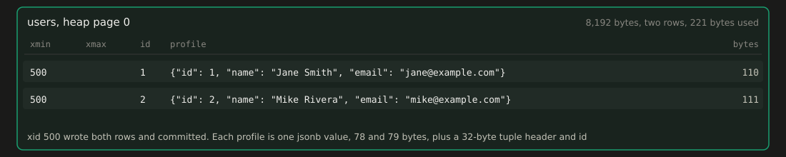

---

<!-- _class: code-md bul-sm -->

# One year in

```json
-- row 1, version 2, after a year of features: 688 bytes
{"id": 1, "name": "Jane Smith-Rivera", "email": "jane@example.com",
 "spouse": {"id": 2, "name": "Mike Rivera"},
 "addresses": [{"type": "home", "line1": "14 Bryant Park Pl",
                "city": "New York", "zip": "10018"},
               {"type": "work", "line1": "350 Fifth Ave",
                "city": "New York", "zip": "10118"}],
 "preferences": {"theme": "dark", "language": "en-US",
                 "notifications": {"email": true, "sms": false, "push": true}},
 "login_history": ["2026-11-01T08:12:00Z", "2026-11-03T18:40:11Z",
                   "2026-11-09T07:55:43Z", "2026-11-14T21:03:27Z",
                   "2026-11-17T06:48:09Z"],
 "updated_at": "2026-11-18T18:30:00Z"}
```

- Version 1 of row 1 is dead. Its 110 bytes fit nothing in this table any more
- `profile || '{"theme": "light"}'` rewrites all 688 bytes, not the 17 you changed
- One login a day in `login_history`: 250 KB of dead versions per user per year

---

# A year of logins on one row

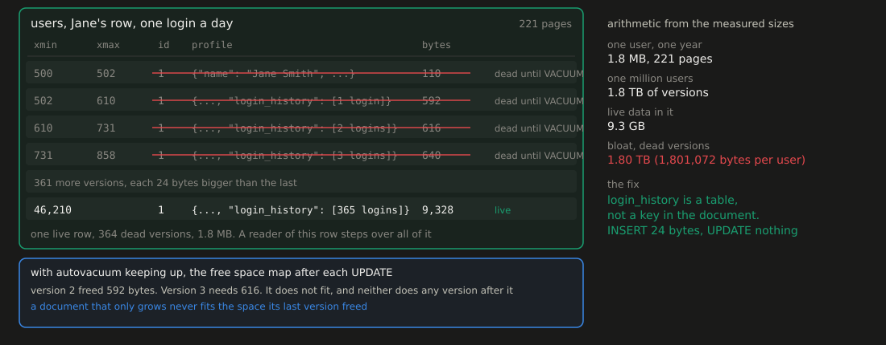

---

<!-- _class: vcenter -->

# It's always connections

- The reader steps over 364 dead versions to find the live one
- 221 pages where there should be one. The row is a disk read, not a cache hit
- Every query holds its connection for the extra pages. Same traffic, longer holds
- The pool opens more connections to keep up, months after the schema decision
- Autovacuum reads and rewrites the same pages, competing with the queries for the disk

---

# Same traffic, longer holds

<svg xmlns="http://www.w3.org/2000/svg" id="pool-bloat-svg" width="1150" height="470" viewBox="0 0 1100 450" font-family="DejaVu Sans, system-ui, sans-serif">
<rect width="1100" height="450" fill="#1a1a19"/>
<rect x="110" y="70" width="150" height="56" rx="8" fill="#3987e5" fill-opacity="0.12" stroke="#3987e5" stroke-width="1.5"/>
<text x="185.0" y="95" fill="#f0efec" font-size="14" text-anchor="middle">app instance</text>
<text x="185.0" y="114" fill="#c3c2b7" font-size="12" text-anchor="middle">pool of 20 clients</text>
<rect x="110" y="150" width="150" height="56" rx="8" fill="#3987e5" fill-opacity="0.12" stroke="#3987e5" stroke-width="1.5"/>
<text x="185.0" y="175" fill="#f0efec" font-size="14" text-anchor="middle">app instance</text>
<text x="185.0" y="194" fill="#c3c2b7" font-size="12" text-anchor="middle">pool of 20 clients</text>
<rect x="110" y="230" width="150" height="56" rx="8" fill="#3987e5" fill-opacity="0.12" stroke="#3987e5" stroke-width="1.5"/>
<text x="185.0" y="255" fill="#f0efec" font-size="14" text-anchor="middle">app instance</text>
<text x="185.0" y="274" fill="#c3c2b7" font-size="12" text-anchor="middle">pool of 20 clients</text>
<rect id="pb-tbl" x="20" y="318" width="150" height="56" rx="8" fill="#199e70" fill-opacity="0.14" stroke="#199e70" stroke-width="1.5"/>
<text x="95.0" y="342" fill="#f0efec" font-size="14" text-anchor="middle">users table</text>
<text id="pb-pg-ok" x="95.0" y="361" fill="#199e70" font-size="12" text-anchor="middle">1 page per row</text>
<text id="pb-pg1" x="95.0" y="361" fill="#e0a52a" font-size="12" text-anchor="middle" opacity="0">20 pages per row</text>
<text id="pb-pg2" x="95.0" y="361" fill="#e0a52a" font-size="12" text-anchor="middle" opacity="0">80 pages per row</text>
<text id="pb-pg3" x="95.0" y="361" fill="#e0a52a" font-size="12" text-anchor="middle" opacity="0">150 pages per row</text>
<text id="pb-pg4" x="95.0" y="361" fill="#e5484d" font-size="12" text-anchor="middle" opacity="0">221 pages per row</text>
<line id="pb-ln1" x1="260" y1="76" x2="380" y2="80" stroke="#d95926" stroke-width="1.3"/>
<line id="pb-ln2" x1="260" y1="156" x2="380" y2="176" stroke="#d95926" stroke-width="1.3"/>
<line id="pb-ln3" x1="260" y1="236" x2="380" y2="272" stroke="#d95926" stroke-width="1.3"/>
<line id="pb-ln4" x1="260" y1="83" x2="380" y2="92" stroke="#d95926" stroke-width="1.3"/>
<line id="pb-ln5" x1="260" y1="163" x2="380" y2="188" stroke="#d95926" stroke-width="1.3"/>
<line id="pb-ln6" x1="260" y1="245" x2="380" y2="286" stroke="#d95926" stroke-width="1.3"/>
<line id="pb-ln7" x1="260" y1="91" x2="380" y2="103" stroke="#d95926" stroke-width="1.3"/>
<line id="pb-ln8" x1="260" y1="171" x2="380" y2="199" stroke="#d95926" stroke-width="1.3"/>
<line id="pb-ln9" x1="260" y1="254" x2="380" y2="300" stroke="#d95926" stroke-width="1.3"/>
<line id="pb-ln10" x1="260" y1="98" x2="380" y2="115" stroke="#d95926" stroke-width="1.3"/>
<line id="pb-ln11" x1="260" y1="178" x2="380" y2="211" stroke="#d95926" stroke-width="1.3"/>
<line id="pb-ln12" x1="260" y1="262" x2="380" y2="314" stroke="#d95926" stroke-width="1.3"/>
<line id="pb-ln13" x1="260" y1="105" x2="380" y2="127" stroke="#d95926" stroke-width="1.3"/>
<line id="pb-ln14" x1="260" y1="185" x2="380" y2="223" stroke="#d95926" stroke-width="1.3"/>
<line id="pb-ln15" x1="260" y1="271" x2="380" y2="328" stroke="#d95926" stroke-width="1.3"/>
<line id="pb-ln16" x1="260" y1="113" x2="380" y2="138" stroke="#d95926" stroke-width="1.3"/>
<line id="pb-ln17" x1="260" y1="193" x2="380" y2="234" stroke="#d95926" stroke-width="1.3"/>
<line id="pb-ln18" x1="260" y1="280" x2="380" y2="342" stroke="#d95926" stroke-width="1.3"/>
<line id="pb-ln19" x1="260" y1="120" x2="380" y2="150" stroke="#d95926" stroke-width="1.3"/>
<line id="pb-ln20" x1="260" y1="200" x2="380" y2="246" stroke="#d95926" stroke-width="1.3"/>
<path d="M 380,62 V 384 A 230.0,18 0 0 0 840,384 V 62" fill="#199e70" fill-opacity="0.08" stroke="#199e70" stroke-width="1.5"/>
<ellipse cx="610.0" cy="62" rx="230.0" ry="18" fill="#199e70" fill-opacity="0.22" stroke="#199e70" stroke-width="1.5"/>
<text x="610.0" y="106" fill="#f0efec" font-size="15" text-anchor="middle">Postgres: 5 server connections, grows to 20</text>
<rect id="pb-slot1" x="410" y="124" width="60" height="44" rx="6" fill="#d95926" fill-opacity="0.8" stroke="#d95926" stroke-width="1.5"/>
<text id="pb-lab1" x="440.0" y="150.0" fill="#f0efec" font-size="10" text-anchor="middle">query</text>
<rect id="pb-slot2" x="494" y="124" width="60" height="44" rx="6" fill="#d95926" fill-opacity="0.8" stroke="#d95926" stroke-width="1.5"/>
<text id="pb-lab2" x="524.0" y="150.0" fill="#f0efec" font-size="10" text-anchor="middle">query</text>
<rect id="pb-slot3" x="578" y="124" width="60" height="44" rx="6" fill="#d95926" fill-opacity="0.8" stroke="#d95926" stroke-width="1.5"/>
<text id="pb-lab3" x="608.0" y="150.0" fill="#f0efec" font-size="10" text-anchor="middle">query</text>
<rect id="pb-slot4" x="662" y="124" width="60" height="44" rx="6" fill="#d95926" fill-opacity="0.8" stroke="#d95926" stroke-width="1.5"/>
<text id="pb-lab4" x="692.0" y="150.0" fill="#f0efec" font-size="10" text-anchor="middle">query</text>
<rect id="pb-slot5" x="746" y="124" width="60" height="44" rx="6" fill="#d95926" fill-opacity="0.8" stroke="#d95926" stroke-width="1.5"/>
<text id="pb-lab5" x="776.0" y="150.0" fill="#f0efec" font-size="10" text-anchor="middle">query</text>
<rect id="pb-slot6" x="410" y="186" width="60" height="44" rx="6" fill="#d95926" fill-opacity="0.8" stroke="#d95926" stroke-width="1.5"/>
<text id="pb-lab6" x="440.0" y="212.0" fill="#f0efec" font-size="10" text-anchor="middle">query</text>
<text id="pb-new1" x="440.0" y="212.0" fill="#f0efec" font-size="10" text-anchor="middle" opacity="0">new</text>
<rect id="pb-slot7" x="494" y="186" width="60" height="44" rx="6" fill="#d95926" fill-opacity="0.8" stroke="#d95926" stroke-width="1.5"/>
<text id="pb-lab7" x="524.0" y="212.0" fill="#f0efec" font-size="10" text-anchor="middle">query</text>
<text id="pb-new2" x="524.0" y="212.0" fill="#f0efec" font-size="10" text-anchor="middle" opacity="0">new</text>
<rect id="pb-slot8" x="578" y="186" width="60" height="44" rx="6" fill="#d95926" fill-opacity="0.8" stroke="#d95926" stroke-width="1.5"/>
<text id="pb-lab8" x="608.0" y="212.0" fill="#f0efec" font-size="10" text-anchor="middle">query</text>
<text id="pb-new3" x="608.0" y="212.0" fill="#f0efec" font-size="10" text-anchor="middle" opacity="0">new</text>
<rect id="pb-slot9" x="662" y="186" width="60" height="44" rx="6" fill="#d95926" fill-opacity="0.8" stroke="#d95926" stroke-width="1.5"/>
<text id="pb-lab9" x="692.0" y="212.0" fill="#f0efec" font-size="10" text-anchor="middle">query</text>
<text id="pb-new4" x="692.0" y="212.0" fill="#f0efec" font-size="10" text-anchor="middle" opacity="0">new</text>
<rect id="pb-slot10" x="746" y="186" width="60" height="44" rx="6" fill="#d95926" fill-opacity="0.8" stroke="#d95926" stroke-width="1.5"/>
<text id="pb-lab10" x="776.0" y="212.0" fill="#f0efec" font-size="10" text-anchor="middle">query</text>
<text id="pb-new5" x="776.0" y="212.0" fill="#f0efec" font-size="10" text-anchor="middle" opacity="0">new</text>
<rect id="pb-slot11" x="410" y="248" width="60" height="44" rx="6" fill="#d95926" fill-opacity="0.8" stroke="#d95926" stroke-width="1.5"/>
<text id="pb-lab11" x="440.0" y="274.0" fill="#f0efec" font-size="10" text-anchor="middle">query</text>
<text id="pb-new6" x="440.0" y="274.0" fill="#f0efec" font-size="10" text-anchor="middle" opacity="0">new</text>
<rect id="pb-slot12" x="494" y="248" width="60" height="44" rx="6" fill="#d95926" fill-opacity="0.8" stroke="#d95926" stroke-width="1.5"/>
<text id="pb-lab12" x="524.0" y="274.0" fill="#f0efec" font-size="10" text-anchor="middle">query</text>
<text id="pb-new7" x="524.0" y="274.0" fill="#f0efec" font-size="10" text-anchor="middle" opacity="0">new</text>
<rect id="pb-slot13" x="578" y="248" width="60" height="44" rx="6" fill="#d95926" fill-opacity="0.8" stroke="#d95926" stroke-width="1.5"/>
<text id="pb-lab13" x="608.0" y="274.0" fill="#f0efec" font-size="10" text-anchor="middle">query</text>
<text id="pb-new8" x="608.0" y="274.0" fill="#f0efec" font-size="10" text-anchor="middle" opacity="0">new</text>
<rect id="pb-slot14" x="662" y="248" width="60" height="44" rx="6" fill="#d95926" fill-opacity="0.8" stroke="#d95926" stroke-width="1.5"/>
<text id="pb-lab14" x="692.0" y="274.0" fill="#f0efec" font-size="10" text-anchor="middle">query</text>
<text id="pb-new9" x="692.0" y="274.0" fill="#f0efec" font-size="10" text-anchor="middle" opacity="0">new</text>
<rect id="pb-slot15" x="746" y="248" width="60" height="44" rx="6" fill="#d95926" fill-opacity="0.8" stroke="#d95926" stroke-width="1.5"/>
<text id="pb-lab15" x="776.0" y="274.0" fill="#f0efec" font-size="10" text-anchor="middle">query</text>
<text id="pb-new10" x="776.0" y="274.0" fill="#f0efec" font-size="10" text-anchor="middle" opacity="0">new</text>
<rect id="pb-slot16" x="410" y="310" width="60" height="44" rx="6" fill="#d95926" fill-opacity="0.8" stroke="#d95926" stroke-width="1.5"/>
<text id="pb-lab16" x="440.0" y="336.0" fill="#f0efec" font-size="10" text-anchor="middle">query</text>
<text id="pb-new11" x="440.0" y="336.0" fill="#f0efec" font-size="10" text-anchor="middle" opacity="0">new</text>
<rect id="pb-slot17" x="494" y="310" width="60" height="44" rx="6" fill="#d95926" fill-opacity="0.8" stroke="#d95926" stroke-width="1.5"/>
<text id="pb-lab17" x="524.0" y="336.0" fill="#f0efec" font-size="10" text-anchor="middle">query</text>
<text id="pb-new12" x="524.0" y="336.0" fill="#f0efec" font-size="10" text-anchor="middle" opacity="0">new</text>
<rect id="pb-slot18" x="578" y="310" width="60" height="44" rx="6" fill="#d95926" fill-opacity="0.8" stroke="#d95926" stroke-width="1.5"/>
<text id="pb-lab18" x="608.0" y="336.0" fill="#f0efec" font-size="10" text-anchor="middle">query</text>
<text id="pb-new13" x="608.0" y="336.0" fill="#f0efec" font-size="10" text-anchor="middle" opacity="0">new</text>
<rect id="pb-slot19" x="662" y="310" width="60" height="44" rx="6" fill="#d95926" fill-opacity="0.8" stroke="#d95926" stroke-width="1.5"/>
<text id="pb-lab19" x="692.0" y="336.0" fill="#f0efec" font-size="10" text-anchor="middle">query</text>
<text id="pb-new14" x="692.0" y="336.0" fill="#f0efec" font-size="10" text-anchor="middle" opacity="0">new</text>
<rect id="pb-slot20" x="746" y="310" width="60" height="44" rx="6" fill="#d95926" fill-opacity="0.8" stroke="#d95926" stroke-width="1.5"/>
<text id="pb-lab20" x="776.0" y="336.0" fill="#f0efec" font-size="10" text-anchor="middle">query</text>
<text id="pb-new15" x="776.0" y="336.0" fill="#f0efec" font-size="10" text-anchor="middle" opacity="0">new</text>
<text x="410" y="374" fill="#199e70" font-size="12" text-anchor="start">green: free</text>
<text x="530" y="374" fill="#d95926" font-size="12" text-anchor="start">orange: busy, reading dead versions to find the live row</text>
<rect id="pb-bslot1" x="494" y="124" width="60" height="44" rx="6" fill="#d95926" fill-opacity="0.8" stroke="#d95926" stroke-width="1.5" opacity="0"/>
<text id="pb-blab1" x="524.0" y="150.0" fill="#f0efec" font-size="10" text-anchor="middle" opacity="0">query</text>
<line id="pb-bln1" x1="260" y1="156" x2="380" y2="176" stroke="#d95926" stroke-width="1.3" opacity="0"/>
<rect id="pb-bslot2" x="662" y="124" width="60" height="44" rx="6" fill="#d95926" fill-opacity="0.8" stroke="#d95926" stroke-width="1.5" opacity="0"/>
<text id="pb-blab2" x="692.0" y="150.0" fill="#f0efec" font-size="10" text-anchor="middle" opacity="0">query</text>
<line id="pb-bln2" x1="260" y1="83" x2="380" y2="92" stroke="#d95926" stroke-width="1.3" opacity="0"/>
<rect id="pb-bslot3" x="410" y="124" width="60" height="44" rx="6" fill="#d95926" fill-opacity="0.8" stroke="#d95926" stroke-width="1.5" opacity="0"/>
<text id="pb-blab3" x="440.0" y="150.0" fill="#f0efec" font-size="10" text-anchor="middle" opacity="0">query</text>
<line id="pb-bln3" x1="260" y1="76" x2="380" y2="80" stroke="#d95926" stroke-width="1.3" opacity="0"/>
<rect id="pb-bslot4" x="578" y="124" width="60" height="44" rx="6" fill="#d95926" fill-opacity="0.8" stroke="#d95926" stroke-width="1.5" opacity="0"/>
<text id="pb-blab4" x="608.0" y="150.0" fill="#f0efec" font-size="10" text-anchor="middle" opacity="0">query</text>
<line id="pb-bln4" x1="260" y1="236" x2="380" y2="272" stroke="#d95926" stroke-width="1.3" opacity="0"/>
<rect id="pb-fail1" x="110" y="70" width="150" height="56" rx="8" fill="#e5484d" fill-opacity="0.18" stroke="#e5484d" stroke-width="2"/>
<line id="pb-strike1" x1="114" y1="122" x2="256" y2="74" stroke="#e5484d" stroke-width="3"/>
<rect id="pb-fail2" x="110" y="150" width="150" height="56" rx="8" fill="#e5484d" fill-opacity="0.18" stroke="#e5484d" stroke-width="2"/>
<line id="pb-strike2" x1="114" y1="202" x2="256" y2="154" stroke="#e5484d" stroke-width="3"/>
<rect id="pb-fail3" x="110" y="230" width="150" height="56" rx="8" fill="#e5484d" fill-opacity="0.18" stroke="#e5484d" stroke-width="2"/>
<line id="pb-strike3" x1="114" y1="282" x2="256" y2="234" stroke="#e5484d" stroke-width="3"/>
<text id="pb-cap1" x="20" y="438" fill="#f0efec" font-size="15" text-anchor="start" opacity="0">every query reads one page, holds its connection for a millisecond, and gives it back</text>
<text id="pb-cap2" x="20" y="438" fill="#f0efec" font-size="15" text-anchor="start" opacity="0">the table bloats. The same query reads 20 pages, then 80. Each one holds its connection longer</text>
<text id="pb-cap3" x="20" y="438" fill="#f0efec" font-size="15" text-anchor="start" opacity="0">no free connection, so the pool opens a few more. They fill the same way: same traffic, longer holds</text>
<text id="pb-cap4" x="20" y="438" fill="#f0efec" font-size="15" text-anchor="start" opacity="0">every server connection is busy reading dead versions. The pool is exhausted and the app is down</text>
<text id="pb-cap5" x="20" y="438" fill="#f0efec" font-size="15" text-anchor="start">221 pages per row. The database is saturated, the app is down, and not a line of code changed</text>
<rect x="1004" y="10" width="86" height="28" rx="6" fill="#1a1a19" fill-opacity="1" stroke="#383835" stroke-width="1.2"/>
<text id="pb-ctl-label" x="1047" y="29" fill="#c3c2b7" font-size="13" text-anchor="middle">pause (a)</text>
<rect x="908" y="10" width="86" height="28" rx="6" fill="#1a1a19" fill-opacity="1" stroke="#383835" stroke-width="1.2"/>
<text x="951" y="29" fill="#c3c2b7" font-size="13" text-anchor="middle">restart (r)</text>
<animate href="#pb-tbl" attributeName="fill" values="#e5484d;#e5484d;#199e70;#199e70;#e0a52a;#e0a52a;#e5484d;#e5484d" keyTimes="0.0000;0.0675;0.0692;0.2266;0.2284;0.5969;0.5986;1.0000" calcMode="discrete" dur="28.9s" repeatCount="indefinite"/>
<animate href="#pb-tbl" attributeName="stroke" values="#e5484d;#e5484d;#199e70;#199e70;#e0a52a;#e0a52a;#e5484d;#e5484d" keyTimes="0.0000;0.0675;0.0692;0.2266;0.2284;0.5969;0.5986;1.0000" calcMode="discrete" dur="28.9s" repeatCount="indefinite"/>
<animate href="#pb-pg-ok" attributeName="opacity" values="0;0;1;1;0;0" keyTimes="0.0000;0.0675;0.0692;0.2266;0.2284;1.0000" calcMode="discrete" dur="28.9s" repeatCount="indefinite"/>
<animate href="#pb-pg1" attributeName="opacity" values="0;0;0;0;1;1;0;0" keyTimes="0.0000;0.0675;0.0692;0.2266;0.2284;0.3547;0.3564;1.0000" calcMode="discrete" dur="28.9s" repeatCount="indefinite"/>
<animate href="#pb-pg2" attributeName="opacity" values="0;0;0;0;1;1;0;0" keyTimes="0.0000;0.0675;0.0692;0.3547;0.3564;0.4758;0.4775;1.0000" calcMode="discrete" dur="28.9s" repeatCount="indefinite"/>
<animate href="#pb-pg3" attributeName="opacity" values="0;0;0;0;1;1;0;0" keyTimes="0.0000;0.0675;0.0692;0.4758;0.4775;0.5969;0.5986;1.0000" calcMode="discrete" dur="28.9s" repeatCount="indefinite"/>
<animate href="#pb-pg4" attributeName="opacity" values="1;1;0;0;1;1" keyTimes="0.0000;0.0675;0.0692;0.5969;0.5986;1.0000" calcMode="discrete" dur="28.9s" repeatCount="indefinite"/>
<animate href="#pb-ln1" attributeName="stroke" values="#d95926;#d95926;#199e70;#199e70;#d95926;#d95926" keyTimes="0.0000;0.0675;0.0692;0.2474;0.2491;1.0000" calcMode="discrete" dur="28.9s" repeatCount="indefinite"/>
<animate href="#pb-ln2" attributeName="stroke" values="#d95926;#d95926;#199e70;#199e70;#d95926;#d95926" keyTimes="0.0000;0.0675;0.0692;0.2647;0.2664;1.0000" calcMode="discrete" dur="28.9s" repeatCount="indefinite"/>
<animate href="#pb-ln3" attributeName="stroke" values="#d95926;#d95926;#199e70;#199e70;#d95926;#d95926" keyTimes="0.0000;0.0675;0.0692;0.2820;0.2837;1.0000" calcMode="discrete" dur="28.9s" repeatCount="indefinite"/>
<animate href="#pb-ln4" attributeName="stroke" values="#d95926;#d95926;#199e70;#199e70;#d95926;#d95926" keyTimes="0.0000;0.0675;0.0692;0.2993;0.3010;1.0000" calcMode="discrete" dur="28.9s" repeatCount="indefinite"/>
<animate href="#pb-ln5" attributeName="stroke" values="#d95926;#d95926;#199e70;#199e70;#d95926;#d95926" keyTimes="0.0000;0.0675;0.0692;0.3166;0.3183;1.0000" calcMode="discrete" dur="28.9s" repeatCount="indefinite"/>
<animate href="#pb-ln6" attributeName="stroke" values="#d95926;#d95926;#199e70;#199e70;#d95926;#d95926" keyTimes="0.0000;0.0675;0.0692;0.3547;0.3564;1.0000" calcMode="discrete" dur="28.9s" repeatCount="indefinite"/>
<animate href="#pb-ln6" attributeName="opacity" values="1;1;0;0;1;1" keyTimes="0.0000;0.0675;0.0692;0.3374;0.3391;1.0000" calcMode="discrete" dur="28.9s" repeatCount="indefinite"/>
<animate href="#pb-ln7" attributeName="stroke" values="#d95926;#d95926;#199e70;#199e70;#d95926;#d95926" keyTimes="0.0000;0.0675;0.0692;0.3824;0.3841;1.0000" calcMode="discrete" dur="28.9s" repeatCount="indefinite"/>
<animate href="#pb-ln7" attributeName="opacity" values="1;1;0;0;1;1" keyTimes="0.0000;0.0675;0.0692;0.3374;0.3391;1.0000" calcMode="discrete" dur="28.9s" repeatCount="indefinite"/>
<animate href="#pb-ln8" attributeName="stroke" values="#d95926;#d95926;#199e70;#199e70;#d95926;#d95926" keyTimes="0.0000;0.0675;0.0692;0.4100;0.4118;1.0000" calcMode="discrete" dur="28.9s" repeatCount="indefinite"/>
<animate href="#pb-ln8" attributeName="opacity" values="1;1;0;0;1;1" keyTimes="0.0000;0.0675;0.0692;0.3374;0.3391;1.0000" calcMode="discrete" dur="28.9s" repeatCount="indefinite"/>
<animate href="#pb-ln9" attributeName="stroke" values="#d95926;#d95926;#199e70;#199e70;#d95926;#d95926" keyTimes="0.0000;0.0675;0.0692;0.4377;0.4394;1.0000" calcMode="discrete" dur="28.9s" repeatCount="indefinite"/>
<animate href="#pb-ln9" attributeName="opacity" values="1;1;0;0;1;1" keyTimes="0.0000;0.0675;0.0692;0.3374;0.3391;1.0000" calcMode="discrete" dur="28.9s" repeatCount="indefinite"/>
<animate href="#pb-ln10" attributeName="stroke" values="#d95926;#d95926;#199e70;#199e70;#d95926;#d95926" keyTimes="0.0000;0.0675;0.0692;0.4758;0.4775;1.0000" calcMode="discrete" dur="28.9s" repeatCount="indefinite"/>
<animate href="#pb-ln10" attributeName="opacity" values="1;1;0;0;1;1" keyTimes="0.0000;0.0675;0.0692;0.4585;0.4602;1.0000" calcMode="discrete" dur="28.9s" repeatCount="indefinite"/>
<animate href="#pb-ln11" attributeName="stroke" values="#d95926;#d95926;#199e70;#199e70;#d95926;#d95926" keyTimes="0.0000;0.0675;0.0692;0.5035;0.5052;1.0000" calcMode="discrete" dur="28.9s" repeatCount="indefinite"/>
<animate href="#pb-ln11" attributeName="opacity" values="1;1;0;0;1;1" keyTimes="0.0000;0.0675;0.0692;0.4585;0.4602;1.0000" calcMode="discrete" dur="28.9s" repeatCount="indefinite"/>
<animate href="#pb-ln12" attributeName="stroke" values="#d95926;#d95926;#199e70;#199e70;#d95926;#d95926" keyTimes="0.0000;0.0675;0.0692;0.5311;0.5329;1.0000" calcMode="discrete" dur="28.9s" repeatCount="indefinite"/>
<animate href="#pb-ln12" attributeName="opacity" values="1;1;0;0;1;1" keyTimes="0.0000;0.0675;0.0692;0.4585;0.4602;1.0000" calcMode="discrete" dur="28.9s" repeatCount="indefinite"/>
<animate href="#pb-ln13" attributeName="stroke" values="#d95926;#d95926;#199e70;#199e70;#d95926;#d95926" keyTimes="0.0000;0.0675;0.0692;0.5588;0.5606;1.0000" calcMode="discrete" dur="28.9s" repeatCount="indefinite"/>
<animate href="#pb-ln13" attributeName="opacity" values="1;1;0;0;1;1" keyTimes="0.0000;0.0675;0.0692;0.4585;0.4602;1.0000" calcMode="discrete" dur="28.9s" repeatCount="indefinite"/>
<animate href="#pb-ln14" attributeName="stroke" values="#d95926;#d95926;#199e70;#199e70;#d95926;#d95926" keyTimes="0.0000;0.0675;0.0692;0.5969;0.5986;1.0000" calcMode="discrete" dur="28.9s" repeatCount="indefinite"/>
<animate href="#pb-ln14" attributeName="opacity" values="1;1;0;0;1;1" keyTimes="0.0000;0.0675;0.0692;0.5796;0.5813;1.0000" calcMode="discrete" dur="28.9s" repeatCount="indefinite"/>
<animate href="#pb-ln15" attributeName="stroke" values="#d95926;#d95926;#199e70;#199e70;#d95926;#d95926" keyTimes="0.0000;0.0675;0.0692;0.6246;0.6263;1.0000" calcMode="discrete" dur="28.9s" repeatCount="indefinite"/>
<animate href="#pb-ln15" attributeName="opacity" values="1;1;0;0;1;1" keyTimes="0.0000;0.0675;0.0692;0.5796;0.5813;1.0000" calcMode="discrete" dur="28.9s" repeatCount="indefinite"/>
<animate href="#pb-ln16" attributeName="stroke" values="#d95926;#d95926;#199e70;#199e70;#d95926;#d95926" keyTimes="0.0000;0.0675;0.0692;0.6522;0.6540;1.0000" calcMode="discrete" dur="28.9s" repeatCount="indefinite"/>
<animate href="#pb-ln16" attributeName="opacity" values="1;1;0;0;1;1" keyTimes="0.0000;0.0675;0.0692;0.5796;0.5813;1.0000" calcMode="discrete" dur="28.9s" repeatCount="indefinite"/>
<animate href="#pb-ln17" attributeName="stroke" values="#d95926;#d95926;#199e70;#199e70;#d95926;#d95926" keyTimes="0.0000;0.0675;0.0692;0.6799;0.6817;1.0000" calcMode="discrete" dur="28.9s" repeatCount="indefinite"/>
<animate href="#pb-ln17" attributeName="opacity" values="1;1;0;0;1;1" keyTimes="0.0000;0.0675;0.0692;0.5796;0.5813;1.0000" calcMode="discrete" dur="28.9s" repeatCount="indefinite"/>
<animate href="#pb-ln18" attributeName="stroke" values="#d95926;#d95926;#199e70;#199e70;#d95926;#d95926" keyTimes="0.0000;0.0675;0.0692;0.7180;0.7197;1.0000" calcMode="discrete" dur="28.9s" repeatCount="indefinite"/>
<animate href="#pb-ln18" attributeName="opacity" values="1;1;0;0;1;1" keyTimes="0.0000;0.0675;0.0692;0.7007;0.7024;1.0000" calcMode="discrete" dur="28.9s" repeatCount="indefinite"/>
<animate href="#pb-ln19" attributeName="stroke" values="#d95926;#d95926;#199e70;#199e70;#d95926;#d95926" keyTimes="0.0000;0.0675;0.0692;0.7457;0.7474;1.0000" calcMode="discrete" dur="28.9s" repeatCount="indefinite"/>
<animate href="#pb-ln19" attributeName="opacity" values="1;1;0;0;1;1" keyTimes="0.0000;0.0675;0.0692;0.7007;0.7024;1.0000" calcMode="discrete" dur="28.9s" repeatCount="indefinite"/>
<animate href="#pb-ln20" attributeName="stroke" values="#d95926;#d95926;#199e70;#199e70;#d95926;#d95926" keyTimes="0.0000;0.0675;0.0692;0.7734;0.7751;1.0000" calcMode="discrete" dur="28.9s" repeatCount="indefinite"/>
<animate href="#pb-ln20" attributeName="opacity" values="1;1;0;0;1;1" keyTimes="0.0000;0.0675;0.0692;0.7007;0.7024;1.0000" calcMode="discrete" dur="28.9s" repeatCount="indefinite"/>
<animate href="#pb-slot1" attributeName="fill" values="#d95926;#d95926;#199e70;#199e70;#d95926;#d95926" keyTimes="0.0000;0.0675;0.0692;0.2474;0.2491;1.0000" calcMode="discrete" dur="28.9s" repeatCount="indefinite"/>
<animate href="#pb-slot1" attributeName="stroke" values="#d95926;#d95926;#199e70;#199e70;#d95926;#d95926" keyTimes="0.0000;0.0675;0.0692;0.2474;0.2491;1.0000" calcMode="discrete" dur="28.9s" repeatCount="indefinite"/>
<animate href="#pb-lab1" attributeName="opacity" values="1;1;0;0;1;1" keyTimes="0.0000;0.0675;0.0692;0.2474;0.2491;1.0000" calcMode="discrete" dur="28.9s" repeatCount="indefinite"/>
<animate href="#pb-slot2" attributeName="fill" values="#d95926;#d95926;#199e70;#199e70;#d95926;#d95926" keyTimes="0.0000;0.0675;0.0692;0.2647;0.2664;1.0000" calcMode="discrete" dur="28.9s" repeatCount="indefinite"/>
<animate href="#pb-slot2" attributeName="stroke" values="#d95926;#d95926;#199e70;#199e70;#d95926;#d95926" keyTimes="0.0000;0.0675;0.0692;0.2647;0.2664;1.0000" calcMode="discrete" dur="28.9s" repeatCount="indefinite"/>
<animate href="#pb-lab2" attributeName="opacity" values="1;1;0;0;1;1" keyTimes="0.0000;0.0675;0.0692;0.2647;0.2664;1.0000" calcMode="discrete" dur="28.9s" repeatCount="indefinite"/>
<animate href="#pb-slot3" attributeName="fill" values="#d95926;#d95926;#199e70;#199e70;#d95926;#d95926" keyTimes="0.0000;0.0675;0.0692;0.2820;0.2837;1.0000" calcMode="discrete" dur="28.9s" repeatCount="indefinite"/>
<animate href="#pb-slot3" attributeName="stroke" values="#d95926;#d95926;#199e70;#199e70;#d95926;#d95926" keyTimes="0.0000;0.0675;0.0692;0.2820;0.2837;1.0000" calcMode="discrete" dur="28.9s" repeatCount="indefinite"/>
<animate href="#pb-lab3" attributeName="opacity" values="1;1;0;0;1;1" keyTimes="0.0000;0.0675;0.0692;0.2820;0.2837;1.0000" calcMode="discrete" dur="28.9s" repeatCount="indefinite"/>
<animate href="#pb-slot4" attributeName="fill" values="#d95926;#d95926;#199e70;#199e70;#d95926;#d95926" keyTimes="0.0000;0.0675;0.0692;0.2993;0.3010;1.0000" calcMode="discrete" dur="28.9s" repeatCount="indefinite"/>
<animate href="#pb-slot4" attributeName="stroke" values="#d95926;#d95926;#199e70;#199e70;#d95926;#d95926" keyTimes="0.0000;0.0675;0.0692;0.2993;0.3010;1.0000" calcMode="discrete" dur="28.9s" repeatCount="indefinite"/>
<animate href="#pb-lab4" attributeName="opacity" values="1;1;0;0;1;1" keyTimes="0.0000;0.0675;0.0692;0.2993;0.3010;1.0000" calcMode="discrete" dur="28.9s" repeatCount="indefinite"/>
<animate href="#pb-slot5" attributeName="fill" values="#d95926;#d95926;#199e70;#199e70;#d95926;#d95926" keyTimes="0.0000;0.0675;0.0692;0.3166;0.3183;1.0000" calcMode="discrete" dur="28.9s" repeatCount="indefinite"/>
<animate href="#pb-slot5" attributeName="stroke" values="#d95926;#d95926;#199e70;#199e70;#d95926;#d95926" keyTimes="0.0000;0.0675;0.0692;0.3166;0.3183;1.0000" calcMode="discrete" dur="28.9s" repeatCount="indefinite"/>
<animate href="#pb-lab5" attributeName="opacity" values="1;1;0;0;1;1" keyTimes="0.0000;0.0675;0.0692;0.3166;0.3183;1.0000" calcMode="discrete" dur="28.9s" repeatCount="indefinite"/>
<animate href="#pb-slot6" attributeName="fill" values="#d95926;#d95926;#199e70;#199e70;#d95926;#d95926" keyTimes="0.0000;0.0675;0.0692;0.3547;0.3564;1.0000" calcMode="discrete" dur="28.9s" repeatCount="indefinite"/>
<animate href="#pb-slot6" attributeName="stroke" values="#d95926;#d95926;#199e70;#199e70;#d95926;#d95926" keyTimes="0.0000;0.0675;0.0692;0.3547;0.3564;1.0000" calcMode="discrete" dur="28.9s" repeatCount="indefinite"/>
<animate href="#pb-lab6" attributeName="opacity" values="1;1;0;0;1;1" keyTimes="0.0000;0.0675;0.0692;0.3547;0.3564;1.0000" calcMode="discrete" dur="28.9s" repeatCount="indefinite"/>
<animate href="#pb-slot6" attributeName="opacity" values="1;1;0;0;1;1" keyTimes="0.0000;0.0675;0.0692;0.3374;0.3391;1.0000" calcMode="discrete" dur="28.9s" repeatCount="indefinite"/>
<animate href="#pb-new1" attributeName="opacity" values="0;0;1;1;0;0" keyTimes="0.0000;0.3374;0.3391;0.3547;0.3564;1.0000" calcMode="discrete" dur="28.9s" repeatCount="indefinite"/>
<animate href="#pb-slot7" attributeName="fill" values="#d95926;#d95926;#199e70;#199e70;#d95926;#d95926" keyTimes="0.0000;0.0675;0.0692;0.3824;0.3841;1.0000" calcMode="discrete" dur="28.9s" repeatCount="indefinite"/>
<animate href="#pb-slot7" attributeName="stroke" values="#d95926;#d95926;#199e70;#199e70;#d95926;#d95926" keyTimes="0.0000;0.0675;0.0692;0.3824;0.3841;1.0000" calcMode="discrete" dur="28.9s" repeatCount="indefinite"/>
<animate href="#pb-lab7" attributeName="opacity" values="1;1;0;0;1;1" keyTimes="0.0000;0.0675;0.0692;0.3824;0.3841;1.0000" calcMode="discrete" dur="28.9s" repeatCount="indefinite"/>
<animate href="#pb-slot7" attributeName="opacity" values="1;1;0;0;1;1" keyTimes="0.0000;0.0675;0.0692;0.3374;0.3391;1.0000" calcMode="discrete" dur="28.9s" repeatCount="indefinite"/>
<animate href="#pb-new2" attributeName="opacity" values="0;0;1;1;0;0" keyTimes="0.0000;0.3374;0.3391;0.3824;0.3841;1.0000" calcMode="discrete" dur="28.9s" repeatCount="indefinite"/>
<animate href="#pb-slot8" attributeName="fill" values="#d95926;#d95926;#199e70;#199e70;#d95926;#d95926" keyTimes="0.0000;0.0675;0.0692;0.4100;0.4118;1.0000" calcMode="discrete" dur="28.9s" repeatCount="indefinite"/>
<animate href="#pb-slot8" attributeName="stroke" values="#d95926;#d95926;#199e70;#199e70;#d95926;#d95926" keyTimes="0.0000;0.0675;0.0692;0.4100;0.4118;1.0000" calcMode="discrete" dur="28.9s" repeatCount="indefinite"/>
<animate href="#pb-lab8" attributeName="opacity" values="1;1;0;0;1;1" keyTimes="0.0000;0.0675;0.0692;0.4100;0.4118;1.0000" calcMode="discrete" dur="28.9s" repeatCount="indefinite"/>
<animate href="#pb-slot8" attributeName="opacity" values="1;1;0;0;1;1" keyTimes="0.0000;0.0675;0.0692;0.3374;0.3391;1.0000" calcMode="discrete" dur="28.9s" repeatCount="indefinite"/>
<animate href="#pb-new3" attributeName="opacity" values="0;0;1;1;0;0" keyTimes="0.0000;0.3374;0.3391;0.4100;0.4118;1.0000" calcMode="discrete" dur="28.9s" repeatCount="indefinite"/>
<animate href="#pb-slot9" attributeName="fill" values="#d95926;#d95926;#199e70;#199e70;#d95926;#d95926" keyTimes="0.0000;0.0675;0.0692;0.4377;0.4394;1.0000" calcMode="discrete" dur="28.9s" repeatCount="indefinite"/>
<animate href="#pb-slot9" attributeName="stroke" values="#d95926;#d95926;#199e70;#199e70;#d95926;#d95926" keyTimes="0.0000;0.0675;0.0692;0.4377;0.4394;1.0000" calcMode="discrete" dur="28.9s" repeatCount="indefinite"/>
<animate href="#pb-lab9" attributeName="opacity" values="1;1;0;0;1;1" keyTimes="0.0000;0.0675;0.0692;0.4377;0.4394;1.0000" calcMode="discrete" dur="28.9s" repeatCount="indefinite"/>
<animate href="#pb-slot9" attributeName="opacity" values="1;1;0;0;1;1" keyTimes="0.0000;0.0675;0.0692;0.3374;0.3391;1.0000" calcMode="discrete" dur="28.9s" repeatCount="indefinite"/>
<animate href="#pb-new4" attributeName="opacity" values="0;0;1;1;0;0" keyTimes="0.0000;0.3374;0.3391;0.4377;0.4394;1.0000" calcMode="discrete" dur="28.9s" repeatCount="indefinite"/>
<animate href="#pb-slot10" attributeName="fill" values="#d95926;#d95926;#199e70;#199e70;#d95926;#d95926" keyTimes="0.0000;0.0675;0.0692;0.4758;0.4775;1.0000" calcMode="discrete" dur="28.9s" repeatCount="indefinite"/>
<animate href="#pb-slot10" attributeName="stroke" values="#d95926;#d95926;#199e70;#199e70;#d95926;#d95926" keyTimes="0.0000;0.0675;0.0692;0.4758;0.4775;1.0000" calcMode="discrete" dur="28.9s" repeatCount="indefinite"/>
<animate href="#pb-lab10" attributeName="opacity" values="1;1;0;0;1;1" keyTimes="0.0000;0.0675;0.0692;0.4758;0.4775;1.0000" calcMode="discrete" dur="28.9s" repeatCount="indefinite"/>
<animate href="#pb-slot10" attributeName="opacity" values="1;1;0;0;1;1" keyTimes="0.0000;0.0675;0.0692;0.4585;0.4602;1.0000" calcMode="discrete" dur="28.9s" repeatCount="indefinite"/>
<animate href="#pb-new5" attributeName="opacity" values="0;0;1;1;0;0" keyTimes="0.0000;0.4585;0.4602;0.4758;0.4775;1.0000" calcMode="discrete" dur="28.9s" repeatCount="indefinite"/>
<animate href="#pb-slot11" attributeName="fill" values="#d95926;#d95926;#199e70;#199e70;#d95926;#d95926" keyTimes="0.0000;0.0675;0.0692;0.5035;0.5052;1.0000" calcMode="discrete" dur="28.9s" repeatCount="indefinite"/>
<animate href="#pb-slot11" attributeName="stroke" values="#d95926;#d95926;#199e70;#199e70;#d95926;#d95926" keyTimes="0.0000;0.0675;0.0692;0.5035;0.5052;1.0000" calcMode="discrete" dur="28.9s" repeatCount="indefinite"/>
<animate href="#pb-lab11" attributeName="opacity" values="1;1;0;0;1;1" keyTimes="0.0000;0.0675;0.0692;0.5035;0.5052;1.0000" calcMode="discrete" dur="28.9s" repeatCount="indefinite"/>
<animate href="#pb-slot11" attributeName="opacity" values="1;1;0;0;1;1" keyTimes="0.0000;0.0675;0.0692;0.4585;0.4602;1.0000" calcMode="discrete" dur="28.9s" repeatCount="indefinite"/>
<animate href="#pb-new6" attributeName="opacity" values="0;0;1;1;0;0" keyTimes="0.0000;0.4585;0.4602;0.5035;0.5052;1.0000" calcMode="discrete" dur="28.9s" repeatCount="indefinite"/>
<animate href="#pb-slot12" attributeName="fill" values="#d95926;#d95926;#199e70;#199e70;#d95926;#d95926" keyTimes="0.0000;0.0675;0.0692;0.5311;0.5329;1.0000" calcMode="discrete" dur="28.9s" repeatCount="indefinite"/>
<animate href="#pb-slot12" attributeName="stroke" values="#d95926;#d95926;#199e70;#199e70;#d95926;#d95926" keyTimes="0.0000;0.0675;0.0692;0.5311;0.5329;1.0000" calcMode="discrete" dur="28.9s" repeatCount="indefinite"/>
<animate href="#pb-lab12" attributeName="opacity" values="1;1;0;0;1;1" keyTimes="0.0000;0.0675;0.0692;0.5311;0.5329;1.0000" calcMode="discrete" dur="28.9s" repeatCount="indefinite"/>
<animate href="#pb-slot12" attributeName="opacity" values="1;1;0;0;1;1" keyTimes="0.0000;0.0675;0.0692;0.4585;0.4602;1.0000" calcMode="discrete" dur="28.9s" repeatCount="indefinite"/>
<animate href="#pb-new7" attributeName="opacity" values="0;0;1;1;0;0" keyTimes="0.0000;0.4585;0.4602;0.5311;0.5329;1.0000" calcMode="discrete" dur="28.9s" repeatCount="indefinite"/>
<animate href="#pb-slot13" attributeName="fill" values="#d95926;#d95926;#199e70;#199e70;#d95926;#d95926" keyTimes="0.0000;0.0675;0.0692;0.5588;0.5606;1.0000" calcMode="discrete" dur="28.9s" repeatCount="indefinite"/>
<animate href="#pb-slot13" attributeName="stroke" values="#d95926;#d95926;#199e70;#199e70;#d95926;#d95926" keyTimes="0.0000;0.0675;0.0692;0.5588;0.5606;1.0000" calcMode="discrete" dur="28.9s" repeatCount="indefinite"/>
<animate href="#pb-lab13" attributeName="opacity" values="1;1;0;0;1;1" keyTimes="0.0000;0.0675;0.0692;0.5588;0.5606;1.0000" calcMode="discrete" dur="28.9s" repeatCount="indefinite"/>
<animate href="#pb-slot13" attributeName="opacity" values="1;1;0;0;1;1" keyTimes="0.0000;0.0675;0.0692;0.4585;0.4602;1.0000" calcMode="discrete" dur="28.9s" repeatCount="indefinite"/>
<animate href="#pb-new8" attributeName="opacity" values="0;0;1;1;0;0" keyTimes="0.0000;0.4585;0.4602;0.5588;0.5606;1.0000" calcMode="discrete" dur="28.9s" repeatCount="indefinite"/>
<animate href="#pb-slot14" attributeName="fill" values="#d95926;#d95926;#199e70;#199e70;#d95926;#d95926" keyTimes="0.0000;0.0675;0.0692;0.5969;0.5986;1.0000" calcMode="discrete" dur="28.9s" repeatCount="indefinite"/>
<animate href="#pb-slot14" attributeName="stroke" values="#d95926;#d95926;#199e70;#199e70;#d95926;#d95926" keyTimes="0.0000;0.0675;0.0692;0.5969;0.5986;1.0000" calcMode="discrete" dur="28.9s" repeatCount="indefinite"/>
<animate href="#pb-lab14" attributeName="opacity" values="1;1;0;0;1;1" keyTimes="0.0000;0.0675;0.0692;0.5969;0.5986;1.0000" calcMode="discrete" dur="28.9s" repeatCount="indefinite"/>
<animate href="#pb-slot14" attributeName="opacity" values="1;1;0;0;1;1" keyTimes="0.0000;0.0675;0.0692;0.5796;0.5813;1.0000" calcMode="discrete" dur="28.9s" repeatCount="indefinite"/>
<animate href="#pb-new9" attributeName="opacity" values="0;0;1;1;0;0" keyTimes="0.0000;0.5796;0.5813;0.5969;0.5986;1.0000" calcMode="discrete" dur="28.9s" repeatCount="indefinite"/>
<animate href="#pb-slot15" attributeName="fill" values="#d95926;#d95926;#199e70;#199e70;#d95926;#d95926" keyTimes="0.0000;0.0675;0.0692;0.6246;0.6263;1.0000" calcMode="discrete" dur="28.9s" repeatCount="indefinite"/>
<animate href="#pb-slot15" attributeName="stroke" values="#d95926;#d95926;#199e70;#199e70;#d95926;#d95926" keyTimes="0.0000;0.0675;0.0692;0.6246;0.6263;1.0000" calcMode="discrete" dur="28.9s" repeatCount="indefinite"/>
<animate href="#pb-lab15" attributeName="opacity" values="1;1;0;0;1;1" keyTimes="0.0000;0.0675;0.0692;0.6246;0.6263;1.0000" calcMode="discrete" dur="28.9s" repeatCount="indefinite"/>
<animate href="#pb-slot15" attributeName="opacity" values="1;1;0;0;1;1" keyTimes="0.0000;0.0675;0.0692;0.5796;0.5813;1.0000" calcMode="discrete" dur="28.9s" repeatCount="indefinite"/>
<animate href="#pb-new10" attributeName="opacity" values="0;0;1;1;0;0" keyTimes="0.0000;0.5796;0.5813;0.6246;0.6263;1.0000" calcMode="discrete" dur="28.9s" repeatCount="indefinite"/>
<animate href="#pb-slot16" attributeName="fill" values="#d95926;#d95926;#199e70;#199e70;#d95926;#d95926" keyTimes="0.0000;0.0675;0.0692;0.6522;0.6540;1.0000" calcMode="discrete" dur="28.9s" repeatCount="indefinite"/>
<animate href="#pb-slot16" attributeName="stroke" values="#d95926;#d95926;#199e70;#199e70;#d95926;#d95926" keyTimes="0.0000;0.0675;0.0692;0.6522;0.6540;1.0000" calcMode="discrete" dur="28.9s" repeatCount="indefinite"/>
<animate href="#pb-lab16" attributeName="opacity" values="1;1;0;0;1;1" keyTimes="0.0000;0.0675;0.0692;0.6522;0.6540;1.0000" calcMode="discrete" dur="28.9s" repeatCount="indefinite"/>
<animate href="#pb-slot16" attributeName="opacity" values="1;1;0;0;1;1" keyTimes="0.0000;0.0675;0.0692;0.5796;0.5813;1.0000" calcMode="discrete" dur="28.9s" repeatCount="indefinite"/>
<animate href="#pb-new11" attributeName="opacity" values="0;0;1;1;0;0" keyTimes="0.0000;0.5796;0.5813;0.6522;0.6540;1.0000" calcMode="discrete" dur="28.9s" repeatCount="indefinite"/>
<animate href="#pb-slot17" attributeName="fill" values="#d95926;#d95926;#199e70;#199e70;#d95926;#d95926" keyTimes="0.0000;0.0675;0.0692;0.6799;0.6817;1.0000" calcMode="discrete" dur="28.9s" repeatCount="indefinite"/>
<animate href="#pb-slot17" attributeName="stroke" values="#d95926;#d95926;#199e70;#199e70;#d95926;#d95926" keyTimes="0.0000;0.0675;0.0692;0.6799;0.6817;1.0000" calcMode="discrete" dur="28.9s" repeatCount="indefinite"/>
<animate href="#pb-lab17" attributeName="opacity" values="1;1;0;0;1;1" keyTimes="0.0000;0.0675;0.0692;0.6799;0.6817;1.0000" calcMode="discrete" dur="28.9s" repeatCount="indefinite"/>
<animate href="#pb-slot17" attributeName="opacity" values="1;1;0;0;1;1" keyTimes="0.0000;0.0675;0.0692;0.5796;0.5813;1.0000" calcMode="discrete" dur="28.9s" repeatCount="indefinite"/>
<animate href="#pb-new12" attributeName="opacity" values="0;0;1;1;0;0" keyTimes="0.0000;0.5796;0.5813;0.6799;0.6817;1.0000" calcMode="discrete" dur="28.9s" repeatCount="indefinite"/>
<animate href="#pb-slot18" attributeName="fill" values="#d95926;#d95926;#199e70;#199e70;#d95926;#d95926" keyTimes="0.0000;0.0675;0.0692;0.7180;0.7197;1.0000" calcMode="discrete" dur="28.9s" repeatCount="indefinite"/>
<animate href="#pb-slot18" attributeName="stroke" values="#d95926;#d95926;#199e70;#199e70;#d95926;#d95926" keyTimes="0.0000;0.0675;0.0692;0.7180;0.7197;1.0000" calcMode="discrete" dur="28.9s" repeatCount="indefinite"/>
<animate href="#pb-lab18" attributeName="opacity" values="1;1;0;0;1;1" keyTimes="0.0000;0.0675;0.0692;0.7180;0.7197;1.0000" calcMode="discrete" dur="28.9s" repeatCount="indefinite"/>
<animate href="#pb-slot18" attributeName="opacity" values="1;1;0;0;1;1" keyTimes="0.0000;0.0675;0.0692;0.7007;0.7024;1.0000" calcMode="discrete" dur="28.9s" repeatCount="indefinite"/>
<animate href="#pb-new13" attributeName="opacity" values="0;0;1;1;0;0" keyTimes="0.0000;0.7007;0.7024;0.7180;0.7197;1.0000" calcMode="discrete" dur="28.9s" repeatCount="indefinite"/>
<animate href="#pb-slot19" attributeName="fill" values="#d95926;#d95926;#199e70;#199e70;#d95926;#d95926" keyTimes="0.0000;0.0675;0.0692;0.7457;0.7474;1.0000" calcMode="discrete" dur="28.9s" repeatCount="indefinite"/>
<animate href="#pb-slot19" attributeName="stroke" values="#d95926;#d95926;#199e70;#199e70;#d95926;#d95926" keyTimes="0.0000;0.0675;0.0692;0.7457;0.7474;1.0000" calcMode="discrete" dur="28.9s" repeatCount="indefinite"/>
<animate href="#pb-lab19" attributeName="opacity" values="1;1;0;0;1;1" keyTimes="0.0000;0.0675;0.0692;0.7457;0.7474;1.0000" calcMode="discrete" dur="28.9s" repeatCount="indefinite"/>
<animate href="#pb-slot19" attributeName="opacity" values="1;1;0;0;1;1" keyTimes="0.0000;0.0675;0.0692;0.7007;0.7024;1.0000" calcMode="discrete" dur="28.9s" repeatCount="indefinite"/>
<animate href="#pb-new14" attributeName="opacity" values="0;0;1;1;0;0" keyTimes="0.0000;0.7007;0.7024;0.7457;0.7474;1.0000" calcMode="discrete" dur="28.9s" repeatCount="indefinite"/>
<animate href="#pb-slot20" attributeName="fill" values="#d95926;#d95926;#199e70;#199e70;#d95926;#d95926" keyTimes="0.0000;0.0675;0.0692;0.7734;0.7751;1.0000" calcMode="discrete" dur="28.9s" repeatCount="indefinite"/>
<animate href="#pb-slot20" attributeName="stroke" values="#d95926;#d95926;#199e70;#199e70;#d95926;#d95926" keyTimes="0.0000;0.0675;0.0692;0.7734;0.7751;1.0000" calcMode="discrete" dur="28.9s" repeatCount="indefinite"/>
<animate href="#pb-lab20" attributeName="opacity" values="1;1;0;0;1;1" keyTimes="0.0000;0.0675;0.0692;0.7734;0.7751;1.0000" calcMode="discrete" dur="28.9s" repeatCount="indefinite"/>
<animate href="#pb-slot20" attributeName="opacity" values="1;1;0;0;1;1" keyTimes="0.0000;0.0675;0.0692;0.7007;0.7024;1.0000" calcMode="discrete" dur="28.9s" repeatCount="indefinite"/>
<animate href="#pb-new15" attributeName="opacity" values="0;0;1;1;0;0" keyTimes="0.0000;0.7007;0.7024;0.7734;0.7751;1.0000" calcMode="discrete" dur="28.9s" repeatCount="indefinite"/>
<animate href="#pb-bslot1" attributeName="opacity" values="0;0;1;1;0;0" keyTimes="0.0000;0.0952;0.0969;0.1055;0.1073;1.0000" calcMode="discrete" dur="28.9s" repeatCount="indefinite"/>
<animate href="#pb-blab1" attributeName="opacity" values="0;0;1;1;0;0" keyTimes="0.0000;0.0952;0.0969;0.1055;0.1073;1.0000" calcMode="discrete" dur="28.9s" repeatCount="indefinite"/>
<animate href="#pb-bln1" attributeName="opacity" values="0;0;1;1;0;0" keyTimes="0.0000;0.0952;0.0969;0.1055;0.1073;1.0000" calcMode="discrete" dur="28.9s" repeatCount="indefinite"/>
<animate href="#pb-bslot2" attributeName="opacity" values="0;0;1;1;0;0" keyTimes="0.0000;0.1332;0.1349;0.1436;0.1453;1.0000" calcMode="discrete" dur="28.9s" repeatCount="indefinite"/>
<animate href="#pb-blab2" attributeName="opacity" values="0;0;1;1;0;0" keyTimes="0.0000;0.1332;0.1349;0.1436;0.1453;1.0000" calcMode="discrete" dur="28.9s" repeatCount="indefinite"/>
<animate href="#pb-bln2" attributeName="opacity" values="0;0;1;1;0;0" keyTimes="0.0000;0.1332;0.1349;0.1436;0.1453;1.0000" calcMode="discrete" dur="28.9s" repeatCount="indefinite"/>
<animate href="#pb-bslot3" attributeName="opacity" values="0;0;1;1;0;0" keyTimes="0.0000;0.1713;0.1730;0.1817;0.1834;1.0000" calcMode="discrete" dur="28.9s" repeatCount="indefinite"/>
<animate href="#pb-blab3" attributeName="opacity" values="0;0;1;1;0;0" keyTimes="0.0000;0.1713;0.1730;0.1817;0.1834;1.0000" calcMode="discrete" dur="28.9s" repeatCount="indefinite"/>
<animate href="#pb-bln3" attributeName="opacity" values="0;0;1;1;0;0" keyTimes="0.0000;0.1713;0.1730;0.1817;0.1834;1.0000" calcMode="discrete" dur="28.9s" repeatCount="indefinite"/>
<animate href="#pb-bslot4" attributeName="opacity" values="0;0;1;1;0;0" keyTimes="0.0000;0.1747;0.1765;0.1851;0.1869;1.0000" calcMode="discrete" dur="28.9s" repeatCount="indefinite"/>
<animate href="#pb-blab4" attributeName="opacity" values="0;0;1;1;0;0" keyTimes="0.0000;0.1747;0.1765;0.1851;0.1869;1.0000" calcMode="discrete" dur="28.9s" repeatCount="indefinite"/>
<animate href="#pb-bln4" attributeName="opacity" values="0;0;1;1;0;0" keyTimes="0.0000;0.1747;0.1765;0.1851;0.1869;1.0000" calcMode="discrete" dur="28.9s" repeatCount="indefinite"/>
<animate href="#pb-fail1" attributeName="opacity" values="1;1;0;0;1;1" keyTimes="0.0000;0.0675;0.0692;0.7941;0.7958;1.0000" calcMode="discrete" dur="28.9s" repeatCount="indefinite"/>
<animate href="#pb-strike1" attributeName="opacity" values="1;1;0;0;1;1" keyTimes="0.0000;0.0675;0.0692;0.7941;0.7958;1.0000" calcMode="discrete" dur="28.9s" repeatCount="indefinite"/>
<animate href="#pb-fail2" attributeName="opacity" values="1;1;0;0;1;1" keyTimes="0.0000;0.0675;0.0692;0.8183;0.8201;1.0000" calcMode="discrete" dur="28.9s" repeatCount="indefinite"/>
<animate href="#pb-strike2" attributeName="opacity" values="1;1;0;0;1;1" keyTimes="0.0000;0.0675;0.0692;0.8183;0.8201;1.0000" calcMode="discrete" dur="28.9s" repeatCount="indefinite"/>
<animate href="#pb-fail3" attributeName="opacity" values="1;1;0;0;1;1" keyTimes="0.0000;0.0675;0.0692;0.8426;0.8443;1.0000" calcMode="discrete" dur="28.9s" repeatCount="indefinite"/>
<animate href="#pb-strike3" attributeName="opacity" values="1;1;0;0;1;1" keyTimes="0.0000;0.0675;0.0692;0.8426;0.8443;1.0000" calcMode="discrete" dur="28.9s" repeatCount="indefinite"/>
<animate href="#pb-cap1" attributeName="opacity" values="0;0;1;1;0;0" keyTimes="0.0000;0.0675;0.0692;0.2266;0.2284;1.0000" calcMode="discrete" dur="28.9s" repeatCount="indefinite"/>
<animate href="#pb-cap2" attributeName="opacity" values="0;0;1;1;0;0" keyTimes="0.0000;0.2266;0.2284;0.3374;0.3391;1.0000" calcMode="discrete" dur="28.9s" repeatCount="indefinite"/>
<animate href="#pb-cap3" attributeName="opacity" values="0;0;1;1;0;0" keyTimes="0.0000;0.3374;0.3391;0.7941;0.7958;1.0000" calcMode="discrete" dur="28.9s" repeatCount="indefinite"/>
<animate href="#pb-cap4" attributeName="opacity" values="0;0;1;1;0;0" keyTimes="0.0000;0.7941;0.7958;0.8945;0.8962;1.0000" calcMode="discrete" dur="28.9s" repeatCount="indefinite"/>
<animate href="#pb-cap5" attributeName="opacity" values="1;1;0;0;1;1" keyTimes="0.0000;0.0675;0.0692;0.8945;0.8962;1.0000" calcMode="discrete" dur="28.9s" repeatCount="indefinite"/>
<rect id="pb-ctl" x="1004" y="10" width="86" height="28" rx="6" fill="transparent" cursor="pointer"/>
<rect id="pb-ctl-restart" x="908" y="10" width="86" height="28" rx="6" fill="transparent" cursor="pointer"/>
<script>(function(){var svg=document.getElementById("pool-bloat-svg");if(!svg||!svg.pauseAnimations)return;var paused=false,label=document.getElementById("pb-ctl-label");function toggle(){paused=!paused;if(paused){svg.pauseAnimations();}else{svg.unpauseAnimations();}label.textContent=paused?"resume (a)":"pause (a)";}function restart(){svg.setCurrentTime(0);if(paused){svg.pauseAnimations();}else{svg.unpauseAnimations();}}document.getElementById("pb-ctl").addEventListener("click",toggle);document.getElementById("pb-ctl-restart").addEventListener("click",restart);document.addEventListener("keydown",function(e){if(e.key==="a"){toggle();}else if(e.key==="r"){restart();}});})();</script>
</svg>

---

<!-- _class: code-md -->

# The fix

- The document grows with every login, so every version is bigger than the gap the last one freed
- Facts that accumulate go in a table. The `users` row never changes again

```sql
-- before: one login rewrites the whole profile, 9,296 bytes by day 365
UPDATE users
   SET profile = jsonb_set(profile, '{login_history}',
                           profile->'login_history' || to_jsonb(now()))
 WHERE id = 1;

-- after: a table. INSERT one 40-byte row, UPDATE nothing
CREATE TABLE login_history (
       user_id       bigint       NOT NULL REFERENCES users (id),
       logged_in_at  timestamptz  NOT NULL DEFAULT now(),
       PRIMARY KEY (user_id, logged_in_at)
);

INSERT INTO login_history (user_id) VALUES (1);
```

---

<!-- _class: code-md -->

# Better, not best

- Overwrite a field instead of appending to a list. Every version is the same 110 bytes
- The gap vacuum frees fits the next version, so the table stops growing
- Still one dead version per login. Vacuum has to keep up, and a pinned horizon still bites

```sql
-- same size every time: replace last_login, keep no history in the document
UPDATE users
   SET profile = jsonb_set(profile, '{last_login}', to_jsonb(now()))
 WHERE id = 1;
```

---

# Mistake #2: we leave transactions open

```python
cur.execute("SELECT * FROM orders WHERE id = %s FOR UPDATE", (oid,))

resp = requests.post("https://api.payments-provider.com/v1/charges",     # HTTP to a third party
                     json={"card": card, "amount": amount})

cur.execute("UPDATE orders SET status = 'paid' WHERE id = %s", (oid,))
conn.commit()
```

<div style="height: 0.8em"></div>

- Autocommit is off*; the SELECT opened a transaction
- It holds the row lock, and it holds a transaction id
- In READ COMMITTED an xid pins the horizon the way a snapshot does

<small>* in psycopg2/3.  JDBC, others differ here</small>

---

<!-- _class: chart-slide -->

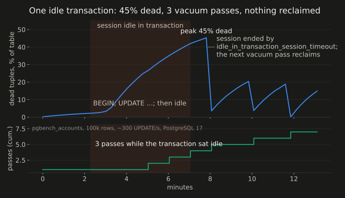

---

# What vacuum tells you

<pre><code class="language-text">INFO:  finished vacuuming "app.public.orders": index scans: 0
tuples: 0 removed, 1483112 remain, <b>612004 are dead but not yet removable</b>
removable cutoff: 982144, which was 61930 XIDs old when operation ended</code></pre>

"dead but not yet removable" with an old cutoff: someone holds the horizon.

| Holder | What it pins | Where to look |
|---|---|---|
| Report running 40 minutes * | snapshot (`xmin`) | `pg_stat_activity` |
| Nightly batch in one transaction | xid and snapshot | `pg_stat_activity` |
| `pg_dump` at noon | snapshot | `pg_stat_activity` |
| Physical slot with `hot_standby_feedback` | `xmin` for every table | `pg_replication_slots` |
| Logical slot nobody consumes | `catalog_xmin`; WAL is retained | `pg_replication_slots` |
| Prepared transaction nobody finished | `xmin`, indefinitely | `pg_prepared_xacts` |

<small>* A read-only transaction holds one too.</small>

---

# What happens when you can't vacuum

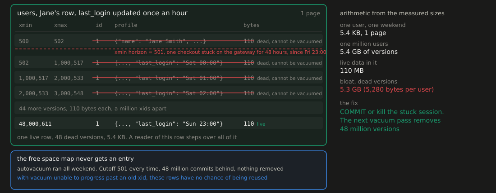

---

# Add a timeout?

```python
cur.execute("SELECT * FROM orders WHERE id = %s FOR UPDATE", (oid,))

resp = requests.post("https://api.payments-provider.com/v1/charges",     # HTTP to a third party
                     json={"card": card, "amount": amount}, timeout=30)  # ? to 30 seconds, sometimes never

cur.execute("UPDATE orders SET status = 'paid' WHERE id = %s", (oid,))
conn.commit()
```

<div style="height: 0.8em"></div>

- Autocommit is off*; the SELECT opened a transaction
- <= 30 second `idle in transaction`. At 300 commits a second, 9,000 can pile up
- It holds the row lock, and it holds a transaction id
- In READ COMMITTED an xid pins the horizon the way a snapshot does

<small>* in psycopg2/3.  JDBC, others differ here</small>

---

# It's always connections

<svg xmlns="http://www.w3.org/2000/svg" id="pool-svg" width="1150" height="470" viewBox="0 0 1100 450" font-family="DejaVu Sans, system-ui, sans-serif">
<rect width="1100" height="450" fill="#1a1a19"/>
<rect x="110" y="70" width="150" height="56" rx="8" fill="#3987e5" fill-opacity="0.12" stroke="#3987e5" stroke-width="1.5"/>
<text x="185.0" y="95" fill="#f0efec" font-size="14" text-anchor="middle">app instance</text>
<text x="185.0" y="114" fill="#c3c2b7" font-size="12" text-anchor="middle">pool of 20 clients</text>
<rect x="110" y="150" width="150" height="56" rx="8" fill="#3987e5" fill-opacity="0.12" stroke="#3987e5" stroke-width="1.5"/>
<text x="185.0" y="175" fill="#f0efec" font-size="14" text-anchor="middle">app instance</text>
<text x="185.0" y="194" fill="#c3c2b7" font-size="12" text-anchor="middle">pool of 20 clients</text>
<rect x="110" y="230" width="150" height="56" rx="8" fill="#3987e5" fill-opacity="0.12" stroke="#3987e5" stroke-width="1.5"/>
<text x="185.0" y="255" fill="#f0efec" font-size="14" text-anchor="middle">app instance</text>
<text x="185.0" y="274" fill="#c3c2b7" font-size="12" text-anchor="middle">pool of 20 clients</text>
<rect id="api" x="20" y="318" width="150" height="56" rx="8" fill="#199e70" fill-opacity="0.14" stroke="#199e70" stroke-width="1.5"/>
<text x="95.0" y="342" fill="#f0efec" font-size="14" text-anchor="middle">payments API</text>
<text id="rt-ok" x="95.0" y="361" fill="#199e70" font-size="12" text-anchor="middle">response: 50 ms</text>
<text id="rt1" x="95.0" y="361" fill="#e0a52a" font-size="12" text-anchor="middle" opacity="0">response: 200 ms</text>
<text id="rt2" x="95.0" y="361" fill="#e0a52a" font-size="12" text-anchor="middle" opacity="0">response: 800 ms</text>
<text id="rt3" x="95.0" y="361" fill="#e0a52a" font-size="12" text-anchor="middle" opacity="0">response: 2 s</text>
<text id="rt4" x="95.0" y="361" fill="#e0a52a" font-size="12" text-anchor="middle" opacity="0">response: 5 s</text>
<text id="rt5" x="95.0" y="361" fill="#e0a52a" font-size="12" text-anchor="middle" opacity="0">response: 10 s</text>
<text id="rt6" x="95.0" y="361" fill="#e5484d" font-size="12" text-anchor="middle" opacity="0">response: 20 s</text>
<line id="ln1" x1="260" y1="76" x2="380" y2="80" stroke="#e5484d" stroke-width="1.3"/>
<path id="call1" d="M 110,76 C 34,76 34,312 32,318" fill="none" stroke="#e0a52a" stroke-width="1.2" stroke-dasharray="4 3"/>
<line id="ln2" x1="260" y1="156" x2="380" y2="176" stroke="#e5484d" stroke-width="1.3"/>
<path id="call2" d="M 110,156 C 42,156 42,312 39,318" fill="none" stroke="#e0a52a" stroke-width="1.2" stroke-dasharray="4 3"/>
<line id="ln3" x1="260" y1="236" x2="380" y2="272" stroke="#e5484d" stroke-width="1.3"/>
<path id="call3" d="M 110,236 C 50,236 50,312 45,318" fill="none" stroke="#e0a52a" stroke-width="1.2" stroke-dasharray="4 3"/>
<line id="ln4" x1="260" y1="83" x2="380" y2="92" stroke="#e5484d" stroke-width="1.3"/>
<path id="call4" d="M 110,83 C 58,83 58,312 52,318" fill="none" stroke="#e0a52a" stroke-width="1.2" stroke-dasharray="4 3"/>
<line id="ln5" x1="260" y1="163" x2="380" y2="188" stroke="#e5484d" stroke-width="1.3"/>
<path id="call5" d="M 110,163 C 66,163 66,312 59,318" fill="none" stroke="#e0a52a" stroke-width="1.2" stroke-dasharray="4 3"/>
<line id="ln6" x1="260" y1="245" x2="380" y2="286" stroke="#e5484d" stroke-width="1.3"/>
<path id="call6" d="M 110,245 C 34,245 34,312 65,318" fill="none" stroke="#e0a52a" stroke-width="1.2" stroke-dasharray="4 3"/>
<line id="ln7" x1="260" y1="91" x2="380" y2="103" stroke="#e5484d" stroke-width="1.3"/>
<path id="call7" d="M 110,91 C 42,91 42,312 72,318" fill="none" stroke="#e0a52a" stroke-width="1.2" stroke-dasharray="4 3"/>
<line id="ln8" x1="260" y1="171" x2="380" y2="199" stroke="#e5484d" stroke-width="1.3"/>
<path id="call8" d="M 110,171 C 50,171 50,312 78,318" fill="none" stroke="#e0a52a" stroke-width="1.2" stroke-dasharray="4 3"/>
<line id="ln9" x1="260" y1="254" x2="380" y2="300" stroke="#e5484d" stroke-width="1.3"/>
<path id="call9" d="M 110,254 C 58,254 58,312 85,318" fill="none" stroke="#e0a52a" stroke-width="1.2" stroke-dasharray="4 3"/>
<line id="ln10" x1="260" y1="98" x2="380" y2="115" stroke="#e5484d" stroke-width="1.3"/>
<path id="call10" d="M 110,98 C 66,98 66,312 92,318" fill="none" stroke="#e0a52a" stroke-width="1.2" stroke-dasharray="4 3"/>
<line id="ln11" x1="260" y1="178" x2="380" y2="211" stroke="#e5484d" stroke-width="1.3"/>
<path id="call11" d="M 110,178 C 34,178 34,312 98,318" fill="none" stroke="#e0a52a" stroke-width="1.2" stroke-dasharray="4 3"/>
<line id="ln12" x1="260" y1="262" x2="380" y2="314" stroke="#e5484d" stroke-width="1.3"/>
<path id="call12" d="M 110,262 C 42,262 42,312 105,318" fill="none" stroke="#e0a52a" stroke-width="1.2" stroke-dasharray="4 3"/>
<line id="ln13" x1="260" y1="105" x2="380" y2="127" stroke="#e5484d" stroke-width="1.3"/>
<path id="call13" d="M 110,105 C 50,105 50,312 112,318" fill="none" stroke="#e0a52a" stroke-width="1.2" stroke-dasharray="4 3"/>
<line id="ln14" x1="260" y1="185" x2="380" y2="223" stroke="#e5484d" stroke-width="1.3"/>
<path id="call14" d="M 110,185 C 58,185 58,312 118,318" fill="none" stroke="#e0a52a" stroke-width="1.2" stroke-dasharray="4 3"/>
<line id="ln15" x1="260" y1="271" x2="380" y2="328" stroke="#e5484d" stroke-width="1.3"/>
<path id="call15" d="M 110,271 C 66,271 66,312 125,318" fill="none" stroke="#e0a52a" stroke-width="1.2" stroke-dasharray="4 3"/>
<line id="ln16" x1="260" y1="113" x2="380" y2="138" stroke="#e5484d" stroke-width="1.3"/>
<path id="call16" d="M 110,113 C 34,113 34,312 131,318" fill="none" stroke="#e0a52a" stroke-width="1.2" stroke-dasharray="4 3"/>
<line id="ln17" x1="260" y1="193" x2="380" y2="234" stroke="#e5484d" stroke-width="1.3"/>
<path id="call17" d="M 110,193 C 42,193 42,312 138,318" fill="none" stroke="#e0a52a" stroke-width="1.2" stroke-dasharray="4 3"/>
<line id="ln18" x1="260" y1="280" x2="380" y2="342" stroke="#e5484d" stroke-width="1.3"/>
<path id="call18" d="M 110,280 C 50,280 50,312 145,318" fill="none" stroke="#e0a52a" stroke-width="1.2" stroke-dasharray="4 3"/>
<line id="ln19" x1="260" y1="120" x2="380" y2="150" stroke="#e5484d" stroke-width="1.3"/>
<path id="call19" d="M 110,120 C 58,120 58,312 151,318" fill="none" stroke="#e0a52a" stroke-width="1.2" stroke-dasharray="4 3"/>
<line id="ln20" x1="260" y1="200" x2="380" y2="246" stroke="#e5484d" stroke-width="1.3"/>
<path id="call20" d="M 110,200 C 66,200 66,312 158,318" fill="none" stroke="#e0a52a" stroke-width="1.2" stroke-dasharray="4 3"/>
<path d="M 380,62 V 384 A 230.0,18 0 0 0 840,384 V 62" fill="#199e70" fill-opacity="0.08" stroke="#199e70" stroke-width="1.5"/>
<ellipse cx="610.0" cy="62" rx="230.0" ry="18" fill="#199e70" fill-opacity="0.22" stroke="#199e70" stroke-width="1.5"/>
<text x="610.0" y="106" fill="#f0efec" font-size="15" text-anchor="middle">Postgres: 5 server connections, grows to 20</text>
<rect id="slot1" x="410" y="124" width="60" height="44" rx="6" fill="#d95926" fill-opacity="0.8" stroke="#d95926" stroke-width="1.5"/>
<text id="lab1" x="440.0" y="150.0" fill="#f0efec" font-size="10" text-anchor="middle">idle in txn</text>
<rect id="slot2" x="494" y="124" width="60" height="44" rx="6" fill="#d95926" fill-opacity="0.8" stroke="#d95926" stroke-width="1.5"/>
<text id="lab2" x="524.0" y="150.0" fill="#f0efec" font-size="10" text-anchor="middle">idle in txn</text>
<rect id="slot3" x="578" y="124" width="60" height="44" rx="6" fill="#d95926" fill-opacity="0.8" stroke="#d95926" stroke-width="1.5"/>
<text id="lab3" x="608.0" y="150.0" fill="#f0efec" font-size="10" text-anchor="middle">idle in txn</text>
<rect id="slot4" x="662" y="124" width="60" height="44" rx="6" fill="#d95926" fill-opacity="0.8" stroke="#d95926" stroke-width="1.5"/>
<text id="lab4" x="692.0" y="150.0" fill="#f0efec" font-size="10" text-anchor="middle">idle in txn</text>
<rect id="slot5" x="746" y="124" width="60" height="44" rx="6" fill="#d95926" fill-opacity="0.8" stroke="#d95926" stroke-width="1.5"/>
<text id="lab5" x="776.0" y="150.0" fill="#f0efec" font-size="10" text-anchor="middle">idle in txn</text>
<rect id="slot6" x="410" y="186" width="60" height="44" rx="6" fill="#d95926" fill-opacity="0.8" stroke="#d95926" stroke-width="1.5"/>
<text id="lab6" x="440.0" y="212.0" fill="#f0efec" font-size="10" text-anchor="middle">idle in txn</text>
<text id="new1" x="440.0" y="212.0" fill="#f0efec" font-size="10" text-anchor="middle" opacity="0">new</text>
<rect id="slot7" x="494" y="186" width="60" height="44" rx="6" fill="#d95926" fill-opacity="0.8" stroke="#d95926" stroke-width="1.5"/>
<text id="lab7" x="524.0" y="212.0" fill="#f0efec" font-size="10" text-anchor="middle">idle in txn</text>
<text id="new2" x="524.0" y="212.0" fill="#f0efec" font-size="10" text-anchor="middle" opacity="0">new</text>
<rect id="slot8" x="578" y="186" width="60" height="44" rx="6" fill="#d95926" fill-opacity="0.8" stroke="#d95926" stroke-width="1.5"/>
<text id="lab8" x="608.0" y="212.0" fill="#f0efec" font-size="10" text-anchor="middle">idle in txn</text>
<text id="new3" x="608.0" y="212.0" fill="#f0efec" font-size="10" text-anchor="middle" opacity="0">new</text>
<rect id="slot9" x="662" y="186" width="60" height="44" rx="6" fill="#d95926" fill-opacity="0.8" stroke="#d95926" stroke-width="1.5"/>
<text id="lab9" x="692.0" y="212.0" fill="#f0efec" font-size="10" text-anchor="middle">idle in txn</text>
<text id="new4" x="692.0" y="212.0" fill="#f0efec" font-size="10" text-anchor="middle" opacity="0">new</text>
<rect id="slot10" x="746" y="186" width="60" height="44" rx="6" fill="#d95926" fill-opacity="0.8" stroke="#d95926" stroke-width="1.5"/>
<text id="lab10" x="776.0" y="212.0" fill="#f0efec" font-size="10" text-anchor="middle">idle in txn</text>
<text id="new5" x="776.0" y="212.0" fill="#f0efec" font-size="10" text-anchor="middle" opacity="0">new</text>
<rect id="slot11" x="410" y="248" width="60" height="44" rx="6" fill="#d95926" fill-opacity="0.8" stroke="#d95926" stroke-width="1.5"/>
<text id="lab11" x="440.0" y="274.0" fill="#f0efec" font-size="10" text-anchor="middle">idle in txn</text>
<text id="new6" x="440.0" y="274.0" fill="#f0efec" font-size="10" text-anchor="middle" opacity="0">new</text>
<rect id="slot12" x="494" y="248" width="60" height="44" rx="6" fill="#d95926" fill-opacity="0.8" stroke="#d95926" stroke-width="1.5"/>
<text id="lab12" x="524.0" y="274.0" fill="#f0efec" font-size="10" text-anchor="middle">idle in txn</text>
<text id="new7" x="524.0" y="274.0" fill="#f0efec" font-size="10" text-anchor="middle" opacity="0">new</text>
<rect id="slot13" x="578" y="248" width="60" height="44" rx="6" fill="#d95926" fill-opacity="0.8" stroke="#d95926" stroke-width="1.5"/>
<text id="lab13" x="608.0" y="274.0" fill="#f0efec" font-size="10" text-anchor="middle">idle in txn</text>
<text id="new8" x="608.0" y="274.0" fill="#f0efec" font-size="10" text-anchor="middle" opacity="0">new</text>
<rect id="slot14" x="662" y="248" width="60" height="44" rx="6" fill="#d95926" fill-opacity="0.8" stroke="#d95926" stroke-width="1.5"/>
<text id="lab14" x="692.0" y="274.0" fill="#f0efec" font-size="10" text-anchor="middle">idle in txn</text>
<text id="new9" x="692.0" y="274.0" fill="#f0efec" font-size="10" text-anchor="middle" opacity="0">new</text>
<rect id="slot15" x="746" y="248" width="60" height="44" rx="6" fill="#d95926" fill-opacity="0.8" stroke="#d95926" stroke-width="1.5"/>
<text id="lab15" x="776.0" y="274.0" fill="#f0efec" font-size="10" text-anchor="middle">idle in txn</text>
<text id="new10" x="776.0" y="274.0" fill="#f0efec" font-size="10" text-anchor="middle" opacity="0">new</text>
<rect id="slot16" x="410" y="310" width="60" height="44" rx="6" fill="#d95926" fill-opacity="0.8" stroke="#d95926" stroke-width="1.5"/>
<text id="lab16" x="440.0" y="336.0" fill="#f0efec" font-size="10" text-anchor="middle">idle in txn</text>
<text id="new11" x="440.0" y="336.0" fill="#f0efec" font-size="10" text-anchor="middle" opacity="0">new</text>
<rect id="slot17" x="494" y="310" width="60" height="44" rx="6" fill="#d95926" fill-opacity="0.8" stroke="#d95926" stroke-width="1.5"/>
<text id="lab17" x="524.0" y="336.0" fill="#f0efec" font-size="10" text-anchor="middle">idle in txn</text>
<text id="new12" x="524.0" y="336.0" fill="#f0efec" font-size="10" text-anchor="middle" opacity="0">new</text>
<rect id="slot18" x="578" y="310" width="60" height="44" rx="6" fill="#d95926" fill-opacity="0.8" stroke="#d95926" stroke-width="1.5"/>
<text id="lab18" x="608.0" y="336.0" fill="#f0efec" font-size="10" text-anchor="middle">idle in txn</text>
<text id="new13" x="608.0" y="336.0" fill="#f0efec" font-size="10" text-anchor="middle" opacity="0">new</text>
<rect id="slot19" x="662" y="310" width="60" height="44" rx="6" fill="#d95926" fill-opacity="0.8" stroke="#d95926" stroke-width="1.5"/>
<text id="lab19" x="692.0" y="336.0" fill="#f0efec" font-size="10" text-anchor="middle">idle in txn</text>
<text id="new14" x="692.0" y="336.0" fill="#f0efec" font-size="10" text-anchor="middle" opacity="0">new</text>
<rect id="slot20" x="746" y="310" width="60" height="44" rx="6" fill="#d95926" fill-opacity="0.8" stroke="#d95926" stroke-width="1.5"/>
<text id="lab20" x="776.0" y="336.0" fill="#f0efec" font-size="10" text-anchor="middle">idle in txn</text>
<text id="new15" x="776.0" y="336.0" fill="#f0efec" font-size="10" text-anchor="middle" opacity="0">new</text>
<text x="410" y="374" fill="#199e70" font-size="12" text-anchor="start">green: serving requests</text>
<text x="610" y="374" fill="#d95926" font-size="12" text-anchor="start">orange: held by a transaction waiting on HTTP</text>
<rect id="bslot1" x="494" y="124" width="60" height="44" rx="6" fill="#d95926" fill-opacity="0.8" stroke="#d95926" stroke-width="1.5" opacity="0"/>
<text id="blab1" x="524.0" y="150.0" fill="#f0efec" font-size="10" text-anchor="middle" opacity="0">idle in txn</text>
<line id="bln1" x1="260" y1="156" x2="380" y2="176" stroke="#e5484d" stroke-width="1.3" opacity="0"/>
<path id="bcall1" d="M 110,156 C 42,156 42,312 39,318" fill="none" stroke="#199e70" stroke-width="1.2" stroke-dasharray="4 3" opacity="0"/>
<rect id="bslot2" x="662" y="124" width="60" height="44" rx="6" fill="#d95926" fill-opacity="0.8" stroke="#d95926" stroke-width="1.5" opacity="0"/>
<text id="blab2" x="692.0" y="150.0" fill="#f0efec" font-size="10" text-anchor="middle" opacity="0">idle in txn</text>
<line id="bln2" x1="260" y1="83" x2="380" y2="92" stroke="#e5484d" stroke-width="1.3" opacity="0"/>
<path id="bcall2" d="M 110,83 C 58,83 58,312 52,318" fill="none" stroke="#199e70" stroke-width="1.2" stroke-dasharray="4 3" opacity="0"/>
<rect id="bslot3" x="410" y="124" width="60" height="44" rx="6" fill="#d95926" fill-opacity="0.8" stroke="#d95926" stroke-width="1.5" opacity="0"/>
<text id="blab3" x="440.0" y="150.0" fill="#f0efec" font-size="10" text-anchor="middle" opacity="0">idle in txn</text>
<line id="bln3" x1="260" y1="76" x2="380" y2="80" stroke="#e5484d" stroke-width="1.3" opacity="0"/>
<path id="bcall3" d="M 110,76 C 34,76 34,312 32,318" fill="none" stroke="#199e70" stroke-width="1.2" stroke-dasharray="4 3" opacity="0"/>
<rect id="bslot4" x="578" y="124" width="60" height="44" rx="6" fill="#d95926" fill-opacity="0.8" stroke="#d95926" stroke-width="1.5" opacity="0"/>
<text id="blab4" x="608.0" y="150.0" fill="#f0efec" font-size="10" text-anchor="middle" opacity="0">idle in txn</text>
<line id="bln4" x1="260" y1="236" x2="380" y2="272" stroke="#e5484d" stroke-width="1.3" opacity="0"/>
<path id="bcall4" d="M 110,236 C 50,236 50,312 45,318" fill="none" stroke="#199e70" stroke-width="1.2" stroke-dasharray="4 3" opacity="0"/>
<rect id="fail1" x="110" y="70" width="150" height="56" rx="8" fill="#e5484d" fill-opacity="0.18" stroke="#e5484d" stroke-width="2"/>
<line id="strike1" x1="114" y1="122" x2="256" y2="74" stroke="#e5484d" stroke-width="3"/>
<rect id="fail2" x="110" y="150" width="150" height="56" rx="8" fill="#e5484d" fill-opacity="0.18" stroke="#e5484d" stroke-width="2"/>
<line id="strike2" x1="114" y1="202" x2="256" y2="154" stroke="#e5484d" stroke-width="3"/>
<rect id="fail3" x="110" y="230" width="150" height="56" rx="8" fill="#e5484d" fill-opacity="0.18" stroke="#e5484d" stroke-width="2"/>
<line id="strike3" x1="114" y1="282" x2="256" y2="234" stroke="#e5484d" stroke-width="3"/>
<text id="cap1" x="20" y="438" fill="#f0efec" font-size="15" text-anchor="start" opacity="0">transactions open, call the payments API, and commit in 50 ms. A connection is idle in transaction for a moment, then free</text>
<text id="cap2" x="20" y="438" fill="#f0efec" font-size="15" text-anchor="start" opacity="0">the payments API slows down. A request opens a transaction, calls it, and holds its server connection while it waits</text>
<text id="cap3" x="20" y="438" fill="#f0efec" font-size="15" text-anchor="start" opacity="0">no free connection, so the pool opens a few more. Each request calls the API inside its transaction, and holds one</text>
<text id="cap4" x="20" y="438" fill="#f0efec" font-size="15" text-anchor="start" opacity="0">every server connection is held by a transaction waiting on HTTP. The pool is exhausted and the database is idle</text>
<text id="cap5" x="20" y="438" fill="#f0efec" font-size="15" text-anchor="start">the payments API recovers. Every connection is still held and every app instance is still stuck</text>
<rect x="1004" y="10" width="86" height="28" rx="6" fill="#1a1a19" fill-opacity="1" stroke="#383835" stroke-width="1.2"/>
<text id="ctl-label" x="1047" y="29" fill="#c3c2b7" font-size="13" text-anchor="middle">pause (a)</text>
<rect x="908" y="10" width="86" height="28" rx="6" fill="#1a1a19" fill-opacity="1" stroke="#383835" stroke-width="1.2"/>
<text x="951" y="29" fill="#c3c2b7" font-size="13" text-anchor="middle">restart (r)</text>
<animate href="#api" attributeName="fill" values="#199e70;#199e70;#e0a52a;#e0a52a;#199e70;#199e70" keyTimes="0.0000;0.2266;0.2284;0.8945;0.8962;1.0000" calcMode="discrete" dur="28.9s" repeatCount="indefinite"/>
<animate href="#api" attributeName="stroke" values="#199e70;#199e70;#e0a52a;#e0a52a;#199e70;#199e70" keyTimes="0.0000;0.2266;0.2284;0.8945;0.8962;1.0000" calcMode="discrete" dur="28.9s" repeatCount="indefinite"/>
<animate href="#rt-ok" attributeName="opacity" values="1;1;0;0;1;1" keyTimes="0.0000;0.2266;0.2284;0.8945;0.8962;1.0000" calcMode="discrete" dur="28.9s" repeatCount="indefinite"/>
<animate href="#rt1" attributeName="opacity" values="0;0;1;1;0;0" keyTimes="0.0000;0.2266;0.2284;0.3547;0.3564;1.0000" calcMode="discrete" dur="28.9s" repeatCount="indefinite"/>
<animate href="#rt2" attributeName="opacity" values="0;0;1;1;0;0" keyTimes="0.0000;0.3547;0.3564;0.4758;0.4775;1.0000" calcMode="discrete" dur="28.9s" repeatCount="indefinite"/>
<animate href="#rt3" attributeName="opacity" values="0;0;1;1;0;0" keyTimes="0.0000;0.4758;0.4775;0.5969;0.5986;1.0000" calcMode="discrete" dur="28.9s" repeatCount="indefinite"/>
<animate href="#rt4" attributeName="opacity" values="0;0;1;1;0;0" keyTimes="0.0000;0.5969;0.5986;0.7180;0.7197;1.0000" calcMode="discrete" dur="28.9s" repeatCount="indefinite"/>
<animate href="#rt5" attributeName="opacity" values="0;0;1;1;0;0" keyTimes="0.0000;0.7180;0.7197;0.7734;0.7751;1.0000" calcMode="discrete" dur="28.9s" repeatCount="indefinite"/>
<animate href="#rt6" attributeName="opacity" values="0;0;1;1;0;0" keyTimes="0.0000;0.7734;0.7751;0.8945;0.8962;1.0000" calcMode="discrete" dur="28.9s" repeatCount="indefinite"/>
<animate href="#ln1" attributeName="stroke" values="#e5484d;#e5484d;#199e70;#199e70;#e5484d;#e5484d" keyTimes="0.0000;0.0675;0.0692;0.2474;0.2491;1.0000" calcMode="discrete" dur="28.9s" repeatCount="indefinite"/>
<animate href="#call1" attributeName="opacity" values="1;1;0;0;1;1" keyTimes="0.0000;0.0675;0.0692;0.2474;0.2491;1.0000" calcMode="discrete" dur="28.9s" repeatCount="indefinite"/>
<animate href="#ln2" attributeName="stroke" values="#e5484d;#e5484d;#199e70;#199e70;#e5484d;#e5484d" keyTimes="0.0000;0.0675;0.0692;0.2647;0.2664;1.0000" calcMode="discrete" dur="28.9s" repeatCount="indefinite"/>
<animate href="#call2" attributeName="opacity" values="1;1;0;0;1;1" keyTimes="0.0000;0.0675;0.0692;0.2647;0.2664;1.0000" calcMode="discrete" dur="28.9s" repeatCount="indefinite"/>
<animate href="#ln3" attributeName="stroke" values="#e5484d;#e5484d;#199e70;#199e70;#e5484d;#e5484d" keyTimes="0.0000;0.0675;0.0692;0.2820;0.2837;1.0000" calcMode="discrete" dur="28.9s" repeatCount="indefinite"/>
<animate href="#call3" attributeName="opacity" values="1;1;0;0;1;1" keyTimes="0.0000;0.0675;0.0692;0.2820;0.2837;1.0000" calcMode="discrete" dur="28.9s" repeatCount="indefinite"/>
<animate href="#ln4" attributeName="stroke" values="#e5484d;#e5484d;#199e70;#199e70;#e5484d;#e5484d" keyTimes="0.0000;0.0675;0.0692;0.2993;0.3010;1.0000" calcMode="discrete" dur="28.9s" repeatCount="indefinite"/>
<animate href="#call4" attributeName="opacity" values="1;1;0;0;1;1" keyTimes="0.0000;0.0675;0.0692;0.2993;0.3010;1.0000" calcMode="discrete" dur="28.9s" repeatCount="indefinite"/>
<animate href="#ln5" attributeName="stroke" values="#e5484d;#e5484d;#199e70;#199e70;#e5484d;#e5484d" keyTimes="0.0000;0.0675;0.0692;0.3166;0.3183;1.0000" calcMode="discrete" dur="28.9s" repeatCount="indefinite"/>
<animate href="#call5" attributeName="opacity" values="1;1;0;0;1;1" keyTimes="0.0000;0.0675;0.0692;0.3166;0.3183;1.0000" calcMode="discrete" dur="28.9s" repeatCount="indefinite"/>
<animate href="#ln6" attributeName="stroke" values="#e5484d;#e5484d;#199e70;#199e70;#e5484d;#e5484d" keyTimes="0.0000;0.0675;0.0692;0.3547;0.3564;1.0000" calcMode="discrete" dur="28.9s" repeatCount="indefinite"/>
<animate href="#ln6" attributeName="opacity" values="1;1;0;0;1;1" keyTimes="0.0000;0.0675;0.0692;0.3374;0.3391;1.0000" calcMode="discrete" dur="28.9s" repeatCount="indefinite"/>
<animate href="#call6" attributeName="opacity" values="1;1;0;0;1;1" keyTimes="0.0000;0.0675;0.0692;0.3547;0.3564;1.0000" calcMode="discrete" dur="28.9s" repeatCount="indefinite"/>
<animate href="#ln7" attributeName="stroke" values="#e5484d;#e5484d;#199e70;#199e70;#e5484d;#e5484d" keyTimes="0.0000;0.0675;0.0692;0.3824;0.3841;1.0000" calcMode="discrete" dur="28.9s" repeatCount="indefinite"/>
<animate href="#ln7" attributeName="opacity" values="1;1;0;0;1;1" keyTimes="0.0000;0.0675;0.0692;0.3374;0.3391;1.0000" calcMode="discrete" dur="28.9s" repeatCount="indefinite"/>
<animate href="#call7" attributeName="opacity" values="1;1;0;0;1;1" keyTimes="0.0000;0.0675;0.0692;0.3824;0.3841;1.0000" calcMode="discrete" dur="28.9s" repeatCount="indefinite"/>
<animate href="#ln8" attributeName="stroke" values="#e5484d;#e5484d;#199e70;#199e70;#e5484d;#e5484d" keyTimes="0.0000;0.0675;0.0692;0.4100;0.4118;1.0000" calcMode="discrete" dur="28.9s" repeatCount="indefinite"/>
<animate href="#ln8" attributeName="opacity" values="1;1;0;0;1;1" keyTimes="0.0000;0.0675;0.0692;0.3374;0.3391;1.0000" calcMode="discrete" dur="28.9s" repeatCount="indefinite"/>
<animate href="#call8" attributeName="opacity" values="1;1;0;0;1;1" keyTimes="0.0000;0.0675;0.0692;0.4100;0.4118;1.0000" calcMode="discrete" dur="28.9s" repeatCount="indefinite"/>
<animate href="#ln9" attributeName="stroke" values="#e5484d;#e5484d;#199e70;#199e70;#e5484d;#e5484d" keyTimes="0.0000;0.0675;0.0692;0.4377;0.4394;1.0000" calcMode="discrete" dur="28.9s" repeatCount="indefinite"/>
<animate href="#ln9" attributeName="opacity" values="1;1;0;0;1;1" keyTimes="0.0000;0.0675;0.0692;0.3374;0.3391;1.0000" calcMode="discrete" dur="28.9s" repeatCount="indefinite"/>
<animate href="#call9" attributeName="opacity" values="1;1;0;0;1;1" keyTimes="0.0000;0.0675;0.0692;0.4377;0.4394;1.0000" calcMode="discrete" dur="28.9s" repeatCount="indefinite"/>
<animate href="#ln10" attributeName="stroke" values="#e5484d;#e5484d;#199e70;#199e70;#e5484d;#e5484d" keyTimes="0.0000;0.0675;0.0692;0.4758;0.4775;1.0000" calcMode="discrete" dur="28.9s" repeatCount="indefinite"/>
<animate href="#ln10" attributeName="opacity" values="1;1;0;0;1;1" keyTimes="0.0000;0.0675;0.0692;0.4585;0.4602;1.0000" calcMode="discrete" dur="28.9s" repeatCount="indefinite"/>
<animate href="#call10" attributeName="opacity" values="1;1;0;0;1;1" keyTimes="0.0000;0.0675;0.0692;0.4758;0.4775;1.0000" calcMode="discrete" dur="28.9s" repeatCount="indefinite"/>
<animate href="#ln11" attributeName="stroke" values="#e5484d;#e5484d;#199e70;#199e70;#e5484d;#e5484d" keyTimes="0.0000;0.0675;0.0692;0.5035;0.5052;1.0000" calcMode="discrete" dur="28.9s" repeatCount="indefinite"/>
<animate href="#ln11" attributeName="opacity" values="1;1;0;0;1;1" keyTimes="0.0000;0.0675;0.0692;0.4585;0.4602;1.0000" calcMode="discrete" dur="28.9s" repeatCount="indefinite"/>
<animate href="#call11" attributeName="opacity" values="1;1;0;0;1;1" keyTimes="0.0000;0.0675;0.0692;0.5035;0.5052;1.0000" calcMode="discrete" dur="28.9s" repeatCount="indefinite"/>
<animate href="#ln12" attributeName="stroke" values="#e5484d;#e5484d;#199e70;#199e70;#e5484d;#e5484d" keyTimes="0.0000;0.0675;0.0692;0.5311;0.5329;1.0000" calcMode="discrete" dur="28.9s" repeatCount="indefinite"/>
<animate href="#ln12" attributeName="opacity" values="1;1;0;0;1;1" keyTimes="0.0000;0.0675;0.0692;0.4585;0.4602;1.0000" calcMode="discrete" dur="28.9s" repeatCount="indefinite"/>
<animate href="#call12" attributeName="opacity" values="1;1;0;0;1;1" keyTimes="0.0000;0.0675;0.0692;0.5311;0.5329;1.0000" calcMode="discrete" dur="28.9s" repeatCount="indefinite"/>
<animate href="#ln13" attributeName="stroke" values="#e5484d;#e5484d;#199e70;#199e70;#e5484d;#e5484d" keyTimes="0.0000;0.0675;0.0692;0.5588;0.5606;1.0000" calcMode="discrete" dur="28.9s" repeatCount="indefinite"/>
<animate href="#ln13" attributeName="opacity" values="1;1;0;0;1;1" keyTimes="0.0000;0.0675;0.0692;0.4585;0.4602;1.0000" calcMode="discrete" dur="28.9s" repeatCount="indefinite"/>
<animate href="#call13" attributeName="opacity" values="1;1;0;0;1;1" keyTimes="0.0000;0.0675;0.0692;0.5588;0.5606;1.0000" calcMode="discrete" dur="28.9s" repeatCount="indefinite"/>
<animate href="#ln14" attributeName="stroke" values="#e5484d;#e5484d;#199e70;#199e70;#e5484d;#e5484d" keyTimes="0.0000;0.0675;0.0692;0.5969;0.5986;1.0000" calcMode="discrete" dur="28.9s" repeatCount="indefinite"/>
<animate href="#ln14" attributeName="opacity" values="1;1;0;0;1;1" keyTimes="0.0000;0.0675;0.0692;0.5796;0.5813;1.0000" calcMode="discrete" dur="28.9s" repeatCount="indefinite"/>
<animate href="#call14" attributeName="opacity" values="1;1;0;0;1;1" keyTimes="0.0000;0.0675;0.0692;0.5969;0.5986;1.0000" calcMode="discrete" dur="28.9s" repeatCount="indefinite"/>
<animate href="#ln15" attributeName="stroke" values="#e5484d;#e5484d;#199e70;#199e70;#e5484d;#e5484d" keyTimes="0.0000;0.0675;0.0692;0.6246;0.6263;1.0000" calcMode="discrete" dur="28.9s" repeatCount="indefinite"/>
<animate href="#ln15" attributeName="opacity" values="1;1;0;0;1;1" keyTimes="0.0000;0.0675;0.0692;0.5796;0.5813;1.0000" calcMode="discrete" dur="28.9s" repeatCount="indefinite"/>
<animate href="#call15" attributeName="opacity" values="1;1;0;0;1;1" keyTimes="0.0000;0.0675;0.0692;0.6246;0.6263;1.0000" calcMode="discrete" dur="28.9s" repeatCount="indefinite"/>
<animate href="#ln16" attributeName="stroke" values="#e5484d;#e5484d;#199e70;#199e70;#e5484d;#e5484d" keyTimes="0.0000;0.0675;0.0692;0.6522;0.6540;1.0000" calcMode="discrete" dur="28.9s" repeatCount="indefinite"/>
<animate href="#ln16" attributeName="opacity" values="1;1;0;0;1;1" keyTimes="0.0000;0.0675;0.0692;0.5796;0.5813;1.0000" calcMode="discrete" dur="28.9s" repeatCount="indefinite"/>
<animate href="#call16" attributeName="opacity" values="1;1;0;0;1;1" keyTimes="0.0000;0.0675;0.0692;0.6522;0.6540;1.0000" calcMode="discrete" dur="28.9s" repeatCount="indefinite"/>
<animate href="#ln17" attributeName="stroke" values="#e5484d;#e5484d;#199e70;#199e70;#e5484d;#e5484d" keyTimes="0.0000;0.0675;0.0692;0.6799;0.6817;1.0000" calcMode="discrete" dur="28.9s" repeatCount="indefinite"/>
<animate href="#ln17" attributeName="opacity" values="1;1;0;0;1;1" keyTimes="0.0000;0.0675;0.0692;0.5796;0.5813;1.0000" calcMode="discrete" dur="28.9s" repeatCount="indefinite"/>
<animate href="#call17" attributeName="opacity" values="1;1;0;0;1;1" keyTimes="0.0000;0.0675;0.0692;0.6799;0.6817;1.0000" calcMode="discrete" dur="28.9s" repeatCount="indefinite"/>
<animate href="#ln18" attributeName="stroke" values="#e5484d;#e5484d;#199e70;#199e70;#e5484d;#e5484d" keyTimes="0.0000;0.0675;0.0692;0.7180;0.7197;1.0000" calcMode="discrete" dur="28.9s" repeatCount="indefinite"/>
<animate href="#ln18" attributeName="opacity" values="1;1;0;0;1;1" keyTimes="0.0000;0.0675;0.0692;0.7007;0.7024;1.0000" calcMode="discrete" dur="28.9s" repeatCount="indefinite"/>
<animate href="#call18" attributeName="opacity" values="1;1;0;0;1;1" keyTimes="0.0000;0.0675;0.0692;0.7180;0.7197;1.0000" calcMode="discrete" dur="28.9s" repeatCount="indefinite"/>
<animate href="#ln19" attributeName="stroke" values="#e5484d;#e5484d;#199e70;#199e70;#e5484d;#e5484d" keyTimes="0.0000;0.0675;0.0692;0.7457;0.7474;1.0000" calcMode="discrete" dur="28.9s" repeatCount="indefinite"/>
<animate href="#ln19" attributeName="opacity" values="1;1;0;0;1;1" keyTimes="0.0000;0.0675;0.0692;0.7007;0.7024;1.0000" calcMode="discrete" dur="28.9s" repeatCount="indefinite"/>
<animate href="#call19" attributeName="opacity" values="1;1;0;0;1;1" keyTimes="0.0000;0.0675;0.0692;0.7457;0.7474;1.0000" calcMode="discrete" dur="28.9s" repeatCount="indefinite"/>
<animate href="#ln20" attributeName="stroke" values="#e5484d;#e5484d;#199e70;#199e70;#e5484d;#e5484d" keyTimes="0.0000;0.0675;0.0692;0.7734;0.7751;1.0000" calcMode="discrete" dur="28.9s" repeatCount="indefinite"/>
<animate href="#ln20" attributeName="opacity" values="1;1;0;0;1;1" keyTimes="0.0000;0.0675;0.0692;0.7007;0.7024;1.0000" calcMode="discrete" dur="28.9s" repeatCount="indefinite"/>
<animate href="#call20" attributeName="opacity" values="1;1;0;0;1;1" keyTimes="0.0000;0.0675;0.0692;0.7734;0.7751;1.0000" calcMode="discrete" dur="28.9s" repeatCount="indefinite"/>
<animate href="#slot1" attributeName="fill" values="#d95926;#d95926;#199e70;#199e70;#d95926;#d95926" keyTimes="0.0000;0.0675;0.0692;0.2474;0.2491;1.0000" calcMode="discrete" dur="28.9s" repeatCount="indefinite"/>
<animate href="#slot1" attributeName="stroke" values="#d95926;#d95926;#199e70;#199e70;#d95926;#d95926" keyTimes="0.0000;0.0675;0.0692;0.2474;0.2491;1.0000" calcMode="discrete" dur="28.9s" repeatCount="indefinite"/>
<animate href="#lab1" attributeName="opacity" values="1;1;0;0;1;1" keyTimes="0.0000;0.0675;0.0692;0.2474;0.2491;1.0000" calcMode="discrete" dur="28.9s" repeatCount="indefinite"/>
<animate href="#slot2" attributeName="fill" values="#d95926;#d95926;#199e70;#199e70;#d95926;#d95926" keyTimes="0.0000;0.0675;0.0692;0.2647;0.2664;1.0000" calcMode="discrete" dur="28.9s" repeatCount="indefinite"/>
<animate href="#slot2" attributeName="stroke" values="#d95926;#d95926;#199e70;#199e70;#d95926;#d95926" keyTimes="0.0000;0.0675;0.0692;0.2647;0.2664;1.0000" calcMode="discrete" dur="28.9s" repeatCount="indefinite"/>
<animate href="#lab2" attributeName="opacity" values="1;1;0;0;1;1" keyTimes="0.0000;0.0675;0.0692;0.2647;0.2664;1.0000" calcMode="discrete" dur="28.9s" repeatCount="indefinite"/>
<animate href="#slot3" attributeName="fill" values="#d95926;#d95926;#199e70;#199e70;#d95926;#d95926" keyTimes="0.0000;0.0675;0.0692;0.2820;0.2837;1.0000" calcMode="discrete" dur="28.9s" repeatCount="indefinite"/>
<animate href="#slot3" attributeName="stroke" values="#d95926;#d95926;#199e70;#199e70;#d95926;#d95926" keyTimes="0.0000;0.0675;0.0692;0.2820;0.2837;1.0000" calcMode="discrete" dur="28.9s" repeatCount="indefinite"/>
<animate href="#lab3" attributeName="opacity" values="1;1;0;0;1;1" keyTimes="0.0000;0.0675;0.0692;0.2820;0.2837;1.0000" calcMode="discrete" dur="28.9s" repeatCount="indefinite"/>
<animate href="#slot4" attributeName="fill" values="#d95926;#d95926;#199e70;#199e70;#d95926;#d95926" keyTimes="0.0000;0.0675;0.0692;0.2993;0.3010;1.0000" calcMode="discrete" dur="28.9s" repeatCount="indefinite"/>
<animate href="#slot4" attributeName="stroke" values="#d95926;#d95926;#199e70;#199e70;#d95926;#d95926" keyTimes="0.0000;0.0675;0.0692;0.2993;0.3010;1.0000" calcMode="discrete" dur="28.9s" repeatCount="indefinite"/>
<animate href="#lab4" attributeName="opacity" values="1;1;0;0;1;1" keyTimes="0.0000;0.0675;0.0692;0.2993;0.3010;1.0000" calcMode="discrete" dur="28.9s" repeatCount="indefinite"/>
<animate href="#slot5" attributeName="fill" values="#d95926;#d95926;#199e70;#199e70;#d95926;#d95926" keyTimes="0.0000;0.0675;0.0692;0.3166;0.3183;1.0000" calcMode="discrete" dur="28.9s" repeatCount="indefinite"/>
<animate href="#slot5" attributeName="stroke" values="#d95926;#d95926;#199e70;#199e70;#d95926;#d95926" keyTimes="0.0000;0.0675;0.0692;0.3166;0.3183;1.0000" calcMode="discrete" dur="28.9s" repeatCount="indefinite"/>
<animate href="#lab5" attributeName="opacity" values="1;1;0;0;1;1" keyTimes="0.0000;0.0675;0.0692;0.3166;0.3183;1.0000" calcMode="discrete" dur="28.9s" repeatCount="indefinite"/>
<animate href="#slot6" attributeName="fill" values="#d95926;#d95926;#199e70;#199e70;#d95926;#d95926" keyTimes="0.0000;0.0675;0.0692;0.3547;0.3564;1.0000" calcMode="discrete" dur="28.9s" repeatCount="indefinite"/>
<animate href="#slot6" attributeName="stroke" values="#d95926;#d95926;#199e70;#199e70;#d95926;#d95926" keyTimes="0.0000;0.0675;0.0692;0.3547;0.3564;1.0000" calcMode="discrete" dur="28.9s" repeatCount="indefinite"/>
<animate href="#lab6" attributeName="opacity" values="1;1;0;0;1;1" keyTimes="0.0000;0.0675;0.0692;0.3547;0.3564;1.0000" calcMode="discrete" dur="28.9s" repeatCount="indefinite"/>
<animate href="#slot6" attributeName="opacity" values="1;1;0;0;1;1" keyTimes="0.0000;0.0675;0.0692;0.3374;0.3391;1.0000" calcMode="discrete" dur="28.9s" repeatCount="indefinite"/>
<animate href="#new1" attributeName="opacity" values="0;0;1;1;0;0" keyTimes="0.0000;0.3374;0.3391;0.3547;0.3564;1.0000" calcMode="discrete" dur="28.9s" repeatCount="indefinite"/>
<animate href="#slot7" attributeName="fill" values="#d95926;#d95926;#199e70;#199e70;#d95926;#d95926" keyTimes="0.0000;0.0675;0.0692;0.3824;0.3841;1.0000" calcMode="discrete" dur="28.9s" repeatCount="indefinite"/>
<animate href="#slot7" attributeName="stroke" values="#d95926;#d95926;#199e70;#199e70;#d95926;#d95926" keyTimes="0.0000;0.0675;0.0692;0.3824;0.3841;1.0000" calcMode="discrete" dur="28.9s" repeatCount="indefinite"/>
<animate href="#lab7" attributeName="opacity" values="1;1;0;0;1;1" keyTimes="0.0000;0.0675;0.0692;0.3824;0.3841;1.0000" calcMode="discrete" dur="28.9s" repeatCount="indefinite"/>
<animate href="#slot7" attributeName="opacity" values="1;1;0;0;1;1" keyTimes="0.0000;0.0675;0.0692;0.3374;0.3391;1.0000" calcMode="discrete" dur="28.9s" repeatCount="indefinite"/>
<animate href="#new2" attributeName="opacity" values="0;0;1;1;0;0" keyTimes="0.0000;0.3374;0.3391;0.3824;0.3841;1.0000" calcMode="discrete" dur="28.9s" repeatCount="indefinite"/>
<animate href="#slot8" attributeName="fill" values="#d95926;#d95926;#199e70;#199e70;#d95926;#d95926" keyTimes="0.0000;0.0675;0.0692;0.4100;0.4118;1.0000" calcMode="discrete" dur="28.9s" repeatCount="indefinite"/>
<animate href="#slot8" attributeName="stroke" values="#d95926;#d95926;#199e70;#199e70;#d95926;#d95926" keyTimes="0.0000;0.0675;0.0692;0.4100;0.4118;1.0000" calcMode="discrete" dur="28.9s" repeatCount="indefinite"/>
<animate href="#lab8" attributeName="opacity" values="1;1;0;0;1;1" keyTimes="0.0000;0.0675;0.0692;0.4100;0.4118;1.0000" calcMode="discrete" dur="28.9s" repeatCount="indefinite"/>
<animate href="#slot8" attributeName="opacity" values="1;1;0;0;1;1" keyTimes="0.0000;0.0675;0.0692;0.3374;0.3391;1.0000" calcMode="discrete" dur="28.9s" repeatCount="indefinite"/>
<animate href="#new3" attributeName="opacity" values="0;0;1;1;0;0" keyTimes="0.0000;0.3374;0.3391;0.4100;0.4118;1.0000" calcMode="discrete" dur="28.9s" repeatCount="indefinite"/>
<animate href="#slot9" attributeName="fill" values="#d95926;#d95926;#199e70;#199e70;#d95926;#d95926" keyTimes="0.0000;0.0675;0.0692;0.4377;0.4394;1.0000" calcMode="discrete" dur="28.9s" repeatCount="indefinite"/>
<animate href="#slot9" attributeName="stroke" values="#d95926;#d95926;#199e70;#199e70;#d95926;#d95926" keyTimes="0.0000;0.0675;0.0692;0.4377;0.4394;1.0000" calcMode="discrete" dur="28.9s" repeatCount="indefinite"/>
<animate href="#lab9" attributeName="opacity" values="1;1;0;0;1;1" keyTimes="0.0000;0.0675;0.0692;0.4377;0.4394;1.0000" calcMode="discrete" dur="28.9s" repeatCount="indefinite"/>
<animate href="#slot9" attributeName="opacity" values="1;1;0;0;1;1" keyTimes="0.0000;0.0675;0.0692;0.3374;0.3391;1.0000" calcMode="discrete" dur="28.9s" repeatCount="indefinite"/>
<animate href="#new4" attributeName="opacity" values="0;0;1;1;0;0" keyTimes="0.0000;0.3374;0.3391;0.4377;0.4394;1.0000" calcMode="discrete" dur="28.9s" repeatCount="indefinite"/>
<animate href="#slot10" attributeName="fill" values="#d95926;#d95926;#199e70;#199e70;#d95926;#d95926" keyTimes="0.0000;0.0675;0.0692;0.4758;0.4775;1.0000" calcMode="discrete" dur="28.9s" repeatCount="indefinite"/>
<animate href="#slot10" attributeName="stroke" values="#d95926;#d95926;#199e70;#199e70;#d95926;#d95926" keyTimes="0.0000;0.0675;0.0692;0.4758;0.4775;1.0000" calcMode="discrete" dur="28.9s" repeatCount="indefinite"/>
<animate href="#lab10" attributeName="opacity" values="1;1;0;0;1;1" keyTimes="0.0000;0.0675;0.0692;0.4758;0.4775;1.0000" calcMode="discrete" dur="28.9s" repeatCount="indefinite"/>
<animate href="#slot10" attributeName="opacity" values="1;1;0;0;1;1" keyTimes="0.0000;0.0675;0.0692;0.4585;0.4602;1.0000" calcMode="discrete" dur="28.9s" repeatCount="indefinite"/>
<animate href="#new5" attributeName="opacity" values="0;0;1;1;0;0" keyTimes="0.0000;0.4585;0.4602;0.4758;0.4775;1.0000" calcMode="discrete" dur="28.9s" repeatCount="indefinite"/>
<animate href="#slot11" attributeName="fill" values="#d95926;#d95926;#199e70;#199e70;#d95926;#d95926" keyTimes="0.0000;0.0675;0.0692;0.5035;0.5052;1.0000" calcMode="discrete" dur="28.9s" repeatCount="indefinite"/>
<animate href="#slot11" attributeName="stroke" values="#d95926;#d95926;#199e70;#199e70;#d95926;#d95926" keyTimes="0.0000;0.0675;0.0692;0.5035;0.5052;1.0000" calcMode="discrete" dur="28.9s" repeatCount="indefinite"/>
<animate href="#lab11" attributeName="opacity" values="1;1;0;0;1;1" keyTimes="0.0000;0.0675;0.0692;0.5035;0.5052;1.0000" calcMode="discrete" dur="28.9s" repeatCount="indefinite"/>
<animate href="#slot11" attributeName="opacity" values="1;1;0;0;1;1" keyTimes="0.0000;0.0675;0.0692;0.4585;0.4602;1.0000" calcMode="discrete" dur="28.9s" repeatCount="indefinite"/>
<animate href="#new6" attributeName="opacity" values="0;0;1;1;0;0" keyTimes="0.0000;0.4585;0.4602;0.5035;0.5052;1.0000" calcMode="discrete" dur="28.9s" repeatCount="indefinite"/>
<animate href="#slot12" attributeName="fill" values="#d95926;#d95926;#199e70;#199e70;#d95926;#d95926" keyTimes="0.0000;0.0675;0.0692;0.5311;0.5329;1.0000" calcMode="discrete" dur="28.9s" repeatCount="indefinite"/>
<animate href="#slot12" attributeName="stroke" values="#d95926;#d95926;#199e70;#199e70;#d95926;#d95926" keyTimes="0.0000;0.0675;0.0692;0.5311;0.5329;1.0000" calcMode="discrete" dur="28.9s" repeatCount="indefinite"/>
<animate href="#lab12" attributeName="opacity" values="1;1;0;0;1;1" keyTimes="0.0000;0.0675;0.0692;0.5311;0.5329;1.0000" calcMode="discrete" dur="28.9s" repeatCount="indefinite"/>
<animate href="#slot12" attributeName="opacity" values="1;1;0;0;1;1" keyTimes="0.0000;0.0675;0.0692;0.4585;0.4602;1.0000" calcMode="discrete" dur="28.9s" repeatCount="indefinite"/>
<animate href="#new7" attributeName="opacity" values="0;0;1;1;0;0" keyTimes="0.0000;0.4585;0.4602;0.5311;0.5329;1.0000" calcMode="discrete" dur="28.9s" repeatCount="indefinite"/>
<animate href="#slot13" attributeName="fill" values="#d95926;#d95926;#199e70;#199e70;#d95926;#d95926" keyTimes="0.0000;0.0675;0.0692;0.5588;0.5606;1.0000" calcMode="discrete" dur="28.9s" repeatCount="indefinite"/>
<animate href="#slot13" attributeName="stroke" values="#d95926;#d95926;#199e70;#199e70;#d95926;#d95926" keyTimes="0.0000;0.0675;0.0692;0.5588;0.5606;1.0000" calcMode="discrete" dur="28.9s" repeatCount="indefinite"/>
<animate href="#lab13" attributeName="opacity" values="1;1;0;0;1;1" keyTimes="0.0000;0.0675;0.0692;0.5588;0.5606;1.0000" calcMode="discrete" dur="28.9s" repeatCount="indefinite"/>
<animate href="#slot13" attributeName="opacity" values="1;1;0;0;1;1" keyTimes="0.0000;0.0675;0.0692;0.4585;0.4602;1.0000" calcMode="discrete" dur="28.9s" repeatCount="indefinite"/>
<animate href="#new8" attributeName="opacity" values="0;0;1;1;0;0" keyTimes="0.0000;0.4585;0.4602;0.5588;0.5606;1.0000" calcMode="discrete" dur="28.9s" repeatCount="indefinite"/>
<animate href="#slot14" attributeName="fill" values="#d95926;#d95926;#199e70;#199e70;#d95926;#d95926" keyTimes="0.0000;0.0675;0.0692;0.5969;0.5986;1.0000" calcMode="discrete" dur="28.9s" repeatCount="indefinite"/>
<animate href="#slot14" attributeName="stroke" values="#d95926;#d95926;#199e70;#199e70;#d95926;#d95926" keyTimes="0.0000;0.0675;0.0692;0.5969;0.5986;1.0000" calcMode="discrete" dur="28.9s" repeatCount="indefinite"/>
<animate href="#lab14" attributeName="opacity" values="1;1;0;0;1;1" keyTimes="0.0000;0.0675;0.0692;0.5969;0.5986;1.0000" calcMode="discrete" dur="28.9s" repeatCount="indefinite"/>
<animate href="#slot14" attributeName="opacity" values="1;1;0;0;1;1" keyTimes="0.0000;0.0675;0.0692;0.5796;0.5813;1.0000" calcMode="discrete" dur="28.9s" repeatCount="indefinite"/>
<animate href="#new9" attributeName="opacity" values="0;0;1;1;0;0" keyTimes="0.0000;0.5796;0.5813;0.5969;0.5986;1.0000" calcMode="discrete" dur="28.9s" repeatCount="indefinite"/>
<animate href="#slot15" attributeName="fill" values="#d95926;#d95926;#199e70;#199e70;#d95926;#d95926" keyTimes="0.0000;0.0675;0.0692;0.6246;0.6263;1.0000" calcMode="discrete" dur="28.9s" repeatCount="indefinite"/>
<animate href="#slot15" attributeName="stroke" values="#d95926;#d95926;#199e70;#199e70;#d95926;#d95926" keyTimes="0.0000;0.0675;0.0692;0.6246;0.6263;1.0000" calcMode="discrete" dur="28.9s" repeatCount="indefinite"/>
<animate href="#lab15" attributeName="opacity" values="1;1;0;0;1;1" keyTimes="0.0000;0.0675;0.0692;0.6246;0.6263;1.0000" calcMode="discrete" dur="28.9s" repeatCount="indefinite"/>
<animate href="#slot15" attributeName="opacity" values="1;1;0;0;1;1" keyTimes="0.0000;0.0675;0.0692;0.5796;0.5813;1.0000" calcMode="discrete" dur="28.9s" repeatCount="indefinite"/>
<animate href="#new10" attributeName="opacity" values="0;0;1;1;0;0" keyTimes="0.0000;0.5796;0.5813;0.6246;0.6263;1.0000" calcMode="discrete" dur="28.9s" repeatCount="indefinite"/>
<animate href="#slot16" attributeName="fill" values="#d95926;#d95926;#199e70;#199e70;#d95926;#d95926" keyTimes="0.0000;0.0675;0.0692;0.6522;0.6540;1.0000" calcMode="discrete" dur="28.9s" repeatCount="indefinite"/>
<animate href="#slot16" attributeName="stroke" values="#d95926;#d95926;#199e70;#199e70;#d95926;#d95926" keyTimes="0.0000;0.0675;0.0692;0.6522;0.6540;1.0000" calcMode="discrete" dur="28.9s" repeatCount="indefinite"/>
<animate href="#lab16" attributeName="opacity" values="1;1;0;0;1;1" keyTimes="0.0000;0.0675;0.0692;0.6522;0.6540;1.0000" calcMode="discrete" dur="28.9s" repeatCount="indefinite"/>
<animate href="#slot16" attributeName="opacity" values="1;1;0;0;1;1" keyTimes="0.0000;0.0675;0.0692;0.5796;0.5813;1.0000" calcMode="discrete" dur="28.9s" repeatCount="indefinite"/>
<animate href="#new11" attributeName="opacity" values="0;0;1;1;0;0" keyTimes="0.0000;0.5796;0.5813;0.6522;0.6540;1.0000" calcMode="discrete" dur="28.9s" repeatCount="indefinite"/>
<animate href="#slot17" attributeName="fill" values="#d95926;#d95926;#199e70;#199e70;#d95926;#d95926" keyTimes="0.0000;0.0675;0.0692;0.6799;0.6817;1.0000" calcMode="discrete" dur="28.9s" repeatCount="indefinite"/>
<animate href="#slot17" attributeName="stroke" values="#d95926;#d95926;#199e70;#199e70;#d95926;#d95926" keyTimes="0.0000;0.0675;0.0692;0.6799;0.6817;1.0000" calcMode="discrete" dur="28.9s" repeatCount="indefinite"/>
<animate href="#lab17" attributeName="opacity" values="1;1;0;0;1;1" keyTimes="0.0000;0.0675;0.0692;0.6799;0.6817;1.0000" calcMode="discrete" dur="28.9s" repeatCount="indefinite"/>
<animate href="#slot17" attributeName="opacity" values="1;1;0;0;1;1" keyTimes="0.0000;0.0675;0.0692;0.5796;0.5813;1.0000" calcMode="discrete" dur="28.9s" repeatCount="indefinite"/>
<animate href="#new12" attributeName="opacity" values="0;0;1;1;0;0" keyTimes="0.0000;0.5796;0.5813;0.6799;0.6817;1.0000" calcMode="discrete" dur="28.9s" repeatCount="indefinite"/>
<animate href="#slot18" attributeName="fill" values="#d95926;#d95926;#199e70;#199e70;#d95926;#d95926" keyTimes="0.0000;0.0675;0.0692;0.7180;0.7197;1.0000" calcMode="discrete" dur="28.9s" repeatCount="indefinite"/>
<animate href="#slot18" attributeName="stroke" values="#d95926;#d95926;#199e70;#199e70;#d95926;#d95926" keyTimes="0.0000;0.0675;0.0692;0.7180;0.7197;1.0000" calcMode="discrete" dur="28.9s" repeatCount="indefinite"/>
<animate href="#lab18" attributeName="opacity" values="1;1;0;0;1;1" keyTimes="0.0000;0.0675;0.0692;0.7180;0.7197;1.0000" calcMode="discrete" dur="28.9s" repeatCount="indefinite"/>
<animate href="#slot18" attributeName="opacity" values="1;1;0;0;1;1" keyTimes="0.0000;0.0675;0.0692;0.7007;0.7024;1.0000" calcMode="discrete" dur="28.9s" repeatCount="indefinite"/>
<animate href="#new13" attributeName="opacity" values="0;0;1;1;0;0" keyTimes="0.0000;0.7007;0.7024;0.7180;0.7197;1.0000" calcMode="discrete" dur="28.9s" repeatCount="indefinite"/>
<animate href="#slot19" attributeName="fill" values="#d95926;#d95926;#199e70;#199e70;#d95926;#d95926" keyTimes="0.0000;0.0675;0.0692;0.7457;0.7474;1.0000" calcMode="discrete" dur="28.9s" repeatCount="indefinite"/>
<animate href="#slot19" attributeName="stroke" values="#d95926;#d95926;#199e70;#199e70;#d95926;#d95926" keyTimes="0.0000;0.0675;0.0692;0.7457;0.7474;1.0000" calcMode="discrete" dur="28.9s" repeatCount="indefinite"/>
<animate href="#lab19" attributeName="opacity" values="1;1;0;0;1;1" keyTimes="0.0000;0.0675;0.0692;0.7457;0.7474;1.0000" calcMode="discrete" dur="28.9s" repeatCount="indefinite"/>
<animate href="#slot19" attributeName="opacity" values="1;1;0;0;1;1" keyTimes="0.0000;0.0675;0.0692;0.7007;0.7024;1.0000" calcMode="discrete" dur="28.9s" repeatCount="indefinite"/>
<animate href="#new14" attributeName="opacity" values="0;0;1;1;0;0" keyTimes="0.0000;0.7007;0.7024;0.7457;0.7474;1.0000" calcMode="discrete" dur="28.9s" repeatCount="indefinite"/>
<animate href="#slot20" attributeName="fill" values="#d95926;#d95926;#199e70;#199e70;#d95926;#d95926" keyTimes="0.0000;0.0675;0.0692;0.7734;0.7751;1.0000" calcMode="discrete" dur="28.9s" repeatCount="indefinite"/>
<animate href="#slot20" attributeName="stroke" values="#d95926;#d95926;#199e70;#199e70;#d95926;#d95926" keyTimes="0.0000;0.0675;0.0692;0.7734;0.7751;1.0000" calcMode="discrete" dur="28.9s" repeatCount="indefinite"/>
<animate href="#lab20" attributeName="opacity" values="1;1;0;0;1;1" keyTimes="0.0000;0.0675;0.0692;0.7734;0.7751;1.0000" calcMode="discrete" dur="28.9s" repeatCount="indefinite"/>
<animate href="#slot20" attributeName="opacity" values="1;1;0;0;1;1" keyTimes="0.0000;0.0675;0.0692;0.7007;0.7024;1.0000" calcMode="discrete" dur="28.9s" repeatCount="indefinite"/>
<animate href="#new15" attributeName="opacity" values="0;0;1;1;0;0" keyTimes="0.0000;0.7007;0.7024;0.7734;0.7751;1.0000" calcMode="discrete" dur="28.9s" repeatCount="indefinite"/>
<animate href="#bslot1" attributeName="opacity" values="0;0;1;1;0;0" keyTimes="0.0000;0.0952;0.0969;0.1194;0.1211;1.0000" calcMode="discrete" dur="28.9s" repeatCount="indefinite"/>
<animate href="#blab1" attributeName="opacity" values="0;0;1;1;0;0" keyTimes="0.0000;0.0952;0.0969;0.1194;0.1211;1.0000" calcMode="discrete" dur="28.9s" repeatCount="indefinite"/>
<animate href="#bln1" attributeName="opacity" values="0;0;1;1;0;0" keyTimes="0.0000;0.0952;0.0969;0.1194;0.1211;1.0000" calcMode="discrete" dur="28.9s" repeatCount="indefinite"/>
<animate href="#bcall1" attributeName="opacity" values="0;0;1;1;0;0" keyTimes="0.0000;0.0952;0.0969;0.1194;0.1211;1.0000" calcMode="discrete" dur="28.9s" repeatCount="indefinite"/>
<animate href="#bslot2" attributeName="opacity" values="0;0;1;1;0;0" keyTimes="0.0000;0.1332;0.1349;0.1574;0.1592;1.0000" calcMode="discrete" dur="28.9s" repeatCount="indefinite"/>
<animate href="#blab2" attributeName="opacity" values="0;0;1;1;0;0" keyTimes="0.0000;0.1332;0.1349;0.1574;0.1592;1.0000" calcMode="discrete" dur="28.9s" repeatCount="indefinite"/>
<animate href="#bln2" attributeName="opacity" values="0;0;1;1;0;0" keyTimes="0.0000;0.1332;0.1349;0.1574;0.1592;1.0000" calcMode="discrete" dur="28.9s" repeatCount="indefinite"/>
<animate href="#bcall2" attributeName="opacity" values="0;0;1;1;0;0" keyTimes="0.0000;0.1332;0.1349;0.1574;0.1592;1.0000" calcMode="discrete" dur="28.9s" repeatCount="indefinite"/>
<animate href="#bslot3" attributeName="opacity" values="0;0;1;1;0;0" keyTimes="0.0000;0.1713;0.1730;0.1920;0.1938;1.0000" calcMode="discrete" dur="28.9s" repeatCount="indefinite"/>
<animate href="#blab3" attributeName="opacity" values="0;0;1;1;0;0" keyTimes="0.0000;0.1713;0.1730;0.1920;0.1938;1.0000" calcMode="discrete" dur="28.9s" repeatCount="indefinite"/>
<animate href="#bln3" attributeName="opacity" values="0;0;1;1;0;0" keyTimes="0.0000;0.1713;0.1730;0.1920;0.1938;1.0000" calcMode="discrete" dur="28.9s" repeatCount="indefinite"/>
<animate href="#bcall3" attributeName="opacity" values="0;0;1;1;0;0" keyTimes="0.0000;0.1713;0.1730;0.1920;0.1938;1.0000" calcMode="discrete" dur="28.9s" repeatCount="indefinite"/>
<animate href="#bslot4" attributeName="opacity" values="0;0;1;1;0;0" keyTimes="0.0000;0.1747;0.1765;0.1990;0.2007;1.0000" calcMode="discrete" dur="28.9s" repeatCount="indefinite"/>
<animate href="#blab4" attributeName="opacity" values="0;0;1;1;0;0" keyTimes="0.0000;0.1747;0.1765;0.1990;0.2007;1.0000" calcMode="discrete" dur="28.9s" repeatCount="indefinite"/>
<animate href="#bln4" attributeName="opacity" values="0;0;1;1;0;0" keyTimes="0.0000;0.1747;0.1765;0.1990;0.2007;1.0000" calcMode="discrete" dur="28.9s" repeatCount="indefinite"/>
<animate href="#bcall4" attributeName="opacity" values="0;0;1;1;0;0" keyTimes="0.0000;0.1747;0.1765;0.1990;0.2007;1.0000" calcMode="discrete" dur="28.9s" repeatCount="indefinite"/>
<animate href="#fail1" attributeName="opacity" values="1;1;0;0;1;1" keyTimes="0.0000;0.0675;0.0692;0.7941;0.7958;1.0000" calcMode="discrete" dur="28.9s" repeatCount="indefinite"/>
<animate href="#strike1" attributeName="opacity" values="1;1;0;0;1;1" keyTimes="0.0000;0.0675;0.0692;0.7941;0.7958;1.0000" calcMode="discrete" dur="28.9s" repeatCount="indefinite"/>
<animate href="#fail2" attributeName="opacity" values="1;1;0;0;1;1" keyTimes="0.0000;0.0675;0.0692;0.8183;0.8201;1.0000" calcMode="discrete" dur="28.9s" repeatCount="indefinite"/>
<animate href="#strike2" attributeName="opacity" values="1;1;0;0;1;1" keyTimes="0.0000;0.0675;0.0692;0.8183;0.8201;1.0000" calcMode="discrete" dur="28.9s" repeatCount="indefinite"/>
<animate href="#fail3" attributeName="opacity" values="1;1;0;0;1;1" keyTimes="0.0000;0.0675;0.0692;0.8426;0.8443;1.0000" calcMode="discrete" dur="28.9s" repeatCount="indefinite"/>
<animate href="#strike3" attributeName="opacity" values="1;1;0;0;1;1" keyTimes="0.0000;0.0675;0.0692;0.8426;0.8443;1.0000" calcMode="discrete" dur="28.9s" repeatCount="indefinite"/>
<animate href="#cap1" attributeName="opacity" values="0;0;1;1;0;0" keyTimes="0.0000;0.0675;0.0692;0.2266;0.2284;1.0000" calcMode="discrete" dur="28.9s" repeatCount="indefinite"/>
<animate href="#cap2" attributeName="opacity" values="0;0;1;1;0;0" keyTimes="0.0000;0.2266;0.2284;0.3374;0.3391;1.0000" calcMode="discrete" dur="28.9s" repeatCount="indefinite"/>
<animate href="#cap3" attributeName="opacity" values="0;0;1;1;0;0" keyTimes="0.0000;0.3374;0.3391;0.7941;0.7958;1.0000" calcMode="discrete" dur="28.9s" repeatCount="indefinite"/>
<animate href="#cap4" attributeName="opacity" values="0;0;1;1;0;0" keyTimes="0.0000;0.7941;0.7958;0.8945;0.8962;1.0000" calcMode="discrete" dur="28.9s" repeatCount="indefinite"/>
<animate href="#cap5" attributeName="opacity" values="1;1;0;0;1;1" keyTimes="0.0000;0.0675;0.0692;0.8945;0.8962;1.0000" calcMode="discrete" dur="28.9s" repeatCount="indefinite"/>
<rect id="ctl" x="1004" y="10" width="86" height="28" rx="6" fill="transparent" cursor="pointer"/>
<rect id="ctl-restart" x="908" y="10" width="86" height="28" rx="6" fill="transparent" cursor="pointer"/>
<script>(function(){var svg=document.getElementById("pool-svg");if(!svg||!svg.pauseAnimations)return;var paused=false,label=document.getElementById("ctl-label");function toggle(){paused=!paused;if(paused){svg.pauseAnimations();}else{svg.unpauseAnimations();}label.textContent=paused?"resume (a)":"pause (a)";}function restart(){svg.setCurrentTime(0);if(paused){svg.pauseAnimations();}else{svg.unpauseAnimations();}}document.getElementById("ctl").addEventListener("click",toggle);document.getElementById("ctl-restart").addEventListener("click",restart);document.addEventListener("keydown",function(e){if(e.key==="a"){toggle();}else if(e.key==="r"){restart();}});})();</script>
</svg>

<div class="foot-note">Don't ignore MVCC</div>

---

# Detection

```sql
-- backends holding a snapshot or an xid, oldest first
SELECT pid, datname, application_name, state,
       age(backend_xmin) AS xmin_age,
       age(backend_xid) AS xid_age,
       now() - xact_start AS xact_time
  FROM pg_stat_activity
WHERE backend_type = 'client backend'
  AND (backend_xmin IS NOT NULL OR backend_xid IS NOT NULL)
ORDER BY greatest(age(backend_xmin), age(backend_xid)) DESC;
```
</br></br>
- `xmin_age` is how many transactions committed since this one started.
- `xact_time` 10s * 500 xact/sec = 5,000 commits 
- Slots and prepared transactions: `pg_replication_slots`, `pg_prepared_xacts`, both in the demo file

---

<!-- _class: code-md tight -->

# The fix

- `FOR UPDATE` plus the charge was never one transaction. Postgres cannot roll back an HTTP call
- Autocommit on. Charge first with an idempotency key, then one guarded `UPDATE`

```python
# borrow a connection. The pool was built with autocommit on
conn = pool.getconn()

# the charge runs with no transaction open
resp = requests.post("https://api.payments-provider.com/v1/charges",
                     headers={"Idempotency-Key": f"order-{oid}"},
                     data={"amount": amount, "currency": "usd",
                           "customer": cust, "confirm": "true"}, timeout=30)

# one UPDATE. The status guard replaces the row lock
cur.execute("UPDATE orders SET status = 'paid' "
            "WHERE id = %s AND status = 'pending'", (oid,))

# the only transaction. SQL only, milliseconds
with conn.transaction():
    cur.execute("INSERT INTO ledger ...")
    cur.execute("UPDATE balances ...")
```

---

# The gateway goes down, Postgres goes idle

<svg xmlns="http://www.w3.org/2000/svg" id="pool-calm-svg" width="1150" height="470" viewBox="0 0 1100 450" font-family="DejaVu Sans, system-ui, sans-serif">
<rect width="1100" height="450" fill="#1a1a19"/>
<rect x="110" y="70" width="150" height="56" rx="8" fill="#3987e5" fill-opacity="0.12" stroke="#3987e5" stroke-width="1.5"/>
<text x="185.0" y="95" fill="#f0efec" font-size="14" text-anchor="middle">app instance</text>
<text x="185.0" y="114" fill="#c3c2b7" font-size="12" text-anchor="middle">pool of 20 clients</text>
<rect x="110" y="150" width="150" height="56" rx="8" fill="#3987e5" fill-opacity="0.12" stroke="#3987e5" stroke-width="1.5"/>
<text x="185.0" y="175" fill="#f0efec" font-size="14" text-anchor="middle">app instance</text>
<text x="185.0" y="194" fill="#c3c2b7" font-size="12" text-anchor="middle">pool of 20 clients</text>
<rect x="110" y="230" width="150" height="56" rx="8" fill="#3987e5" fill-opacity="0.12" stroke="#3987e5" stroke-width="1.5"/>
<text x="185.0" y="255" fill="#f0efec" font-size="14" text-anchor="middle">app instance</text>
<text x="185.0" y="274" fill="#c3c2b7" font-size="12" text-anchor="middle">pool of 20 clients</text>
<rect id="pc-api" x="20" y="318" width="150" height="56" rx="8" fill="#199e70" fill-opacity="0.14" stroke="#199e70" stroke-width="1.5"/>
<text x="95.0" y="342" fill="#f0efec" font-size="14" text-anchor="middle">payments API</text>
<text id="pc-rt-ok" x="95.0" y="361" fill="#199e70" font-size="12" text-anchor="middle">response: 50 ms</text>
<text id="pc-rt-slow" x="95.0" y="361" fill="#e0a52a" font-size="12" text-anchor="middle" opacity="0">response: 2 s</text>
<text id="pc-rt-down" x="95.0" y="361" fill="#e5484d" font-size="12" text-anchor="middle" opacity="0">down</text>
<line x1="260" y1="76" x2="380" y2="80" stroke="#199e70" stroke-width="1.3"/>
<line x1="260" y1="156" x2="380" y2="176" stroke="#199e70" stroke-width="1.3"/>
<line x1="260" y1="236" x2="380" y2="272" stroke="#199e70" stroke-width="1.3"/>
<line x1="260" y1="83" x2="380" y2="92" stroke="#199e70" stroke-width="1.3"/>
<line x1="260" y1="163" x2="380" y2="188" stroke="#199e70" stroke-width="1.3"/>
<path id="pc-call1" d="M 110,76 C 34,76 34,312 32,318" fill="none" stroke="#e0a52a" stroke-width="1.2" stroke-dasharray="4 3" opacity="0"/>
<path id="pc-call2" d="M 110,156 C 42,156 42,312 39,318" fill="none" stroke="#e0a52a" stroke-width="1.2" stroke-dasharray="4 3" opacity="0"/>
<path id="pc-call3" d="M 110,236 C 50,236 50,312 45,318" fill="none" stroke="#e0a52a" stroke-width="1.2" stroke-dasharray="4 3" opacity="0"/>
<path id="pc-call4" d="M 110,83 C 58,83 58,312 52,318" fill="none" stroke="#e0a52a" stroke-width="1.2" stroke-dasharray="4 3" opacity="0"/>
<path id="pc-call5" d="M 110,163 C 66,163 66,312 59,318" fill="none" stroke="#e0a52a" stroke-width="1.2" stroke-dasharray="4 3" opacity="0"/>
<path id="pc-call6" d="M 110,245 C 34,245 34,312 65,318" fill="none" stroke="#e0a52a" stroke-width="1.2" stroke-dasharray="4 3" opacity="0"/>
<path id="pc-call7" d="M 110,91 C 42,91 42,312 72,318" fill="none" stroke="#e0a52a" stroke-width="1.2" stroke-dasharray="4 3" opacity="0"/>
<path id="pc-call8" d="M 110,171 C 50,171 50,312 78,318" fill="none" stroke="#e0a52a" stroke-width="1.2" stroke-dasharray="4 3" opacity="0"/>
<path id="pc-call9" d="M 110,254 C 58,254 58,312 85,318" fill="none" stroke="#e0a52a" stroke-width="1.2" stroke-dasharray="4 3" opacity="0"/>
<text id="pc-wait1" x="185.0" y="308" fill="#e0a52a" font-size="11.5" text-anchor="middle" opacity="0">threads waiting on HTTP, no transaction open</text>
<path d="M 380,62 V 384 A 230.0,18 0 0 0 840,384 V 62" fill="#199e70" fill-opacity="0.08" stroke="#199e70" stroke-width="1.5"/>
<ellipse cx="610.0" cy="62" rx="230.0" ry="18" fill="#199e70" fill-opacity="0.22" stroke="#199e70" stroke-width="1.5"/>
<text x="610.0" y="106" fill="#f0efec" font-size="15" text-anchor="middle">Postgres: 5 server connections, all free</text>
<rect x="410" y="124" width="60" height="44" rx="6" fill="#199e70" fill-opacity="0.8" stroke="#199e70" stroke-width="1.5"/>
<rect x="494" y="124" width="60" height="44" rx="6" fill="#199e70" fill-opacity="0.8" stroke="#199e70" stroke-width="1.5"/>
<rect x="578" y="124" width="60" height="44" rx="6" fill="#199e70" fill-opacity="0.8" stroke="#199e70" stroke-width="1.5"/>
<rect x="662" y="124" width="60" height="44" rx="6" fill="#199e70" fill-opacity="0.8" stroke="#199e70" stroke-width="1.5"/>
<rect x="746" y="124" width="60" height="44" rx="6" fill="#199e70" fill-opacity="0.8" stroke="#199e70" stroke-width="1.5"/>
<text id="pc-idle1" x="610.0" y="238" fill="#898781" font-size="26" text-anchor="middle" opacity="0">idle</text>
<text x="410" y="374" fill="#199e70" font-size="12" text-anchor="start">green: free</text>
<rect id="pc-bslot1" x="494" y="124" width="60" height="44" rx="6" fill="#3987e5" fill-opacity="0.8" stroke="#3987e5" stroke-width="1.5" opacity="0"/>
<text id="pc-blab1" x="524.0" y="150.0" fill="#f0efec" font-size="10" text-anchor="middle" opacity="0">UPDATE</text>
<rect id="pc-bslot2" x="662" y="124" width="60" height="44" rx="6" fill="#3987e5" fill-opacity="0.8" stroke="#3987e5" stroke-width="1.5" opacity="0"/>
<text id="pc-blab2" x="692.0" y="150.0" fill="#f0efec" font-size="10" text-anchor="middle" opacity="0">UPDATE</text>
<rect id="pc-bslot3" x="410" y="124" width="60" height="44" rx="6" fill="#3987e5" fill-opacity="0.8" stroke="#3987e5" stroke-width="1.5" opacity="0"/>
<text id="pc-blab3" x="440.0" y="150.0" fill="#f0efec" font-size="10" text-anchor="middle" opacity="0">UPDATE</text>
<rect id="pc-bslot4" x="578" y="124" width="60" height="44" rx="6" fill="#3987e5" fill-opacity="0.8" stroke="#3987e5" stroke-width="1.5" opacity="0"/>
<text id="pc-blab4" x="608.0" y="150.0" fill="#f0efec" font-size="10" text-anchor="middle" opacity="0">UPDATE</text>
<text id="pc-cap1" x="20" y="438" fill="#f0efec" font-size="15" text-anchor="start" opacity="0">autocommit on. A request charges first, with no transaction open, then runs one UPDATE in a few milliseconds</text>
<text id="pc-cap2" x="20" y="438" fill="#f0efec" font-size="15" text-anchor="start" opacity="0">the payments API slows down. Requests wait on HTTP. No transaction is open, so no server connection is held</text>
<text id="pc-cap3" x="20" y="438" fill="#f0efec" font-size="15" text-anchor="start" opacity="0">the payments API is down. Every request is waiting on HTTP. Postgres has five free connections and nothing to do</text>
<text id="pc-cap4" x="20" y="438" fill="#f0efec" font-size="15" text-anchor="start">the payments API recovers. The waiting requests run their UPDATE and finish. Nothing to clean up</text>
<rect x="1004" y="10" width="86" height="28" rx="6" fill="#1a1a19" fill-opacity="1" stroke="#383835" stroke-width="1.2"/>
<text id="pc-ctl-label" x="1047" y="29" fill="#c3c2b7" font-size="13" text-anchor="middle">pause (a)</text>
<rect x="908" y="10" width="86" height="28" rx="6" fill="#1a1a19" fill-opacity="1" stroke="#383835" stroke-width="1.2"/>
<text x="951" y="29" fill="#c3c2b7" font-size="13" text-anchor="middle">restart (r)</text>
<animate href="#pc-api" attributeName="fill" values="#199e70;#199e70;#e0a52a;#e0a52a;#e5484d;#e5484d;#199e70;#199e70" keyTimes="0.0000;0.3830;0.3860;0.5292;0.5322;0.8216;0.8246;1.0000" calcMode="discrete" dur="17.1s" repeatCount="indefinite"/>
<animate href="#pc-api" attributeName="stroke" values="#199e70;#199e70;#e0a52a;#e0a52a;#e5484d;#e5484d;#199e70;#199e70" keyTimes="0.0000;0.3830;0.3860;0.5292;0.5322;0.8216;0.8246;1.0000" calcMode="discrete" dur="17.1s" repeatCount="indefinite"/>
<animate href="#pc-rt-ok" attributeName="opacity" values="1;1;0;0;1;1" keyTimes="0.0000;0.3830;0.3860;0.8216;0.8246;1.0000" calcMode="discrete" dur="17.1s" repeatCount="indefinite"/>
<animate href="#pc-rt-slow" attributeName="opacity" values="0;0;1;1;0;0" keyTimes="0.0000;0.3830;0.3860;0.5292;0.5322;1.0000" calcMode="discrete" dur="17.1s" repeatCount="indefinite"/>
<animate href="#pc-rt-down" attributeName="opacity" values="0;0;1;1;0;0" keyTimes="0.0000;0.5292;0.5322;0.8216;0.8246;1.0000" calcMode="discrete" dur="17.1s" repeatCount="indefinite"/>
<animate href="#pc-call1" attributeName="opacity" values="0;0;1;1;0;0" keyTimes="0.0000;0.3830;0.3860;0.8216;0.8246;1.0000" calcMode="discrete" dur="17.1s" repeatCount="indefinite"/>
<animate href="#pc-call2" attributeName="opacity" values="0;0;1;1;0;0" keyTimes="0.0000;0.4064;0.4094;0.8216;0.8246;1.0000" calcMode="discrete" dur="17.1s" repeatCount="indefinite"/>
<animate href="#pc-call3" attributeName="opacity" values="0;0;1;1;0;0" keyTimes="0.0000;0.4298;0.4327;0.8216;0.8246;1.0000" calcMode="discrete" dur="17.1s" repeatCount="indefinite"/>
<animate href="#pc-call4" attributeName="opacity" values="0;0;1;1;0;0" keyTimes="0.0000;0.4532;0.4561;0.8216;0.8246;1.0000" calcMode="discrete" dur="17.1s" repeatCount="indefinite"/>
<animate href="#pc-call5" attributeName="opacity" values="0;0;1;1;0;0" keyTimes="0.0000;0.4766;0.4795;0.8216;0.8246;1.0000" calcMode="discrete" dur="17.1s" repeatCount="indefinite"/>
<animate href="#pc-call6" attributeName="opacity" values="0;0;1;1;0;0" keyTimes="0.0000;0.5000;0.5029;0.8216;0.8246;1.0000" calcMode="discrete" dur="17.1s" repeatCount="indefinite"/>
<animate href="#pc-call7" attributeName="opacity" values="0;0;1;1;0;0" keyTimes="0.0000;0.5234;0.5263;0.8216;0.8246;1.0000" calcMode="discrete" dur="17.1s" repeatCount="indefinite"/>
<animate href="#pc-call8" attributeName="opacity" values="0;0;1;1;0;0" keyTimes="0.0000;0.5468;0.5497;0.8216;0.8246;1.0000" calcMode="discrete" dur="17.1s" repeatCount="indefinite"/>
<animate href="#pc-call9" attributeName="opacity" values="0;0;1;1;0;0" keyTimes="0.0000;0.5702;0.5731;0.8216;0.8246;1.0000" calcMode="discrete" dur="17.1s" repeatCount="indefinite"/>
<animate href="#pc-wait1" attributeName="opacity" values="0;0;1;1;0;0" keyTimes="0.0000;0.4064;0.4094;0.8216;0.8246;1.0000" calcMode="discrete" dur="17.1s" repeatCount="indefinite"/>
<animate href="#pc-idle1" attributeName="opacity" values="0;0;1;1;0;0" keyTimes="0.0000;0.3830;0.3860;0.8216;0.8246;1.0000" calcMode="discrete" dur="17.1s" repeatCount="indefinite"/>
<animate href="#pc-bslot1" attributeName="opacity" values="0;0;1;1;0;0" keyTimes="0.0000;0.1608;0.1637;0.1784;0.1813;1.0000" calcMode="discrete" dur="17.1s" repeatCount="indefinite"/>
<animate href="#pc-blab1" attributeName="opacity" values="0;0;1;1;0;0" keyTimes="0.0000;0.1608;0.1637;0.1784;0.1813;1.0000" calcMode="discrete" dur="17.1s" repeatCount="indefinite"/>
<animate href="#pc-bslot2" attributeName="opacity" values="0;0;1;1;0;0" keyTimes="0.0000;0.2251;0.2281;0.2427;0.2456;1.0000" calcMode="discrete" dur="17.1s" repeatCount="indefinite"/>
<animate href="#pc-blab2" attributeName="opacity" values="0;0;1;1;0;0" keyTimes="0.0000;0.2251;0.2281;0.2427;0.2456;1.0000" calcMode="discrete" dur="17.1s" repeatCount="indefinite"/>
<animate href="#pc-bslot3" attributeName="opacity" values="0;0;1;1;0;0" keyTimes="0.0000;0.2895;0.2924;0.3070;0.3099;1.0000" calcMode="discrete" dur="17.1s" repeatCount="indefinite"/>
<animate href="#pc-blab3" attributeName="opacity" values="0;0;1;1;0;0" keyTimes="0.0000;0.2895;0.2924;0.3070;0.3099;1.0000" calcMode="discrete" dur="17.1s" repeatCount="indefinite"/>
<animate href="#pc-bslot4" attributeName="opacity" values="0;0;1;1;0;0" keyTimes="0.0000;0.2953;0.2982;0.3129;0.3158;1.0000" calcMode="discrete" dur="17.1s" repeatCount="indefinite"/>
<animate href="#pc-blab4" attributeName="opacity" values="0;0;1;1;0;0" keyTimes="0.0000;0.2953;0.2982;0.3129;0.3158;1.0000" calcMode="discrete" dur="17.1s" repeatCount="indefinite"/>
<animate href="#pc-cap1" attributeName="opacity" values="0;0;1;1;0;0" keyTimes="0.0000;0.1140;0.1170;0.3830;0.3860;1.0000" calcMode="discrete" dur="17.1s" repeatCount="indefinite"/>
<animate href="#pc-cap2" attributeName="opacity" values="0;0;1;1;0;0" keyTimes="0.0000;0.3830;0.3860;0.5292;0.5322;1.0000" calcMode="discrete" dur="17.1s" repeatCount="indefinite"/>
<animate href="#pc-cap3" attributeName="opacity" values="0;0;1;1;0;0" keyTimes="0.0000;0.5292;0.5322;0.8216;0.8246;1.0000" calcMode="discrete" dur="17.1s" repeatCount="indefinite"/>
<animate href="#pc-cap4" attributeName="opacity" values="1;1;0;0;1;1" keyTimes="0.0000;0.1140;0.1170;0.8216;0.8246;1.0000" calcMode="discrete" dur="17.1s" repeatCount="indefinite"/>
<rect id="pc-ctl" x="1004" y="10" width="86" height="28" rx="6" fill="transparent" cursor="pointer"/>
<rect id="pc-ctl-restart" x="908" y="10" width="86" height="28" rx="6" fill="transparent" cursor="pointer"/>
<script>(function(){var svg=document.getElementById("pool-calm-svg");if(!svg||!svg.pauseAnimations)return;var paused=false,label=document.getElementById("pc-ctl-label");function toggle(){paused=!paused;if(paused){svg.pauseAnimations();}else{svg.unpauseAnimations();}label.textContent=paused?"resume (a)":"pause (a)";}function restart(){svg.setCurrentTime(0);if(paused){svg.pauseAnimations();}else{svg.unpauseAnimations();}}document.getElementById("pc-ctl").addEventListener("click",toggle);document.getElementById("pc-ctl-restart").addEventListener("click",restart);document.addEventListener("keydown",function(e){if(e.key==="a"){toggle();}else if(e.key==="r"){restart();}});})();</script>
</svg>

---

<!-- _class: kv -->

# The fix, server side

```sql
ALTER ROLE app_rw SET idle_in_transaction_session_timeout = '30s';
ALTER ROLE app_rw SET transaction_timeout = '5min';      -- PG 17+: the whole transaction, idle or not
```

</br></br>
- Per role: the app and the reports need different numbers
- Pick the seconds from your commit rate. 30 seconds at 300 commits a second is 9,000 transactions held back

|  |  |  |
|---|---|---|
| alerting today | oldest idle-in-transaction age > 30 s; transactions open > 60 s | yes |
|  | xid age in transactions, the measure that matters; replication slots, prepared transactions | no |
| verify | rerun the detection query; `xmin_age` falls back to the hundreds |  |

---

<!-- _class: kv -->

<style scoped>section table { margin-top: 1.1em; }</style>

# Mistake #3: bulk DELETE instead of partitioning

Replication lag and a WAL spike at 02:00

```sql
-- the nightly retention job
DELETE FROM events WHERE created_at < now() - interval '90 days';
```

`events`: 2,000,000,000 rows, 90 days retention, 6 indexes
</br>
</br>
|  |  |  |
|---|---|---|
| daily rows removed | ~22,000,000 | one day's worth |
| dead tuples in the heap | 22,000,000 | DELETE only marks them |
| WAL at delete time | 22,000,000 | also replayed on every replica |
| transaction | hours | holding an xid and a snapshot the whole time (Mistake #2) |
| vacuum |  |  WAL traffic (heap + all indexes) |

---

# Detection

```sql
-- which statement wrote last night's WAL spike?
SELECT queryid, calls, rows, wal_bytes, total_exec_time
  FROM pg_stat_statements
ORDER BY wal_bytes DESC
LIMIT 5;

-- dead rows by table
SELECT relname, n_dead_tup, n_live_tup, last_autovacuum
  FROM pg_stat_user_tables
ORDER BY n_dead_tup DESC
LIMIT 5;
```

- `wal_bytes` over 1 GB for one statement with `rows` in the millions
- `n_dead_tup` above a fifth of `n_live_tup` and `last_autovacuum` hours old (dead rows).
- Until you can partition: bounded batches, commit each one

---

<!-- _class: code-sm kv -->

# The fix

```sql
-- events already exists. Build the partitioned table next to it; the key must include created_at
CREATE TABLE events_p (LIKE events INCLUDING DEFAULTS, PRIMARY KEY (id, created_at))
  PARTITION BY RANGE (created_at);
CREATE TABLE events_p_2026_08 PARTITION OF events_p FOR VALUES FROM ('2026-08-01') TO ('2026-09-01');
-- one partition per month back to the retention edge, indexes on events_p; pg_partman keeps the calendar
INSERT INTO events_p SELECT * FROM events WHERE created_at >= '2026-08-01' AND created_at < '2026-09-01';   -- a month per batch
SET lock_timeout = '2s';                                          -- the swap is two renames
BEGIN; ALTER TABLE events RENAME TO events_old; ALTER TABLE events_p RENAME TO events; COMMIT;
-- from now on retention is a catalog change. PG 14+. not in a transaction block. waits for open transactions (Mistake #2)
ALTER TABLE events DETACH PARTITION events_p_2026_08 CONCURRENTLY;
DROP TABLE events_p_2026_08;
```

|  |  |
|---|---|
| rows removed | ~680,000,000, a month |
| dead tuples | 0 |
| WAL | catalog rows only |
| wall clock | milliseconds, once open transactions on `events` finish |

|  |  |  |
|---|---|---|
| alerting today | dead tuple ratio > 20% on large tables; replication lag | yes, hours later |
|  | the statement itself (WAL bytes per statement, rows deleted) | no |
| verify | `n_tup_del` stays flat on the parent; the drop is a catalog change |  |

---

<!-- _class: vcenter -->

# It's always connections

- The bulk `DELETE` is one long-running transaction. Its xid pins the horizon for hours
- Vacuum is held back the whole time. Dead versions pile up in every table, not just this one
- The index pages the `DELETE` empties stay allocated. Every `INSERT` and `UPDATE` walks a bigger index
- Slower writes hold their connection longer. Same traffic, longer holds, the pool opens more

---

<!-- _class: kv -->

# Mistake #4: unused indexes

- UPDATE latency slowly increasing
- Connection counts up 1% month-over-month

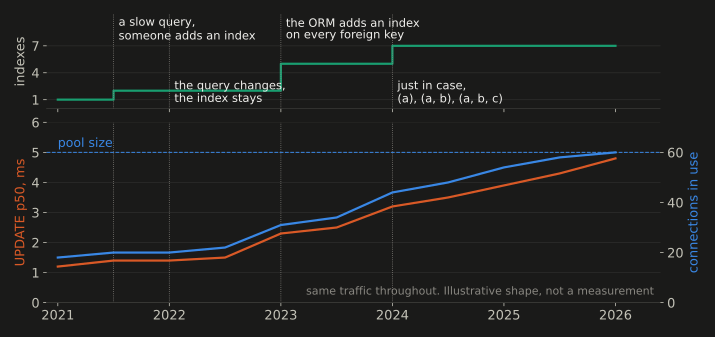

---

<!-- _class: tbl-sm -->

# Write amplification

Measured on 1M rows. Extrapolated to 1B

| | 1M rows, measured | 1B rows at 5,000 UPDATE/s |
|---|---|---|
| heap + primary key on disk | 179 MB | 179 GB |
| seven int indexes on disk | 141 MB | 141 GB |
| page writes per UPDATE, primary key only | 2 | 10,000 per second |
| page writes per UPDATE, seven indexes | 9 | 45,000 per second |
| WAL per UPDATE, primary key only | 311 B | 134 GB per day |
| WAL per UPDATE, seven indexes | 855 B | 369 GB per day |

</br>

- 1M: `UPDATE` takes 0.2 ms with 0 indexes or 7. Everything is in RAM
- 1B: indexes compete with heap for RAM. 
- The `UPDATE` holds its connection through every one of those reads
- Every replica and the WAL archive carry the extra 235 GB a day

---

# Detection

```sql
-- indexes with zero scans since the stats reset, largest first
SELECT s.relname, s.indexrelname, s.idx_scan, s.last_idx_scan,       -- last_idx_scan: PG 16+
       pg_relation_size(s.indexrelid) AS bytes
  FROM pg_stat_user_indexes s
  JOIN pg_index i USING (indexrelid)
WHERE s.idx_scan = 0
  AND NOT i.indisunique
  AND NOT i.indisprimary
ORDER BY pg_relation_size(s.indexrelid) DESC;
```

</br>

- `idx_scan` = 0 with `bytes` over 100 MB: a write tax on every INSERT and non-HOT UPDATE
- Zero counts only since `stats_reset` in `pg_stat_database`; a short window is not proof
- Each replica counts its own scans; check every node before dropping

---

# The index that turns off HOT

HOT: Only update the HEAP (Heap Only Tuples) if the new version fits on the same page and no indexed column change

</br>

```sql
UPDATE pgbench_accounts SET abalance = abalance + 1 WHERE aid = $1;
CREATE INDEX ON pgbench_accounts (abalance);                          -- second run only
```

</br>

| | no index on `abalance` | one index on `abalance` |
|---|---|---|
| update | HOT update | every update changes `abalance` → no HOT |
| indexes | no index touched; old version pruned in place on the next visit | an index entry every time |
| dead tuples | stay flat, even with autovacuum off | every update leaves a dead tuple behind |

---

<!-- _class: chart-slide -->

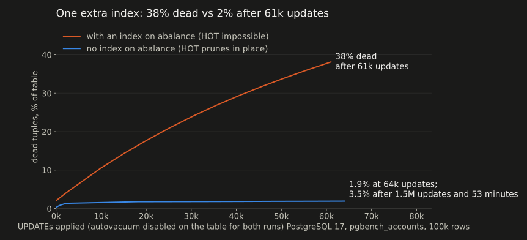

---

<!-- _class: kv -->

# Watch the HOT ratio, then drop the index

```sql
SELECT relname, n_tup_upd, n_tup_hot_upd, n_tup_newpage_upd,   -- n_tup_newpage_upd: PG 16+
       n_dead_tup
  FROM pg_stat_user_tables
WHERE n_tup_upd > 0
ORDER BY n_tup_upd DESC;
```

</br>

- `n_tup_hot_upd` under half of `n_tup_upd`: an indexed column is updated, or the page is full
- Counters are cumulative; diff two samples
- Save `pg_get_indexdef()` first, then `DROP INDEX CONCURRENTLY`

</br>

|  |  |  |
|---|---|---|
| alerting today | unused index bytes (daily); invalid indexes (hourly) | yes |
|  | HOT ratio | no |
| verify | `hot_pct` recovers on the next sample; the index is gone from `pg_index` |  |

---

<!-- _class: tbl-sm -->

# It's always connections! 

Actually - it's efficiency

Thirty years of the same response, raise `max_connections`.

- Just raising your connections glosses over the problem.  
- Make every interaction with the database direct, fast and with consistent latency
- Your _app_ depends on external services. Don't force your DB to as well.

</br>

| Mistake | What it does to connections | The efficiency fix |
|---|---|---|
| connection storms | one per request, the CPU forks | Properly Sized pool |
| ignoring MVCC | every reader steps over the dead versions | a key that only grows gets its own table |
| long-running transactions | held for the whole wait | only SQL inside the transaction |
| bulk DELETE | one held for hours, every query slower | partition and `DROP` |
| unused indexes | every write holds longer, the pool grows | no index without a `SELECT` |

<small>Make each transaction cheaper and the connection count follows</small>

---

<!-- _class: lead -->

# Questions?

Scott Mead · scott@meads.us

Slides and the SQL from this talk will be posted: https://www.meetup.com/postgres-nyc/

<small>Slides: Creative Commons Attribution License (CC BY 4.0). SQL and scripts: PostgreSQL License.</small>

---

# What vacuum tells you

<pre><code class="language-text">INFO:  finished vacuuming "app.public.orders": index scans: 0
tuples: 0 removed, 1483112 remain, <b>612004 are dead but not yet removable</b>
removable cutoff: 982144, which was 61930 XIDs old when operation ended</code></pre>

"dead but not yet removable" with an old cutoff: someone holds the horizon.

| Holder | What it pins | Where to look |
|---|---|---|
| Report running 40 minutes * | snapshot (`xmin`) | `pg_stat_activity` |
| Nightly batch in one transaction | xid and snapshot | `pg_stat_activity` |
| `pg_dump` at noon | snapshot | `pg_stat_activity` |
| Physical slot with `hot_standby_feedback` | `xmin` for every table | `pg_replication_slots` |
| Logical slot nobody consumes | `catalog_xmin`; WAL is retained | `pg_replication_slots` |
| Prepared transaction nobody finished | `xmin`, indefinitely | `pg_prepared_xacts` |

<small>* A read-only transaction holds one too.</small>

---

<!-- _class: chart-slide -->

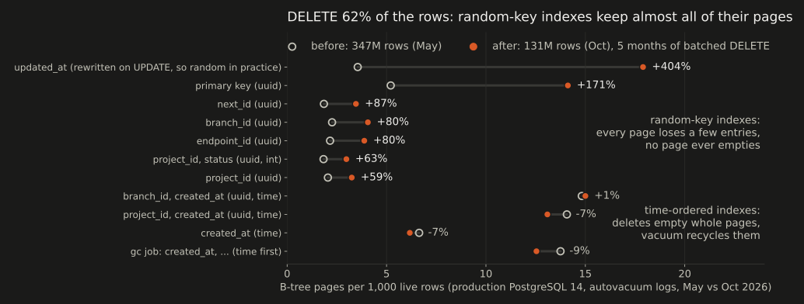

<small>Appendix: all eleven indexes behind the page diagram, May vs October 2026.</small>

---

<!-- _class: code-sm kv -->

<style scoped>section ul { margin: 0.15em 0; } section li { margin: 0; line-height: 1.25; }</style>

# Appendix: know your defaults

You see nothing, until one query holds a connection for hours.

- `statement_timeout`
- `lock_timeout`
- `idle_in_transaction_session_timeout`
- `transaction_timeout` (PG 17)
- `idle_session_timeout` (PG 14)

All five default to 0: a connection can be held forever.

```sql
ALTER ROLE reporting  SET statement_timeout = '15min';
SELECT rolname                                             -- login roles with no statement_timeout override
  FROM pg_roles r
WHERE rolcanlogin
  AND NOT EXISTS (SELECT 1 FROM pg_db_role_setting s
                  WHERE s.setrole = r.oid AND s.setconfig::text LIKE '%statement_timeout%');
```

|  |  |  |
|---|---|---|
| alerting today | login roles with unlimited timeouts | no |
| verify | the query above returns no application roles |  |
